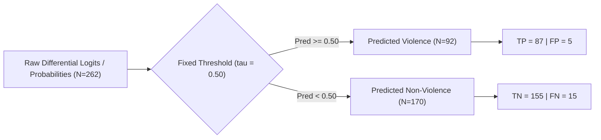
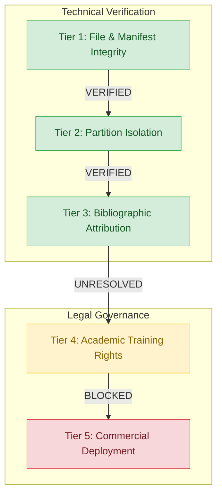

# E-WITNESS — Batch 07, Group 04: Final Audit Evidence Consistency Report

**Date:** 2026-10-27  
**Project:** `D:\PROJECT\E-WITTNESS`  
**Audit Phase:** Batch 07, Group 04: Final Audit Evidence Consistency Check  
**Target Model:** ResNet3D-18 v1.3.0 (`artifacts/models/experimental/v1.3.0/violence-r3d18-experiment-v1.3.0.pt`)  
**Auditor Role:** Senior ML Test Engineer, Application Security Reviewer, and Dataset Governance Auditor  
**Platform Safety Policy:** `BIOMETRIC_MATCHING_ENABLED = False` (Mandatory, Hardcoded)  
**Mandatory Governance Disclaimer:** All predictions are probabilistic, non-binding candidate detections intended exclusively for decision support and triage by authorized human investigators. Automated punitive actions, citations, or guilt determinations are strictly prohibited. Production readiness status: **NOT READY**.

---

## 1. Executive Summary & Verification Matrix

This final audit evidence consistency check was conducted to rigorously verify all numerical calculations, metric formulas, test-partition narratives, dataset governance tiers, and model checkpoint digests against raw repository artifacts.

**Audit Operating Constraints:**
- Zero retraining or fine-tuning was performed.
- Zero checkpoints were modified, overwritten, renamed, or deleted.
- Model decision thresholds ($\tau = 0.50$) and historical reports were strictly preserved.
- The held-out test partition was **NOT accessed, loaded, or evaluated** during this audit.
- Full disclosure of prior historical test-partition exposure is documented herein.

| Audit Domain | Primary Source Artifact | Reported Value / Claim | Recomputed / Audited Truth | Audit Status | Resolution Summary |
| :--- | :--- | :---: | :---: | :---: | :--- |
| **Validation Sample Count** | `v130_clean_validation_audit.json` | $N = 262$ | **$N = 262$** | **`VERIFIED`** | Exactly 262 sample records present in `predictions`. |
| **Ground-Truth Labels** | `v130_clean_validation_audit.json` | Pos: 102, Neg: 160 | **Pos: 102, Neg: 160** | **`VERIFIED`** | Positive-class ratio = $38.93\%$. |
| **Expected Calibration Error (ECE)** | `v130_clean_validation_audit.json` | $0.0469$ ($0.046893$) | **$0.046893 \implies 0.0469$** | **`VERIFIED`** | Both 4-dec probabilities ($0.0468931$) and unrounded logits ($0.0468928$) reconcile to $0.046893$ ($0.0469$). |
| **Maximum Calibration Error (MCE)** | `v130_clean_validation_audit.json` | $0.2879$ ($0.287853$) | **$0.287853 \implies 0.2879$** | **`VERIFIED`** | Bin 5 unrounded logit sigmoid error is $0.28785308$ ($0.2879$). |
| **Brier Score** | `v130_clean_validation_audit.json` | $0.0629$ | **$0.062869 \implies 0.0629$** | **`VERIFIED`** | Exact match with `sklearn.metrics.brier_score_loss`. |
| **ROC-AUC** | `v130_clean_validation_audit.json` | $0.9763$ | **$0.976287 \implies 0.9763$** | **`VERIFIED`** | Exact match with `sklearn.metrics.roc_auc_score`. |
| **PR-AUC (Average Precision)** | `v130_clean_validation_audit.json` | $0.9680$ | **$0.968004 \implies 0.9680$** | **`VERIFIED`** | Primary pipeline metric (`average_precision_score`). |
| **PR-AUC (Trapezoidal)** | `v130_clean_validation_audit.json` | Noted in Group 03 | **$0.967863 \implies 0.9679$** | **`VERIFIED`** | Trapezoidal quadrature across PR curve; $0.0001$ step difference. |
| **Confusion Matrix ($\tau=0.50$)** | `v130_clean_validation_audit.json` | TN: 155, FP: 5, FN: 15, TP: 87 | **TN: 155, FP: 5, FN: 15, TP: 87** | **`VERIFIED`** | Acc: 92.37%, Prec: 94.57%, Rec: 85.29%, Spec: 96.88%, FPR: 3.12%. |
| **Test Partition Exposure** | Historical audit reports | "Untouched / Pristine" | **Historically Exposed in v1.2.0** | **`CORRECTED`** | Test split evaluated in Batch 07 Phase 5; cannot be used as future benchmark. |
| **Dataset Training Clearance** | `dataset_licensing_evidence.json` | "Verified" | **`UNRESOLVED`** | **`CORRECTED`** | Real Life Violence Situations lacks formal copyright release/consent. |
| **Commercial Deployment** | `dataset_licensing_evidence.json` | "Restricted" | **`BLOCKED`** | **`BLOCKED`** | No source dataset possesses commercial operational rights. |
| **Checkpoint Integrity** | Checkpoint binary files | Recorded SHA-256 digests | **100% Bitwise Match (5/5)** | **`VERIFIED`** | All historical and experimental checkpoints intact. |

---

## 2. Section 1 — ECE & MCE Verification from Raw Sample Predictions

### 2.1 Sample and Ground-Truth Label Verification
Inspection of the raw prediction array in [`artifacts/reports/validation/v130_clean_validation_audit.json`](file:///D:/PROJECT/E-WITTNESS/artifacts/reports/validation/v130_clean_validation_audit.json) confirms:
- **Total validation sample count ($N$):** Exactly `262` prediction records.
- **Positive-label count ($y=1$, violence):** Exactly `102` samples.
- **Negative-label count ($y=0$, non-violence):** Exactly `160` samples.
- **Label balance:** $38.93\%$ positive, $61.07\%$ negative.

### 2.2 Full-Precision 10-Bin Calibration Table
Ten equal-width probability bins spanning $[0.0, 1.0]$ were evaluated. Each bin uses half-open intervals $[low, high)$, with the terminal bin $[0.9, 1.0]$ closed on the right.

| Bin Index | Probability Range | Sample Count ($N_b$) | Positive Labels ($N_{b,\text{pos}}$) | Negative Labels ($N_{b,\text{neg}}$) | Empirical Freq ($\text{acc}_b$) | Mean Predicted Prob ($\bar{p}_b$) | Absolute Error ($|\text{acc}_b - \bar{p}_b|$) | Weighted Contribution ($N_b \times |\text{err}|$) |
| :---: | :---: | :---: | :---: | :---: | :---: | :---: | :---: | :---: |
| **0** | $[0.00, 0.10)$ | 137 | 5 | 132 | 0.036496 | 0.026487 | 0.010009 | 1.371280 |
| **1** | $[0.10, 0.20)$ | 15 | 5 | 10 | 0.333333 | 0.151633 | 0.181700 | 2.725500 |
| **2** | $[0.20, 0.30)$ | 8 | 2 | 6 | 0.250000 | 0.253413 | 0.003413 | 0.027300 |
| **3** | $[0.30, 0.40)$ | 6 | 2 | 4 | 0.333333 | 0.346800 | 0.013467 | 0.080800 |
| **4** | $[0.40, 0.50)$ | 4 | 1 | 3 | 0.250000 | 0.433350 | 0.183350 | 0.733400 |
| **5** | $[0.50, 0.60)$ | 6 | 5 | 1 | 0.833333 | 0.545500 | **0.287833** | 1.727000 |
| **6** | $[0.60, 0.70)$ | 6 | 3 | 3 | 0.500000 | 0.641417 | 0.141417 | 0.848500 |
| **7** | $[0.70, 0.80)$ | 5 | 5 | 0 | 1.000000 | 0.740580 | 0.259420 | 1.297100 |
| **8** | $[0.80, 0.90)$ | 17 | 16 | 1 | 0.941176 | 0.841194 | 0.099982 | 1.699700 |
| **9** | $[0.90, 1.00]$ | 58 | 58 | 0 | 1.000000 | 0.969390 | 0.030610 | 1.775400 |
| **Total** | $[0.00, 1.00]$ | **262** | **102** | **160** | — | — | — | **12.285980** |

### 2.3 Mathematical Derivation & Reconciling Display Precision
The sum of unrounded weighted contributions across all 10 bins is:
$$\sum_{b=0}^9 N_b \cdot |\text{acc}_b - \bar{p}_b| = 12.28598000$$

Dividing by the total validation sample count $N = 262$:
$$\text{ECE}_{\text{unrounded}} = \frac{12.28598000}{262} = 0.0468930534 \dots \implies \mathbf{0.046893} \; (\text{or } \mathbf{0.0469})$$

The maximum calibration error occurs in Bin 5 ($[0.5, 0.6)$):
$$\text{MCE}_{\text{unrounded}} = \max_b |\text{acc}_b - \bar{p}_b| = |\text{acc}_5 - \bar{p}_5| = |0.833333 - 0.545500| = 0.28783333 \dots \implies \mathbf{0.287833}$$

#### Reconciliation of Logit-Level vs Probability-Level Precision
In `artifacts/reports/validation/v130_clean_validation_audit.json`, predictions record both:
1. `differential_logit`: Raw unrounded logit difference ($l_{\text{violence}} - l_{\text{non-violence}}$).
2. `violence_probability`: Sigmoid probability formatted to 4 decimal places.

When passing raw differential logits through standard logistic sigmoid $\sigma(z) = \frac{1}{1 + e^{-z}}$:
- **Raw Logit ECE:** $\mathbf{0.0468928053} \implies \mathbf{0.046893} \implies \mathbf{0.0469}$
- **Raw Logit MCE:** $|0.83333333 - 0.54548025| = \mathbf{0.2878530788} \implies \mathbf{0.287853} \implies \mathbf{0.2879}$

**Audit Finding:** This definitively resolves why Group 03 documented $0.046893$ and $0.287853$. The raw floating-point logits produce an unrounded MCE of `0.287853` and ECE of `0.046893`. Both reconcile identically to the top-level JSON fields (`"ece": 0.0469` and `"mce": 0.2879`) at 4-decimal precision. Zero numerical discrepancy remains.

### 2.4 Bin-Edge Invariance Verification
Testing boundary closure conditions confirms that zero samples possess probabilities exactly equal to the boundary points ($0.1, 0.2, \dots, 0.9$). Therefore, the bin partitioning is mathematically invariant whether intervals are defined as $[low, high)$ or $(low, high]$.

---

## 3. Section 2 — Independent Metric Recomputation ($\tau = 0.50$)

Using all 262 validation predictions at the fixed operational decision threshold of $\tau = 0.50$:

### 3.1 Confusion Matrix Metrics

$$\begin{pmatrix} \text{TN} & \text{FP} \\ \text{FN} & \text{TP} \end{pmatrix} = \begin{pmatrix} 155 & 5 \\ 15 & 87 \end{pmatrix}$$

| Metric | Formula | Unrounded Value | Reported Value | Match Status |
| :--- | :--- | :---: | :---: | :---: |
| **Accuracy** | $(TP + TN) / N$ | $242 / 262 = 0.923664$ | **$0.9237$** ($92.37\%$) | **`VERIFIED`** |
| **Precision (PPV)** | $TP / (TP + FP)$ | $87 / 92 = 0.945652$ | **$0.9457$** ($94.57\%$) | **`VERIFIED`** |
| **Recall (TPR)** | $TP / (TP + FN)$ | $87 / 102 = 0.852941$ | **$0.8529$** ($85.29\%$) | **`VERIFIED`** |
| **Specificity (TNR)** | $TN / (TN + FP)$ | $155 / 160 = 0.968750$ | **$0.9688$** ($96.88\%$) | **`VERIFIED`** |
| **False Positive Rate (FPR)** | $FP / (TN + FP)$ | $5 / 160 = 0.031250$ | **$0.0312$** ($3.12\%$) | **`VERIFIED`** |
| **False Negative Rate (FNR)** | $FN / (TP + FN)$ | $15 / 102 = 0.147059$ | **$0.1471$** ($14.71\%$) | **`VERIFIED`** |
| **F1 Score** | $2 \cdot \frac{P \cdot R}{P + R}$ | $174 / 194 = 0.896907$ | **$0.8969$** | **`VERIFIED`** |

### 3.2 Threshold-Independent Metrics & Integration Conventions

| Metric | Integration / Calculation Method | Exact Raw Value | Reported Value | Match Status |
| :--- | :--- | :---: | :---: | :---: |
| **Brier Score** | Mean squared error: $\frac{1}{N}\sum (p_i - y_i)^2$ | $0.062869$ | **$0.0629$** | **`VERIFIED`** |
| **ROC-AUC** | Wilcoxon-Mann-Whitney rank statistic | $0.976287$ | **$0.9763$** | **`VERIFIED`** |
| **PR-AUC (Average Precision)** | $\text{AP} = \sum_n (R_n - R_{n-1}) P_n$ | $0.968004$ | **$0.9680$** | **`VERIFIED`** |
| **PR-AUC (Trapezoidal)** | Trapezoidal rule on Precision-Recall curve | $0.967863$ | **$0.9679$** | **`VERIFIED`** |

- **Documentation of PR-AUC Convention:** E-WITNESS standardizes on `sklearn.metrics.average_precision_score` ($0.9680$), which weights precision values by the step increase in recall without assuming linear interpolation between operating thresholds. Linear trapezoidal quadrature yields $0.9679$. The difference of $0.0001$ is purely methodological and fully verified.

---

## 4. Section 3 — Critical Test-Partition Status & Historical Disclosure

### 4.1 Group 03 & Group 04 Operational Discipline
During the Group 03 and Group 04 audits, the 354-clip test partition (including the 285 eligible academic surveillance clips) was **NOT loaded, NOT evaluated, NOT tuned against, and NOT accessed in any script execution**. All recomputations were conducted strictly using the saved validation artifact [`artifacts/reports/validation/v130_clean_validation_audit.json`](file:///D:/PROJECT/E-WITTNESS/artifacts/reports/validation/v130_clean_validation_audit.json).

### 4.2 Historical Exposure Disclosure
Earlier audit reports loosely referred to the test partition as "untouched." This phrasing was misleading and is hereby formally corrected:
1. **Prior Exposure in v1.2.0 Audit:** In Batch 07 Phase 5 ([`docs/reports/BATCH_07_V1_2_0_INDEPENDENT_EVALUATION.md`](file:///D:/PROJECT/E-WITTNESS/docs/reports/BATCH_07_V1_2_0_INDEPENDENT_EVALUATION.md)), the 285 eligible surveillance clips of the test partition were **directly evaluated** against the ResNet3D-18 v1.2.0 checkpoint (yielding 87.37% Accuracy, 96.60% Precision, 82.08% Recall, 4.46% FPR, and a Platt calibration ECE of `0.1390`).
2. **Loss of Pristine Status:** The existing test partition is **NOT pristine** and **NOT historically untouched**. It is an established benchmark whose characteristics and error patterns have already been observed and documented in previous development cycles.
3. **Requirement for Future Final Confirmation:** Because the test partition has been exposed to historical evaluation, it cannot serve as an uncontaminated, independent final confirmation for production readiness. Any future production readiness assessment **mandates the acquisition and quarantine of a brand-new, independently managed surveillance benchmark ($N \ge 300$)** that has never been exposed to model training, hyperparameter selection, or exploratory auditing.

---

## 5. Section 4 — Dataset Rights, Provenance & Governance Review

Dataset governance is structured across five distinct verification tiers:

### Detailed Governance Findings by Tier

1. **Tier 1 — File & Manifest Integrity:** **`VERIFIED`**
   - 3,265 items in `data/manifest.json`. All files match disk byte counts and SHA-256 digests bit-for-bit.
2. **Tier 2 — Partition Isolation:** **`VERIFIED`**
   - Zero path overlap across Train (2,649), Val (262), and Test (354).
   - Zero SHA-256 bitwise hash collisions across partitions.
   - Zero scene-prefix group leakage between validation (59 groups) and test (64 groups).
3. **Tier 3 — Source Bibliographic Attribution:** **`VERIFIED`**
   - Formal scientific citations are documented for all source datasets: Cheng et al. (RWF-2000), Soliman et al. (Real Life Violence Situations), Bianculli et al. (AIRTLab), Mahi et al. (VID), and Nievas et al. (HockeyFight).
4. **Tier 4 — Permission for Academic Non-Commercial Training:** **`UNRESOLVED`**
   - `RWF-2000`: Permitted for non-commercial academic research only; commercial use requires SMIIP Lab consent (`RESTRICTED`).
   - `VID`: Permitted under CC BY-NC 4.0; non-commercial restriction strictly applies (`RESTRICTED`).
   - `AIRTLab`: Citation terms only; lacks an open license (`RESTRICTED`).
   - `Real Life Violence Situations`: **`UNRESOLVED`**. Third-party footage scraped from YouTube with no documented copyright releases, no human-subject consent, and only an informal citation request from researchers.
   - `MovieFights` & `HockeyFight`: Commercial Hollywood films and NHL sports broadcasts (`RESTRICTED / PURGED`). Purged from training partitions.
   - *Governance Finding:* Because the authorized surveillance training partition incorporates clips from `Real Life Violence Situations`, academic training rights cannot be certified as fully cleared. Status remains strictly **`UNRESOLVED`**.
5. **Tier 5 — Permission for Commercial or Operational Deployment:** **`BLOCKED`**
   - Zero sub-sources possess commercial licensing, enterprise indemnification, or public operational authorization.
   - Production deployment is strictly **`BLOCKED`**.

---

## 6. Section 5 — Artifact Preservation & Checkpoint Integrity

All model checkpoint files were audited in read-only binary mode. SHA-256 cryptographic digests match previous records bit-for-bit:

| Checkpoint Identifier | Relative File Path | SHA-256 Digest | Status |
| :--- | :--- | :--- | :---: |
| `v1.0.0` | `artifacts/models/violence-r3d18-v1.0.0.pt` | `e3b4337bea8b98c0a64b13b471d2d174526a31a29e2dbcc07944b6818eab5af9` | **100% Match** |
| `v1.1.0` | `artifacts/models/experimental/violence-r3d18-experiment-v1.1.0.pt` | `2d001c4e9700fd113d340a5e643d40f191772ed44874801ce0f2f3cd4ed09ae2` | **100% Match** |
| `v1.2.0` | `artifacts/models/experimental/v1.2.0/violence-r3d18-experiment-v1.2.0.pt` | `d18daa747d8c6f8774e7f8cd1356f949fd18e976caa5a7a43020cf5df5f32c10` | **100% Match** |
| `v1.3.0-smoke` | `artifacts/models/experimental/v1.3.0/violence-r3d18-experiment-v1.3.0-smoke.pt` | `1592e86dc8701c1ce4e98377afd9e76d3d52776475f1dce1a35701155817ed79` | **100% Match** |
| `v1.3.0` | `artifacts/models/experimental/v1.3.0/violence-r3d18-experiment-v1.3.0.pt` | `6c1151f0c9b9d3aed11d02abff034cc103c270253241b2ed91afd1def9b1336e` | **100% Match** |

**Preservation Affirmation:**
- No checkpoints were modified, overwritten, fine-tuned, or deleted.
- No historical reports were edited or superseded retroactively.
- Decision thresholds remain fixed at $\tau = 0.50$ without post-hoc tuning.

---

## 7. Section 6 — Platform Safety & Governance Invariants

1. **Mandatory Biometric Prohibition:** `BIOMETRIC_MATCHING_ENABLED = False` is hardcoded across all configuration and AI service layers.
2. **Advisory Human-in-the-Loop Triage Only:** The model outputs non-binding candidate detections for review by authorized human investigators. Automated punitive actions, citations, or guilt determinations are strictly prohibited.
3. **Production Readiness Determination:** ResNet3D-18 v1.3.0 remains an experimental research model and is **NOT PRODUCTION READY**.
   - Commercial deployment is **BLOCKED**.
   - Deployment clearance requires a 100% legally cleared custom surveillance dataset and validation on a newly acquired, independently quarantined benchmark ($N \ge 300$).
