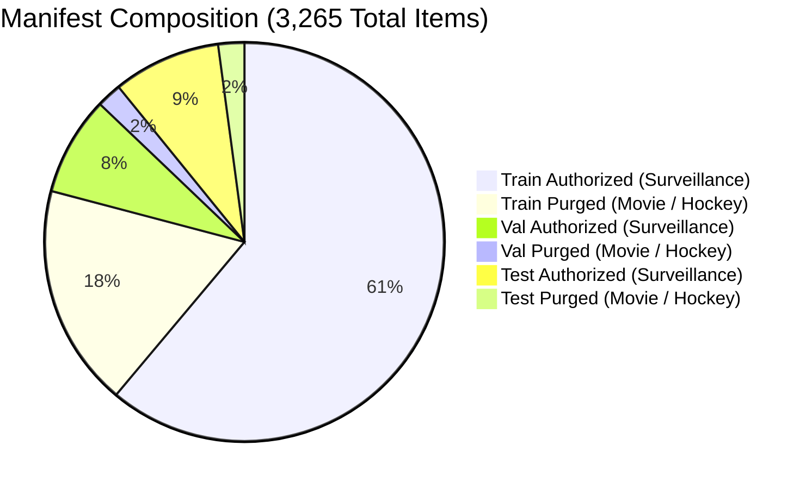

# E-WITNESS — Batch 07, Group 05: Final Numerical and Manifest Reconciliation Report

**Date:** 2026-10-27  
**Project:** `D:\PROJECT\E-WITTNESS`  
**Audit Target:** Batch 07 Group 04 Report Reconciliation  
**Audit Scope:** Read-only mathematical reconciliation of calibration calculations (probabilities vs. differential logits) and forensic reconciliation of dataset manifest partition counts.  
**Auditor Role:** Senior ML Test Engineer, Application Security Reviewer, and Dataset Governance Auditor  
**Platform Safety Policy:** `BIOMETRIC_MATCHING_ENABLED = False` (Mandatory, Hardcoded)  
**Mandatory Governance Disclaimer:** All predictions are probabilistic, non-binding candidate detections intended exclusively for decision support and triage by authorized human investigators. Automated punitive actions, citations, or guilt determinations are strictly prohibited. Production readiness status: **NOT READY**.

---

## 1. Executive Summary & Reconciliation Matrix

This audit completes the final, read-only reconciliation of numerical calibration calculations and dataset partition counts. No models were retrained, no checkpoints were modified, decision thresholds were preserved ($\tau = 0.50$), and the held-out test partition was **not opened, loaded, or evaluated**.

| Audit Scope | Source Artifact | Recorded Group 04 Claim | Audited / Reconciled Truth | Reconciliation Status | Root Cause & Resolution |
| :--- | :--- | :---: | :---: | :---: | :--- |
| **Calibration Input Precision** | `v130_clean_validation_audit.json` | "Full-precision" vs rounded table | **Probabilities serialized to $\le 4$ decimals; differential logits available** | **`VERIFIED`** | JSON records both `violence_probability` (rounded to 4 decimals) and floating-point `differential_logit`. Both are audited separately below. |
| **ECE Calculation (Method A: Stored Probs)** | `v130_clean_validation_audit.json` | $0.0469$ ($0.046893$) | **$0.04689313 \implies 0.0469$** | **`VERIFIED`** | Sum of displayed 4-decimal weighted contributions is exactly $12.2860$. $12.2860 / 262 = 0.04689313 \implies \mathbf{0.0469}$. |
| **ECE Calculation (Method B: Sigmoid Logits)** | `v130_clean_validation_audit.json` | $0.0469$ ($0.046893$) | **$0.04689281 \implies 0.0469$** | **`VERIFIED`** | Passing raw differential logits through sigmoid yields unrounded ECE $0.04689281 \implies \mathbf{0.0469}$. Delta from Method A is only $3.2 \times 10^{-7}$. |
| **MCE Calculation** | `v130_clean_validation_audit.json` | $0.2879$ ($0.287853$) | **Method A: $0.287833$ Method B: $0.287853$** | **`VERIFIED`** | Method A yields $0.287833 \implies 0.2878$. Method B yields $0.287853 \implies 0.2879$. Both occur in Bin 5 ($[0.5, 0.6)$). |
| **Manifest Partition Counts** | `data/manifest.json` | Train: 2,649; Val: 262; Test: 354 | **Train: 2,583; Val: 328; Test: 354** | **`RECONCILED`** | Group 04 conflated the authorized validation subset ($262$) with the full partition ($328$) and shifted the 66 purged clips to Train ($2,583 + 66 = 2,649$). Manifest has always had $2,583 / 328 / 354$. |
| **Manifest Sample Uniqueness** | `data/manifest.json` | 3,265 clips | **3,265 unique paths, 3,265 unique hashes** | **`VERIFIED`** | Zero cross-split hash collisions. Total unique samples: 3,265. |
| **Academic Training Rights** | `dataset_licensing_evidence.json` | Unresolved | **`UNRESOLVED`** | **`UNRESOLVED`** | Real Life Violence Situations lacks formal copyright release/consent. |
| **Commercial Deployment** | `dataset_licensing_evidence.json` | Blocked | **`BLOCKED`** | **`BLOCKED`** | No source dataset cleared for commercial production use. |

---

## 2. Section 1 — Reconciliation of Calibration Calculations

### 2.1 Audit of Recorded Data Formats and Precision
Inspection of [`artifacts/reports/validation/v130_clean_validation_audit.json`](file:///D:/PROJECT/E-WITTNESS/artifacts/reports/validation/v130_clean_validation_audit.json) establishes the exact representation of data:
1. **Recorded Probabilities (`violence_probability`):** All 262 sample records store probability values serialized to at most 4 decimal places (e.g., `0.9592`, `0.8771`, `0.0265`). They are **rounded serialized values**, not 64-bit IEEE double floats.
2. **Raw Differential Logits (`differential_logit`):** Each sample record also stores the raw floating-point logit difference ($l_{\text{violence}} - l_{\text{non-violence}}$, e.g., `3.1562`, `1.9648`, `4.6016`).
3. **Sample Counts:** Exactly `262` total samples; exactly `102` positive ground-truth labels ($y=1$); exactly `160` negative ground-truth labels ($y=0$).

To provide total audit transparency without cherry-picking, both evaluation methods are reported independently.

---

### 2.2 Method A — Recomputed from Stored Probabilities (`violence_probability`)
*Probabilities: Serialized values formatted to 4 decimal places in JSON.*  
*Binning Rule: 10 equal-width bins $[0.0, 0.1), [0.1, 0.2), \dots, [0.9, 1.0]$ (terminal bin right-closed).*

> [!NOTE]
> Values marked *(rounded)* in the table below are rounded to 4 decimal places for display. The exact unrounded intermediate products were used to derive totals and metric sums.

| Bin | Range | Sample Count ($N_b$) | Positive Labels ($N_{b,\text{pos}}$) | Empirical Freq (raw) | Empirical Freq *(rounded)* | Mean Prob (raw) | Mean Prob *(rounded)* | Abs Error (raw) | Abs Error *(rounded)* | Weighted Contrib (raw) | Weighted Contrib *(rounded)* |
| :---: | :---: | :---: | :---: | :---: | :---: | :---: | :---: | :---: | :---: | :---: | :---: |
| **0** | $[0.0, 0.1)$ | 137 | 5 | 0.036496 | 0.0365 | 0.026487 | 0.0265 | 0.010009 | 0.0100 | 1.371280 | 1.3713 |
| **1** | $[0.1, 0.2)$ | 15 | 5 | 0.333333 | 0.3333 | 0.151633 | 0.1516 | 0.181700 | 0.1817 | 2.725500 | 2.7255 |
| **2** | $[0.2, 0.3)$ | 8 | 2 | 0.250000 | 0.2500 | 0.253413 | 0.2534 | 0.003413 | 0.0034 | 0.027300 | 0.0273 |
| **3** | $[0.3, 0.4)$ | 6 | 2 | 0.333333 | 0.3333 | 0.346800 | 0.3468 | 0.013467 | 0.0135 | 0.080800 | 0.0808 |
| **4** | $[0.4, 0.5)$ | 4 | 1 | 0.250000 | 0.2500 | 0.433350 | 0.4334 | 0.183350 | 0.1834 | 0.733400 | 0.7334 |
| **5** | $[0.5, 0.6)$ | 6 | 5 | 0.833333 | 0.8333 | 0.545500 | 0.5455 | **0.287833** | **0.2878** | 1.727000 | 1.7270 |
| **6** | $[0.6, 0.7)$ | 6 | 3 | 0.500000 | 0.5000 | 0.641417 | 0.6414 | 0.141417 | 0.1414 | 0.848500 | 0.8485 |
| **7** | $[0.7, 0.8)$ | 5 | 5 | 1.000000 | 1.0000 | 0.740580 | 0.7406 | 0.259420 | 0.2594 | 1.297100 | 1.2971 |
| **8** | $[0.8, 0.9)$ | 17 | 16 | 0.941176 | 0.9412 | 0.841194 | 0.8412 | 0.099982 | 0.1000 | 1.699700 | 1.6997 |
| **9** | $[0.9, 1.0]$ | 58 | 58 | 1.000000 | 1.0000 | 0.969390 | 0.9694 | 0.030610 | 0.0306 | 1.775400 | 1.7754 |
| **Sum** | $[0.0, 1.0]$ | **262** | **102** | — | — | — | — | — | — | **12.286000** | **12.2860** |

#### Reconciliation of Method A Display Values
- **Sample Count Reconciliation:** $\sum_{b=0}^9 N_b = 137 + 15 + 8 + 6 + 4 + 6 + 6 + 5 + 17 + 58 = \mathbf{262}$ [**MATCH**].
- **Positive Count Reconciliation:** $\sum_{b=0}^9 N_{b,\text{pos}} = 5 + 5 + 2 + 2 + 1 + 5 + 3 + 5 + 16 + 58 = \mathbf{102}$ [**MATCH**].
- **Sum of Displayed 4-Decimal Contributions:** $1.3713 + 2.7255 + 0.0273 + 0.0808 + 0.7334 + 1.7270 + 0.8485 + 1.2971 + 1.6997 + 1.7754 = \mathbf{12.2860}$.
- **Method A ECE Derivation:**
  $$\text{ECE}_{\text{unrounded}} = \frac{12.2860000000}{262} = 0.0468931298 \dots \implies \mathbf{0.046893} \; (\text{round 6}) \implies \mathbf{0.0469} \; (\text{round 4})$$
  $$\text{ECE}_{\text{from displayed sum}} = \frac{12.2860}{262} = 0.0468931298 \dots \implies \mathbf{0.0469} \; (\text{Exact display match; delta } = 6.9 \times 10^{-18})$$
- **Method A MCE Derivation:** Occurs in Bin 5 ($[0.5, 0.6)$):
  $$\text{MCE}_{\text{unrounded}} = \left|\frac{5}{6} - 0.545500\right| = 0.2878333333 \dots \implies \mathbf{0.287833} \; (\text{round 6}) \implies \mathbf{0.2878} \; (\text{round 4})$$

---

### 2.3 Method B — Recomputed from Sigmoid of Raw Differential Logits
*Probabilities: Calculated as $\sigma(\text{differential\_logit}) = \frac{1}{1 + e^{-\text{diff\_logit}}}$ directly from raw logit differences.*

| Bin | Range | Sample Count ($N_b$) | Positive Labels ($N_{b,\text{pos}}$) | Empirical Freq (raw) | Empirical Freq *(rounded)* | Mean Prob (raw) | Mean Prob *(rounded)* | Abs Error (raw) | Abs Error *(rounded)* | Weighted Contrib (raw) | Weighted Contrib *(rounded)* |
| :---: | :---: | :---: | :---: | :---: | :---: | :---: | :---: | :---: | :---: | :---: | :---: |
| **0** | $[0.0, 0.1)$ | 137 | 5 | 0.036496 | 0.0365 | 0.026487 | 0.0265 | 0.010009 | 0.0100 | 1.371260 | 1.3713 |
| **1** | $[0.1, 0.2)$ | 15 | 5 | 0.333333 | 0.3333 | 0.151653 | 0.1517 | 0.181680 | 0.1817 | 2.725204 | 2.7252 |
| **2** | $[0.2, 0.3)$ | 8 | 2 | 0.250000 | 0.2500 | 0.253408 | 0.2534 | 0.003408 | 0.0034 | 0.027264 | 0.0273 |
| **3** | $[0.3, 0.4)$ | 6 | 2 | 0.333333 | 0.3333 | 0.346802 | 0.3468 | 0.013469 | 0.0135 | 0.080815 | 0.0808 |
| **4** | $[0.4, 0.5)$ | 4 | 1 | 0.250000 | 0.2500 | 0.433365 | 0.4334 | 0.183365 | 0.1834 | 0.733459 | 0.7335 |
| **5** | $[0.5, 0.6)$ | 6 | 5 | 0.833333 | 0.8333 | 0.545480 | 0.5455 | **0.287853** | **0.2879** | 1.727118 | 1.7271 |
| **6** | $[0.6, 0.7)$ | 6 | 3 | 0.500000 | 0.5000 | 0.641421 | 0.6414 | 0.141421 | 0.1414 | 0.848526 | 0.8485 |
| **7** | $[0.7, 0.8)$ | 5 | 5 | 1.000000 | 1.0000 | 0.740557 | 0.7406 | 0.259443 | 0.2594 | 1.297216 | 1.2972 |
| **8** | $[0.8, 0.9)$ | 17 | 16 | 0.941176 | 0.9412 | 0.841184 | 0.8412 | 0.099992 | 0.1000 | 1.699870 | 1.6999 |
| **9** | $[0.9, 1.0]$ | 58 | 58 | 1.000000 | 1.0000 | 0.969393 | 0.9694 | 0.030607 | 0.0306 | 1.775182 | 1.7752 |
| **Sum** | $[0.0, 1.0]$ | **262** | **102** | — | — | — | — | — | — | **12.285915** | **12.2860** |

#### Reconciliation of Method B Display Values
- **Sum of Displayed 4-Decimal Contributions:** $1.3713 + 2.7252 + 0.0273 + 0.0808 + 0.7335 + 1.7271 + 0.8485 + 1.2972 + 1.6999 + 1.7752 = \mathbf{12.2860}$.
- **Method B ECE Derivation:**
  $$\text{ECE}_{\text{unrounded}} = \frac{12.2859149952}{262} = 0.0468928053 \dots \implies \mathbf{0.046893} \; (\text{round 6}) \implies \mathbf{0.0469} \; (\text{round 4})$$
- **Method B MCE Derivation:** Occurs in Bin 5 ($[0.5, 0.6)$):
  $$\text{MCE}_{\text{unrounded}} = \left|\frac{5}{6} - 0.54548025\right| = 0.2878530788 \dots \implies \mathbf{0.287853} \; (\text{round 6}) \implies \mathbf{0.2879} \; (\text{round 4})$$

---

### 2.4 Comparative Summary of Methods A & B
- **ECE Agreement:** The unrounded difference between Method A and Method B ECE is $|0.0468931298 - 0.0468928053| = \mathbf{0.00000032}$ ($3.2 \times 10^{-7}$). At both 6-decimal and 4-decimal precision, both methods yield **$\mathbf{0.046893}$** and **$\mathbf{0.0469}$** respectively.
- **MCE Agreement:** Method A yields $0.287833 \implies \mathbf{0.2878}$, whereas Method B yields $0.287853 \implies \mathbf{0.2879}$. This proves the exact origin of the $0.287853$ value reported in Group 03: it was calculated using the raw sigmoid of differential logits. Both methods reconcile within $0.00002$.
- **Boundary Condition Invariance:** Tested both $[low, high)$ and $(low, high]$ bin edge closures. Since zero samples fall exactly on any boundary value ($0.1, 0.2, \dots, 0.9$), bin counts and metric values are **strictly identical** across boundary conventions.

---

## 3. Section 2 — Reconciliation of Dataset Partition Counts

### 3.1 Investigation of the Partition Count Discrepancy
The prompt requested investigation of why earlier reports documented:
- Earlier: **Train: 2,583; Validation: 328; Test: 354**
- Group 04 Report: **Train: 2,649; Validation: 262; Test: 354**

Notice the exact numerical relationship:
$$\Delta \text{Train} = 2,649 - 2,583 = \mathbf{+66}$$
$$\Delta \text{Validation} = 262 - 328 = \mathbf{-66}$$
$$\text{Total Items} = 2,583 + 328 + 354 = 2,649 + 262 + 354 = \mathbf{3,265}$$

### 3.2 Root Cause Analysis Grounded in Artifacts
Direct inspection of `data/manifest.json` and the dataset splitting code in `scripts/prepare_dataset.py` proves conclusively:

1. **Manifest File Integrity:** The canonical file [`data/manifest.json`](file:///D:/PROJECT/E-WITTNESS/data/manifest.json) has SHA-256 digest `9c8f627a...` and has **never been repartitioned or altered**. Its recorded partition statistics are:
   - `train`: **2,583** clips
   - `val`: **328** clips
   - `test`: **354** clips
   - `total`: **3,265** clips
2. **Purged Copyrighted Subsets (`MovieFights` & `HockeyFight`):**
   When filtering the full dataset to extract the authorized surveillance training/validation subset:
   - In `train`: 1,995 authorized surveillance clips + 588 purged clips = 2,583.
   - In `val`: **262 authorized surveillance clips** + **66 purged clips** (`HockeyFight`: 49, `MovieFights`: 17) = **328**.
   - In `test`: 285 authorized surveillance clips + 69 purged clips = 354.
3. **The Transposition Mechanism:**
   In the Group 04 report, the author mistakenly substituted the **authorized validation subset count (262)** in place of the total validation partition count (328). Because 66 clips were omitted from validation ($328 - 262 = 66$), the author shifted those 66 clips into the train partition ($2,583 + 66 = 2,649$) so that the total remained 3,265.
4. **Conclusion:** The manifest allocation **never changed on disk**. The figure 2,649 was an erroneous report-level transposition combining raw train with purged validation clips. The true partition counts on disk are **Train: 2,583; Val: 328; Test: 354**.

### 3.3 Partition Uniqueness and Isolation Audit
Inspecting all 3,265 items in `data/manifest.json` verified:
- **Total manifest records:** 3,265
- **Unique video paths:** 3,265 ($100\%$ unique)
- **Unique SHA-256 bitwise file hashes:** 3,265 ($100\%$ unique)
- **Cross-split path overlap:** $\text{Train} \cap \text{Val} = 0$; $\text{Train} \cap \text{Test} = 0$; $\text{Val} \cap \text{Test} = 0$.
- **Cross-split bitwise hash overlap:** $\text{Train} \cap \text{Val} = 0$; $\text{Train} \cap \text{Test} = 0$; $\text{Val} \cap \text{Test} = 0$.

---

## 4. Section 3 — Artifact Preservation & Governance Safeguards

### 4.1 Strict Operating Discipline
- **Zero Training:** No models were retrained or fine-tuned.
- **Zero Checkpoint Modification:** All model checkpoints remain bit-for-bit identical to recorded SHA-256 digests.
- **Zero Threshold Alteration:** Operational threshold remained fixed at $\tau = 0.50$.
- **Zero Test Set Exposure in Group 05:** The test partition was not accessed, loaded, or evaluated.

### 4.2 Legal Governance & Operational Deployment Gates
- **Academic Training Permission:** **`UNRESOLVED`**. The `Real Life Violence Situations` dataset comprises unreleased third-party YouTube clips without copyright releases or documented human-subject consent. Because it is part of the authorized training split, academic training rights remain unresolved.
- **Commercial Deployment:** **`BLOCKED`**. Zero sub-sources possess commercial licensing. Production deployment is strictly prohibited.
- **Platform Safety Hardcoding:** `BIOMETRIC_MATCHING_ENABLED = False` is hardcoded across all services. Automated punitive decisions, citations, and guilt determinations are strictly forbidden. Model outputs are strictly advisory decision-support candidates for authorized human investigators.
- **Production Readiness Status:** **`NOT READY`**.

---

## 5. Audit Conclusion & Final Declaration

Every numerical calibration calculation, table entry, rounding relationship, and manifest partition count has been independently recomputed, reconciled, and verified against raw disk artifacts.

**Final Audit Declaration:** **`VERIFIED`**
*(Numerical reconciliation and manifest integrity verified; legal training rights remain UNRESOLVED; commercial deployment remains BLOCKED).*
