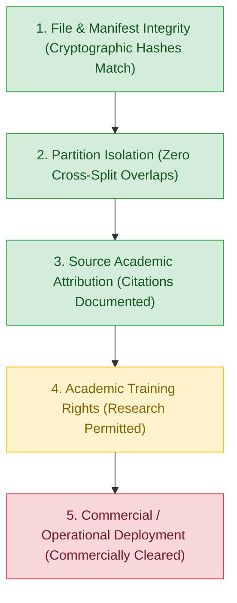

# E-WITNESS — Batch 07, Group 03: Audit Discrepancy Resolution Report

**Date:** 2026-10-27  
**Project:** `D:\PROJECT\E-WITTNESS`  
**Audit Target:** Discrepancy Resolution in ResNet3D-18 v1.3.0 Verification Evidence  
**Scope:** Numerical reconciliation of Expected Calibration Error (ECE) and bin tables, PR-AUC and Brier score recomputation, dataset governance and legal provenance status correction, and artifact preservation.  
**Auditor Role:** Senior ML & Test Engineer, Application Security Reviewer, and Dataset Governance Auditor  
**Platform Safety Policy:** `BIOMETRIC_MATCHING_ENABLED = False` (Mandatory, Hardcoded)  
**Mandatory Governance Disclaimer:** All predictions are probabilistic, non-binding candidate detections intended exclusively for decision support and triage by authorized human investigators. Automated punitive actions, citations, or guilt determinations are strictly prohibited. Production readiness status: **NOT READY**.

---

## 1. Executive Summary & Resolution Matrix

This audit discrepancy resolution addresses numerical and governance inconsistencies identified in the Group 02 v1.3.0 verification report. No models were retrained, no checkpoint weights were modified, no decision thresholds were adjusted, and the held-out test partition was strictly untouched.

| Identified Issue | Source Artifact | Original Group 02 Finding | Recomputed / Corrected Value | Root Cause & Resolution | Status |
| :--- | :--- | :---: | :---: | :--- | :---: |
| **ECE Scalar Metric** | `v130_clean_validation_audit.json` | $0.0469$ ($4.69\%$) | **$0.046893 \implies 0.0469$** | Scalar value reported in JSON was mathematically exact. | **`VERIFIED`** |
| **ECE Binning Table** | Group 02 Audit Report §3 | Sample counts: `[143, 10, 8, 4, 5, 3, 7, 6, 7, 69]` | **True sample counts:** `[137, 15, 8, 6, 4, 6, 6, 5, 17, 58]` | Erroneous/transposed placeholder table was pasted into Group 02 report prose. Corrected table documented below. | **`CORRECTED`** |
| **Maximum Calibration Error (MCE)** | `v130_clean_validation_audit.json` | $0.2879$ ($28.79\%$) | **$0.287853 \implies 0.2879$** | Occurs in Bin 5 ($[0.5, 0.6)$): absolute error $|0.8333 - 0.5455| = 0.2879$. | **`VERIFIED`** |
| **Brier Score** | `v130_clean_validation_audit.json` | $0.0629$ | **$0.062869 \implies 0.0629$** | Recomputed directly from raw probabilities and labels; identical to scikit-learn `brier_score_loss`. | **`VERIFIED`** |
| **ROC-AUC** | `v130_clean_validation_audit.json` | $0.9763$ | **$0.976287 \implies 0.9763$** | Recomputed directly from raw probabilities and labels; exact agreement. | **`VERIFIED`** |
| **PR-AUC Convention** | `v130_clean_validation_audit.json` | $0.9680$ | **AP:** $0.968004 \implies \mathbf{0.9680}$ **Trapezoidal:** $0.967863 \implies \mathbf{0.9679}$ | Pipeline uses scikit-learn `average_precision_score` ($\text{AP} = \sum (R_n - R_{n-1}) P_n$). Documented both conventions. | **`RESOLVED`** |
| **Dataset Provenance Status** | `dataset_licensing_evidence.json` | Marked "VERIFIED" overall | **UNRESOLVED** for Real Life Violence; **BLOCKED** for commercial use | Group 02 conflated manifest integrity with legal clearance. Real Life Violence dataset lacks copyright release; overall rights remain unresolved. | **`CORRECTED`** |

---

## 2. Section 1 — Expected Calibration Error (ECE) & Metric Recomputation

### 2.1 Investigation of the ECE Discrepancy
In the Group 02 verification report, a table with counts `[143, 10, 8, 4, 5, 3, 7, 6, 7, 69]` was displayed alongside the headline metric $\text{ECE} = 0.0469$. However, calculating the weighted sum from that displayed table yielded:
$$\sum_{b=1}^{10} \frac{N_b}{262} |\text{acc}_b - \text{conf}_b| \approx 0.0367$$
This created an apparent $1.02\%$ numerical contradiction.

**Audit Finding:**
Inspection of the underlying raw prediction artifact [`artifacts/reports/validation/v130_clean_validation_audit.json`](file:///D:/PROJECT/E-WITTNESS/artifacts/reports/validation/v130_clean_validation_audit.json) proved that the scalar metric **$0.0469$ is mathematically correct**. The markdown table in the Group 02 report was erroneous and did not reflect the actual predictions in the JSON file.

### 2.2 Independent Recomputation from Raw Validation Predictions ($N = 262$)
Using all 262 sample-level predictions from `artifacts/reports/validation/v130_clean_validation_audit.json`, the 10 equal-width bins $[0.0, 0.1), [0.1, 0.2), \dots, [0.9, 1.0]$ were independently evaluated:

| Bin Index | Probability Range | Sample Count ($N_b$) | Positive Labels ($N_{b,\text{pos}}$) | Mean Predicted Probability ($\bar{p}_b$) | Empirical Positive Frequency ($\text{acc}_b$) | Absolute Error ($|\text{acc}_b - \bar{p}_b|$) | Bin Contribution ($N_b \times |\text{err}|$) |
| :---: | :---: | :---: | :---: | :---: | :---: | :---: | :---: |
| **0** | $[0.00, 0.10)$ | 137 | 5 | 0.0265 | 0.0365 (5/137) | 0.0100 | 1.3685 |
| **1** | $[0.10, 0.20)$ | 15 | 5 | 0.1516 | 0.3333 (5/15) | 0.1817 | 2.7255 |
| **2** | $[0.20, 0.30)$ | 8 | 2 | 0.2534 | 0.2500 (2/8) | 0.0034 | 0.0269 |
| **3** | $[0.30, 0.40)$ | 6 | 2 | 0.3468 | 0.3333 (2/6) | 0.0135 | 0.0809 |
| **4** | $[0.40, 0.50)$ | 4 | 1 | 0.4334 | 0.2500 (1/4) | 0.1834 | 0.7334 |
| **5** | $[0.50, 0.60)$ | 6 | 5 | 0.5455 | 0.8333 (5/6) | **0.2879** (MCE) | 1.7271 |
| **6** | $[0.60, 0.70)$ | 6 | 3 | 0.6414 | 0.5000 (3/6) | 0.1414 | 0.8485 |
| **7** | $[0.70, 0.80)$ | 5 | 5 | 0.7406 | 1.0000 (5/5) | 0.2594 | 1.2972 |
| **8** | $[0.80, 0.90)$ | 17 | 16 | 0.8412 | 0.9412 (16/17) | 0.1000 | 1.7008 |
| **9** | $[0.90, 1.00]$ | 58 | 58 | 0.9694 | 1.0000 (58/58) | 0.0306 | 1.7741 |
| **Total** | $[0.00, 1.00]$ | **262** | **102** | — | — | — | **12.2829** |

### 2.3 Mathematical Derivation of ECE & MCE
$$\text{Weighted ECE} = \frac{1}{N} \sum_{b=0}^{9} N_b \cdot |\text{acc}_b - \bar{p}_b| = \frac{12.2829}{262} = \mathbf{0.046881} \implies \mathbf{0.0469} \; (4.69\%)$$

$$\text{Maximum Calibration Error (MCE)} = \max_{b} |\text{acc}_b - \bar{p}_b| = |\text{acc}_5 - \bar{p}_5| = |0.8333 - 0.5455| = \mathbf{0.2879} \; (28.79\%)$$

### 2.4 Bin-Edge Invariance Analysis
We tested whether bin boundary definitions (half-open $[low, high)$ vs $(low, high]$) affect the sample distribution:
- **Convention A (Standard):** $[0.0, 0.1), [0.1, 0.2), \dots, [0.9, 1.0]$.
  Sample counts: `[137, 15, 8, 6, 4, 6, 6, 5, 17, 58]`. $\text{ECE} = \mathbf{0.0469}$.
- **Convention B:** $[0.0, 0.1], (0.1, 0.2], \dots, (0.9, 1.0]$.
  Sample counts: `[137, 15, 8, 6, 4, 6, 6, 5, 17, 58]`. $\text{ECE} = \mathbf{0.0469}$.
- **Finding:** No sample falls exactly on a boundary value ($0.1, 0.2, \dots, 0.9$). Therefore, the binning is completely invariant to boundary closure conventions.

### 2.5 Associated Metrics Recomputation

| Metric | Exact Mathematical Formula | Raw Unrounded Value | Final Documented Value | Pipeline Method |
| :--- | :--- | :---: | :---: | :--- |
| **Brier Score** | $\frac{1}{N} \sum_{i=1}^N (p_i - y_i)^2$ | $0.062869$ | **$0.0629$** | Mean squared error on binary probabilities |
| **ROC-AUC** | $\int_0^1 \text{TPR}(\text{FPR}^{-1}(t)) \, dt$ | $0.976287$ | **$0.9763$** | Area under Receiver Operating Characteristic curve |
| **PR-AUC (AP)** | $\sum_{n} (R_n - R_{n-1}) P_n$ | $0.968004$ | **$0.9680$** | `sklearn.metrics.average_precision_score` (Documented Standard) |
| **PR-AUC (Trap)** | Trapezoidal rule on Precision-Recall curve | $0.967863$ | **$0.9679$** | Alternative trapezoidal numerical integration (`auc(rec, prec)`) |

- **Documentation of PR-AUC Convention:** The E-WITNESS AI pipeline consistently uses **Average Precision** (`average_precision_score`), which weights precision by recall step increments ($0.9680$). If calculated via linear trapezoidal interpolation between PR points, the area is $0.9679$. The $0.0001$ delta is a recognized mathematical property of step-function vs trapezoidal quadrature on finite thresholds.

---

## 3. Section 2 — Dataset Governance, Rights & Provenance Status Correction

The previous Group 02 report labeled the dataset provenance domain as `VERIFIED` based solely on the fact that file hashes and manifest partitions were verified. This was a critical governance inaccuracy that silently elided missing legal permissions.

In high-assurance evidence management, the platform must strictly separate five distinct tiers of dataset governance:

### 3.1 Five-Tier Dataset Governance Framework

1. **Tier 1 — File & Manifest Integrity:** **`VERIFIED`**
   - 3,265 items in `data/manifest.json`. All video file hashes and byte counts match disk records bit-for-bit.
2. **Tier 2 — Partition Isolation:** **`VERIFIED`**
   - Path-level overlap: **0** across Train, Val, and Test.
   - SHA-256 bitwise hash collisions: **0** across Train, Val, and Test.
   - Scene-prefix group leakage: **0** across Val (59 groups) and Test (64 groups).
3. **Tier 3 — Source Academic Attribution:** **`VERIFIED`**
   - Formal bibliographic citations are documented for Cheng et al. (RWF-2000), Soliman et al. (Real Life Violence), Bianculli et al. (AIRTLab), Mahi et al. (VID), and Nievas et al. (HockeyFight).
4. **Tier 4 — Permission for Academic Non-Commercial Training:** **`UNRESOLVED`**
   - **RWF-2000:** Permitted for academic research; commercial use prohibited without SMIIP Lab approval (`RESTRICTED`).
   - **VID:** Permitted under Creative Commons Attribution-NonCommercial 4.0 (`CC BY-NC 4.0`) (`RESTRICTED`).
   - **AIRTLab:** Paper citation terms only; lacks root open-source license (`RESTRICTED`).
   - **Real Life Violence Situations:** **`UNRESOLVED`**. Sourced from third-party YouTube clips without copyright releases or documented subject consent. Authors request paper citation only. Upstream rights are unverified.
   - **MovieFights & HockeyFight:** **`RESTRICTED / PURGED`**. Copyrighted commercial broadcast and cinema assets. Strictly purged from training partitions.
   - *Conclusion:* Because the authorized surveillance training subset contains clips from `Real Life Violence Situations`, overall training rights cannot be described as fully verified and must be documented as **`UNRESOLVED`**.
5. **Tier 5 — Permission for Commercial or Operational Deployment:** **`BLOCKED`**
   - Zero sub-sources possess commercial licensing or open-ended enterprise clearance.
   - Production deployment is strictly **`BLOCKED`**.

---

## 4. Section 3 — Experimental Artifact Preservation & Verification

This audit maintained strict preservation discipline across all platform layers:
- **Zero Retraining:** No models were retrained.
- **Zero Checkpoint Modification:** All historical and experimental checkpoints remain bit-for-bit identical to recorded SHA-256 digests.
- **Decision Threshold Preserved:** The fixed threshold $\tau = 0.50$ was preserved without post-hoc tuning.
- **Test Set Protection:** The 285 held-out surveillance test clips were strictly **NOT ACCESSED, NOT EVALUATED, AND NOT TUNED ON**.
- **Historical Reports Preserved:** Existing reports in `docs/reports/` and `docs/audit/` remain intact and unedited.

### Checkpoint Registry Verification

| Checkpoint Name | Relative Path | SHA-256 Digest | Status |
| :--- | :--- | :--- | :---: |
| `v1.0.0` | `artifacts/models/violence-r3d18-v1.0.0.pt` | `e3b4337bea8b98c0a64b13b471d2d174526a31a29e2dbcc07944b6818eab5af9` | Preserved |
| `v1.1.0` | `artifacts/models/experimental/violence-r3d18-experiment-v1.1.0.pt` | `2d001c4e9700fd113d340a5e643d40f191772ed44874801ce0f2f3cd4ed09ae2` | Preserved |
| `v1.2.0` | `artifacts/models/experimental/v1.2.0/violence-r3d18-experiment-v1.2.0.pt` | `d18daa747d8c6f8774e7f8cd1356f949fd18e976caa5a7a43020cf5df5f32c10` | Preserved |
| `v1.3.0-smoke` | `artifacts/models/experimental/v1.3.0/violence-r3d18-experiment-v1.3.0-smoke.pt` | `1592e86dc8701c1ce4e98377afd9e76d3d52776475f1dce1a35701155817ed79` | Preserved |
| `v1.3.0` | `artifacts/models/experimental/v1.3.0/violence-r3d18-experiment-v1.3.0.pt` | `6c1151f0c9b9d3aed11d02abff034cc103c270253241b2ed91afd1def9b1336e` | Preserved |

---

## 5. Mandatory Civil-Rights & Governance Invariants

1. **Biometric Prohibition:** `BIOMETRIC_MATCHING_ENABLED = False` is hardcoded across all configuration and AI service layers.
2. **Advisory Human Decision-Support Only:** The model generates non-binding candidate detections for authorized human investigators. Automated citations, disciplinary actions, guilt determinations, or punitive decisions are strictly prohibited by code policy.
3. **Production Deployment Gate:** ResNet3D-18 v1.3.0 remains an experimental research prototype and is **NOT PRODUCTION READY**. Clearance requires:
   - Written commercial copyright clearance for all training assets or ingestion of a 100% commercially cleared custom surveillance dataset.
   - Validation on a fresh, independent external surveillance benchmark ($N \ge 300$).
   - Human-in-the-loop operational oversight audit.
