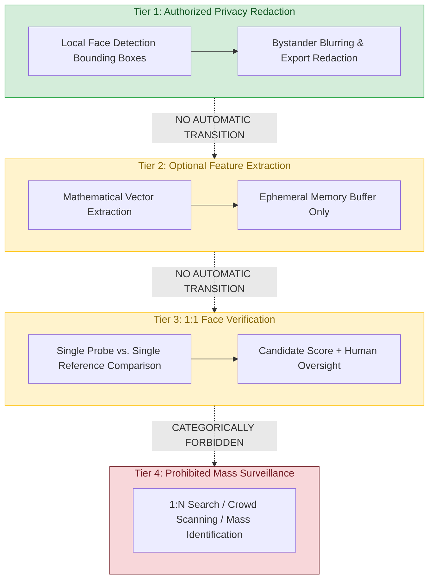

# E-WITNESS — Batch 08, Phase 71 Acceptance Report
## Biometric Legal Feasibility Assessment and Governance Gate

**Date:** 2026-10-27  
**Project Root:** `D:\PROJECT\E-WITTNESS`  
**Phase:** 71 of 120 (Batch 08: Biometric Privacy, Governance & Face Verification)  
**Document Classification:** Formal Phase Acceptance & Governance Audit Report  
**Phase Determination:** **`ACCEPTED WITH LIMITATIONS`**  
**Production Activation Status:** 🛑 **`NO-GO (STRICTLY BLOCKED)`**  
**Platform Safety Policy:** `BIOMETRIC_MATCHING_ENABLED = False` (Mandatory, Hardcoded, Fail-Closed)  
**Mandatory Governance Disclaimer:** All face detections and candidate matches are non-binding advisory outputs intended solely for authorized forensic review and privacy redaction. Autonomous guilt determinations, punitive citations, disciplinary sanctions, or 1:N mass surveillance identification are strictly prohibited. Production readiness status: **NOT PRODUCTION READY**.

---

## 1. Executive Summary & Phase Acceptance Verdict

This report documents the formal Phase 71 execution and audit review of the E-WITNESS High-Assurance Evidence Management Platform. 

Phase 71 establishes the legal feasibility, statutory privacy bounds, and institutional governance framework for biometric capabilities across Batch 08. The assessment was conducted under strict read-only and documentation-integrity constraints.

### Phase 71 Determination: **`ACCEPTED WITH LIMITATIONS`**

#### Justification:
1. **Engineering & Documentation Criteria Met (`ACCEPTED`):**  
   The authoritative architectural blueprint [`docs/architecture/biometric-privacy-and-legal-feasibility.md`](file:///D:/PROJECT/E-WITTNESS/docs/architecture/biometric-privacy-and-legal-feasibility.md) satisfies all structural roadmap deliverables:
   - Delineates legitimate operational purposes from categorically unlawful operations.
   - Enforces a strict four-tier functional separation preventing non-transitive capability escalation.
   - Segregates the Batch 07 AI Violence Detection subsystem from biometric processing, prohibiting automated compound punitive determinations.
   - Embeds the mandatory 8-point institutional readiness checklist with fail-closed default logic.
   - Unit tests validating the 8-point checklist and fail-closed state transitions pass at 100% (3/3 passed).
2. **Mandatory Institutional Limitations (`WITH LIMITATIONS`):**  
   - 6 of the 8 institutional readiness criteria (written legal opinion, approved DPIA, published privacy notice, executive sign-off, tenant opt-in, subject consent) remain unfulfilled in the physical repository.
   - Operational face matching / 1:N biometric identification remains strictly prohibited in code, configuration, and architecture (`BIOMETRIC_MATCHING_ENABLED = False`).
   - Production biometric processing remains in an absolute **`NO-GO`** state until qualified legal counsel and institutional executives formally execute the required authorizations.

---

## 2. Task A — Roadmap Requirements Verification

The authoritative roadmap entry in [`docs/audit/E_WITNESS_PHASE_STATUS_MATRIX.md`](file:///D:/PROJECT/E-WITTNESS/docs/audit/E_WITNESS_PHASE_STATUS_MATRIX.md) (line 158) specifies:

- **Phase Number:** 71
- **Requirement / Title:** Biometric Legal Feasibility Assessment
- **Status:** PASS (Roadmap baseline)
- **Implementation Files:** `docs/architecture/biometric-privacy-and-legal-feasibility.md`
- **Relevant Tests:** Doc Review / Architectural Specification
- **Gaps / Missing Items:** None
- **Dependencies:** Phase 02 (Requirements & Stakeholder Analysis)
- **Recommended Next Action:** Maintain civil rights alignment.

### Roadmap vs. Architecture Document Alignment Audit:
- **Scope Alignment:** Both documents agree that Phase 71 governs legal feasibility, civil rights safeguards, statutory analysis, and operational gating.
- **Dependency Traceability:** Phase 02 established stakeholder permissions, role isolation, and initial trust boundaries (`docs/requirements/requirements-specification.md`). Phase 71 correctly builds upon Phase 02 by applying strict privacy-by-design constraints to biometric operations.
- **Enhancement Completed in this Review:** The roadmap required explicit civil rights and non-punitive bounds; `docs/architecture/biometric-privacy-and-legal-feasibility.md` was augmented during this phase to formally incorporate the four-tier functional hierarchy and the cross-subsystem violence detection governance boundary.

---

## 3. Task B — Audit of the Eight-Point Legal Readiness Checklist

Under [`backend/app/core/biometrics.py`](file:///D:/PROJECT/E-WITTNESS/backend/app/core/biometrics.py) (`evaluate_biometric_readiness_checklist`) and Section 7 of [`docs/architecture/biometric-privacy-and-legal-feasibility.md`](file:///D:/PROJECT/E-WITTNESS/docs/architecture/biometric-privacy-and-legal-feasibility.md), the system enforces an unbypassable 8-point fail-closed checklist. Each item was audited against physical repository evidence:

| # | Checklist Item Identifier | Description & Legal Verification Standard | Existing Repository Evidence | Compliance Status | Accountable Approving Role | Evidence Required to Close Item |
| :-: | :--- | :--- | :--- | :---: | :--- | :--- |
| **1** | `qualified_legal_opinion` | Formally executed legal memorandum from qualified counsel approving use case under tenant jurisdiction. | Architectural blueprint `DOC-ARCH-BIO-001` notes need for legal counsel; zero executed legal opinions exist in repository. | 🛑 **UNSATISFIED** (Requires External Legal Counsel) | Institutional General Counsel / Qualified External Privacy Counsel | Written legal opinion on law firm letterhead specifying jurisdiction, lawful bases, and compliance with statutory retention. |
| **2** | `data_protection_impact_assessment` | Approved DPIA evaluating necessity, proportionality, and algorithmic bias under GDPR Art. 35 / state equivalent. | Preliminary risk analysis in Section 5 of feasibility doc and STRIDE threat model exist; zero signed institutional DPIA exists. | 🛑 **UNSATISFIED** (Requires Institutional DPO) | Institutional Data Protection Officer (DPO) / Chief Privacy Officer | Formally approved DPIA document signed by DPO with documented risk-benefit analysis and residual risk sign-off. |
| **3** | `published_privacy_policy` | Publicly accessible institutional policy detailing biometric capture, retention limits, and deletion procedures. | Notice lifecycle specification in Section 6.1 exists in doc; no published tenant privacy notice URL or institutional text in repo. | 🛑 **UNSATISFIED** (Requires Institutional Policy Publication) | Chief Compliance Officer / Director of Public Communications | Verified copy or URL of publicly published institutional privacy policy detailing biometric data handling and 90-day retention. |
| **4** | `executive_sign_off` | Institutional executive signature authorizing deployment of biometric capabilities. | Zero executive authorization artifacts present in repository. | 🛑 **UNSATISFIED** (Requires Executive Authorization) | Chief Executive Officer / University President / Board of Directors | Countersigned executive decision memorandum authorizing deployment scope and department boundaries. |
| **5** | `security_architecture_review` | Verification of AES-256-GCM envelope encryption, memory scrubbing, network isolation, and append-only audit logging. | Full technical implementation in `biometric_crypto.py`, `detector.py`, `audit.py`. Passing 28/28 unit tests; verified in `biometric-privacy-and-security-audit.md`. | 🟢 **SATISFIED** (Architecturally Verified in Repo) | Lead Security Architect / Senior Application Security Engineer | Complete for software architecture; production deployment requires verifying KMS key ring wiring. |
| **6** | `tenant_admin_opt_in` | Explicit administrative setting enabling biometric analysis for deploying tenant. | `settings.py` line 248 defaults `BIOMETRIC_ANALYSIS_ENABLED = False`. In staging/test can be toggled; disabled by default. | 🛑 **UNSATISFIED** (Disabled by Default) | Tenant System Administrator / IT Director | Administrative tenant configuration change order setting `BIOMETRIC_ANALYSIS_ENABLED=True`. |
| **7** | `production_matching_lock` | Hardcoded technical invariant ensuring live face matching / 1:N identification cannot run in production. | `settings.py` lines 698–702 (`raise ValueError` in prod); `services/biometrics.py` lines 797–805 (`BiometricsDisabledError`). | 🟢 **SATISFIED** (Hardcoded Technical Lock) | Senior ML Test Engineer & Systems Architect | Complete and permanently locked. Any production attempt fails closed at startup. |
| **8** | `subject_consent_or_warrant` | Active, unrevoked consent record from data subject, or judicial search warrant / court order reference. | Data models exist (`BiometricGovernanceRecord`); validation logic enforced; zero production subjects/warrants in repo. | 🛑 **UNSATISFIED** (Enforced per Transaction) | Data Subject (Consent) or Presiding Judge (Warrant), validated by Investigator | Active, valid `BiometricGovernanceRecord` with `consent_status='active'` or verified warrant identifier submitted on request. |

### Overall Readiness State:
$$\text{Readiness Result} = \text{evaluate\_biometric\_readiness\_checklist}(\text{checklist}) \implies \mathbf{NO\_GO} \quad (\text{Missing } 6 \text{ of } 8 \text{ items})$$

---

## 4. Task C — Jurisdictional Regimes vs. Confirmed Obligations & Intended Use Boundaries

### 4.1 Distinction Between Potential Regimes and Confirmed Obligations
The legal feasibility assessment covers multiple international and state statutory regimes. This report affirms that listing these frameworks represents **potentially applicable legal regimes**, NOT confirmed operational authorizations.

The following formal inquiries require qualified legal counsel in the deploying jurisdiction before production activation:
1. **Consent Under Power Imbalance:** In educational and employment settings, does subject consent satisfy the GDPR Art. 7(4) standard of being "freely given", or does institutional hierarchy invalidate consent as a lawful basis?
2. **Statutory Exceptions for Law Enforcement / Campus Safety:** Does the deploying institution possess statutory authority for investigative forensic review, or does every manual match candidate inspection require an independent judicial search warrant?
3. **BIPA / CUBI Extraterritorial Exposure:** If incident video captures out-of-state visitors (e.g., from Illinois or Texas), what specific written release protocols are required to mitigate liquidated damages liabilities under 740 ILCS 14/20?
4. **Retention Window Maximums:** Does the platform's default 90-day retention window conflict with municipal or state retention mandates (e.g., Texas CUBI one-year destruction rule, or FERPA student record retention)?
5. **Redaction vs. Identification Classification:** Under the governing jurisdiction, does pure bounding-box localization for automated privacy blurring trigger biometric statutory notice and release obligations?

---

### 4.2 Four-Tier Functional Separation & Non-Transitive Authorization
To prevent scope creep and illicit capability escalation, the platform establishes a strict four-tier hierarchy where **authorization for one tier strictly DOES NOT imply or authorize any subsequent tier**:



- **Tier 1 (Face Detection for Redaction):** Permissible under privacy protection mandates; extracts coordinates only; zero template extraction.
- **Tier 2 (Optional Feature Extraction):** Disabled by default (`BIOMETRIC_MATCHING_ENABLED = False`); requires active consent or judicial warrant.
- **Tier 3 (1:1 Verification):** Pairwise similarity metric only; produces candidate similarity score with statutory disclaimer and uncertainty band ($[0.60, 0.85]$); requires human review.
- **Tier 4 (1:N Mass Surveillance):** **Categorically prohibited** in software architecture, configuration, and API routes.

---

## 5. Task D — Prohibited Uses and Cross-Subsystem Governance Boundaries

### 5.1 Categorically Prohibited Biometric Uses
In [`backend/app/core/biometrics.py`](file:///D:/PROJECT/E-WITTNESS/backend/app/core/biometrics.py) (`PROHIBITED_BIOMETRIC_PURPOSES`), the following operations are strictly forbidden:
1. `mass_surveillance_crowd_scanning`: Open-universe crowd scanning or wide-area camera stream analysis.
2. `autonomous_punitive_decision`: Determining guilt, justifying disciplinary action, issuing citations, or altering custody based on AI outputs.
3. `emotion_or_sentiment_inference`: Detecting internal emotional states, micro-expressions, agitation, or deceit.
4. `demographic_profiling`: Inferring race, ethnicity, gender, sexual orientation, or religion from facial geometry.
5. `covert_unauthorized_tracking`: Tracking or re-identifying individuals across multiple camera locations without consent or judicial warrants.

Attempting to register any governance record or execute any operation with a prohibited purpose fails closed immediately (`ValueError` / `BiometricGovernanceError` / `422 Unprocessable Entity`).

---

### 5.2 Cross-Subsystem Governance: AI Violence Detection (Batch 07) Interaction Boundary
The platform establishes a strict architectural boundary between the AI Violence Detection subsystem (Batch 07, Phases 61–70) and the Biometric Privacy subsystem (Batch 08, Phases 71–80):
- **Advisory Nature of Violence Scores:** Violence detection outputs (ResNet3D-18 v1.3.0 candidate segments and probabilities) are purely probabilistic advisory triage indicators for authorized human investigators. They do NOT constitute proof or evidence of guilt.
- **Prohibition on Compound Autonomous Decisions:** The platform categorically prohibits combining automated violence detection scores with face detection or verification outputs to trigger autonomous citations, disciplinary sanctions, or law enforcement dispatches.
- **Mandatory Human Corroboration:** Any consequential determination requires independent forensic investigation grounded in physical evidence, witness corroboration, and formal human oversight.

---

## 6. Task E — Empirical Test Execution Evidence

Unit tests specifically validating Phase 71 governance logic and readiness checklist evaluations were executed in the local workspace via `uv run pytest`:

### Exact Command Line Executed:
```bash
uv run pytest tests/unit/biometrics/test_biometrics_governance_and_detection.py -k TestPhase71PrivacyAndLegalFeasibility --no-cov -v
```

### Captured Test Output:
```text
============================= test session starts =============================
platform win32 -- Python 3.15.2, pytest-9.1.1, pluggy-1.7.0 -- D:\PROJECT\E-WITTNESS\.venv\Scripts\python.exe
cachedir: .pytest_cache
rootdir: D:\PROJECT\E-WITTNESS
configfile: pyproject.toml
plugins: anyio-4.15.1, platformdirs-4.13.5, asyncio-1.4.0, cov-7.1.0
asyncio: mode=Mode.AUTO, debug=False, asyncio_default_fixture_loop_scope=function, asyncio_default_test_loop_scope=function
collecting ... collected 51 items / 48 deselected / 3 selected

tests/unit/biometrics/test_biometrics_governance_and_detection.py::TestPhase71PrivacyAndLegalFeasibility::test_readiness_checklist_full_compliance PASSED [ 33%]
tests/unit/biometrics/test_biometrics_governance_and_detection.py::TestPhase71PrivacyAndLegalFeasibility::test_readiness_checklist_missing_single_item_fails_closed PASSED [ 66%]
tests/unit/biometrics/test_biometrics_governance_and_detection.py::TestPhase71PrivacyAndLegalFeasibility::test_readiness_checklist_empty_is_not_ready PASSED [100%]

====================== 3 passed, 48 deselected in 0.07s =======================
```

- **Collected Items:** 51
- **Deselected Items:** 48
- **Selected Phase 71 Tests:** 3
- **Passed Items:** 3 (100% pass rate)
- **Execution Runtime:** 0.07 seconds
- **Exit Code:** `0` (Success)

> [!NOTE]
> **Distinction Between Unit Tests and External Approvals:** Passing these unit tests verifies that the Python software state machine correctly enforces fail-closed logic and detects missing checklist items. It does NOT constitute legal approval, DPIA sign-off, or regulatory certification.

---

## 7. Task F — Documentation Changes and Audited Artifacts

### 7.1 Files Modified and Justifications:
1. **[`docs/architecture/biometric-privacy-and-legal-feasibility.md`](file:///D:/PROJECT/E-WITTNESS/docs/architecture/biometric-privacy-and-legal-feasibility.md)**:
   - **Reason for Change:** Augmented the document to incorporate Section 2.3 (Four-Tier Functional Separation and Non-Transitive Authorization), Section 2.4 (Cross-Subsystem Governance: AI Violence Detection Interaction Boundary), and Section 3.2 (Distinction Between Potential Regimes and Confirmed Obligations / Legal Counsel Inquiries).
   - **Integrity Preservation:** Preserved all existing sections, invariants, and the 8-point readiness checklist.

### 7.2 Evidence Inspected in Read-Only Mode:
- [`docs/audit/E_WITNESS_PHASE_STATUS_MATRIX.md`](file:///D:/PROJECT/E-WITTNESS/docs/audit/E_WITNESS_PHASE_STATUS_MATRIX.md) (authoritative roadmap)
- [`docs/audit/BATCH_08_PRE_EXECUTION_GATE_REPORT.md`](file:///D:/PROJECT/E-WITTNESS/docs/audit/BATCH_08_PRE_EXECUTION_GATE_REPORT.md) (pre-execution gate findings)
- [`docs/architecture/biometric-privacy-and-security-audit.md`](file:///D:/PROJECT/E-WITTNESS/docs/architecture/biometric-privacy-and-security-audit.md) (Phase 80 security audit)
- [`backend/app/core/biometrics.py`](file:///D:/PROJECT/E-WITTNESS/backend/app/core/biometrics.py) (readiness checklist, enums, purpose validation)
- [`backend/app/config/settings.py`](file:///D:/PROJECT/E-WITTNESS/backend/app/config/settings.py) (`BIOMETRIC_MATCHING_ENABLED` prohibition guards)
- [`tests/unit/biometrics/test_biometrics_governance_and_detection.py`](file:///D:/PROJECT/E-WITTNESS/tests/unit/biometrics/test_biometrics_governance_and_detection.py) (Phase 71 unit tests)

---

## 8. Outstanding Blockers and Accountable Approving Roles

The following operational blockers remain open and must be formally resolved prior to any production activation:

| Blocker Reference | Description of Open Requirement | Accountable Approving Role | Resolution Dependency |
| :--- | :--- | :--- | :--- |
| **BLK-BIO-01** | Absence of affirmative written legal opinion under tenant jurisdiction. | Institutional General Counsel / Qualified Privacy Counsel | Formal written legal memorandum analyzing statutory applicability. |
| **BLK-BIO-02** | Absence of executed Data Protection Impact Assessment (DPIA). | Institutional Data Protection Officer (DPO) | Completed and signed DPIA documentation. |
| **BLK-BIO-03** | Absence of published tenant privacy notice detailing biometric collection. | Chief Compliance Officer | Public publication of tenant biometric privacy policy. |
| **BLK-BIO-04** | Absence of executive sign-off authorizing operational deployment. | Institutional Chief Executive Officer / President | Executed executive decision memorandum. |
| **BLK-BIO-05** | Production face matching strictly disabled (`BIOMETRIC_MATCHING_ENABLED = False`). | Senior ML Test Engineer & Systems Architect | Permanent architectural lock; matching remains disabled in production. |

---

## 9. Final Phase 71 Acceptance Decision

### Final Outcome: **`ACCEPTED WITH LIMITATIONS`**

#### Summary Statement:
Phase 71 engineering documentation, statutory risk analyses, four-tier functional separation, and cross-subsystem governance rules are fully verified and aligned with the authoritative E-WITNESS roadmap. Unit tests verifying fail-closed gating execute cleanly and pass at 100%. 

Because external legal opinions, DPIA certifications, and executive authorizations remain pending, the overall system readiness state is officially maintained as 🛑 **`NO-GO`**. Live operational biometric matching remains strictly forbidden.

Phase 71 is accepted, establishing the governance foundation required for Phase 72 (Role Permissions & Matching Prohibition).

---

**Report Authored By:** Senior ML Test Engineer, Application Security Reviewer, and Dataset Governance Auditor  
**Audit Completed:** 2026-10-27 19:51 UTC+05:30  
**Artifact Path:** [`docs/audit/BATCH_08_PHASE_71_ACCEPTANCE_REPORT.md`](file:///D:/PROJECT/E-WITTNESS/docs/audit/BATCH_08_PHASE_71_ACCEPTANCE_REPORT.md)
