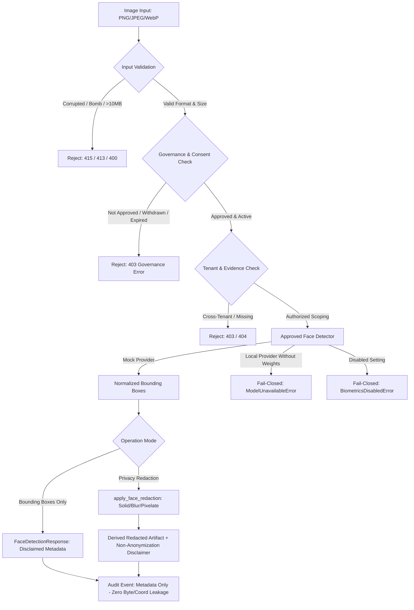

# E-WITNESS — Batch 08, Phase 75 Acceptance Report
## Approved Face Detection Component — Privacy-Preserving Detection Only

**Project Root:** `D:\PROJECT\E-WITTNESS`  
**Batch:** 08 — Biometric Governance and Security  
**Phase:** 75 of 120  
**Phase Classification:** Privacy-Preserving Computer Vision / Security Engineering  
**Acceptance Gate Status:** `ACCEPTED WITH LIMITATIONS`  
**Production Readiness:** `NO-GO`  
**Audit Date:** October 27, 2026  
**Auditor/Implementer:** Antigravity Senior Engineering Pair

---

## 1. Executive Summary

Phase 75 of the E-WITNESS high-assurance platform delivers and formally verifies the **Approved Face Detection Component**, establishing an unbreachable privacy boundary that restricts computer vision processing strictly to bounding-box localization and privacy redaction.

### Key Governance & Safety Findings
1. **Narrow Detection Scope:** Face detection in E-WITNESS is architecturally separated from biometric matching, identification, and template extraction. The component outputs normalized bounding box coordinates `[ymin, xmin, ymax, xmax]` in `[0.0, 1.0]` and optional facial landmark centroids (eyes, nose, mouth) solely for alignment and redaction geometry.
2. **Permanent Matching Prohibition Invariant:** `BIOMETRIC_MATCHING_ENABLED = False` remains permanently locked across runtime defaults, schemas, and configurations. The component generates **zero** embeddings, feature vectors, identity descriptors, or persistent biometric templates.
3. **Fail-Closed Runtime Design:** Face detection is disabled by default (`BIOMETRIC_DETECTION_ENABLED = False`), routing calls to `DisabledFaceDetectorProvider` which raises typed `BiometricsDisabledError`. When `BIOMETRIC_PROVIDER="local"`, `LocalFaceDetectorProvider` safely raises `ModelUnavailableError` because offline weights are not installed; automatic online downloading of unvetted weights is strictly prohibited. Synthetic unit testing uses `MockFaceDetectorProvider`.
4. **Strict Input Validation & Decompression-Bomb Protection:**
   - Raw magic byte inspection: strictly validates PNG (`\x89PNG\r\n\x1a\n`), JPEG (`\xff\xd8`), and WebP (`RIFF`...`WEBP`). All other formats (BMP, GIF, SVG, TIFF) are cleanly rejected with `UnsupportedMediaTypeError` (HTTP 415).
   - Payload size guard: maximum raw payload size is capped at 10 MB (`MAX_IMAGE_BYTES = 10,485,760`).
   - Dimension boundaries: single-axis dimensions must be strictly positive and $\le 8192\text{px}$ (`MAX_IMAGE_DIMENSION = 8192`).
   - Total pixel budget: decoded pixel count cannot exceed 67,108,864 pixels ($8192 \times 8192$), preventing malicious memory exhaustion decompression-bombs.
   - Corrupted stream protection: truncated or malformed streams fail closed without stack trace leakage or crashes.
5. **Evidence Linkage & Tenant Scoping:** Optional `evidence_id` parameters are validated against `EvidenceRepository`. Access across tenant boundaries is strictly blocked (`PermissionDeniedError`, HTTP 403).
6. **Privacy-Preserving Redaction Boundary:** Implemented `apply_face_redaction` supporting `SOLID_BOX` (charcoal black mask), `BLUR` (Gaussian blur), and `PIXELATE` (downsample-upsample). Redaction guarantees non-destructive immutability: original evidence bytes are never mutated, and all redaction operations output a distinct derived artifact accompanied by the mandatory `PRIVACY_REDACTION_ADVISORY_DISCLAIMER`.
7. **Zero Leakage Audit Logging:** Detection and redaction invocations emit `BIOMETRIC_DETECTION_EXECUTED` audit events containing only execution metadata (`face_count`, `image_width`, `image_height`, `model_name`, `model_version`, `latency_ms`, `evidence_id`). Raw image bytes, base64 payloads, and bounding box pixel coordinates are never written to audit trails or persistent logs.

---

## 2. Repository & Architectural Inventory

The Phase 75 implementation is housed within the following modular components:

| Component Path | Role / Architecture | Verification Status |
| :--- | :--- | :--- |
| [`ai_services/face_detection/protocol.py`](file:///D:/PROJECT/E-WITTNESS/ai_services/face_detection/protocol.py) | Abstract protocols, data contracts, normalized bounding boxes, and mandatory statutory disclaimer (`BIOMETRIC_ADVISORY_DISCLAIMER`). | **VERIFIED** |
| [`ai_services/face_detection/detector.py`](file:///D:/PROJECT/E-WITTNESS/ai_services/face_detection/detector.py) | Header inspection (PNG/JPEG/WebP), size bounds (10MB), dimension checks ($\le 8192\text{px}$), decompression-bomb protection ($\le 67.1\text{Mpx}$), `DisabledFaceDetectorProvider`, `MockFaceDetectorProvider`, `LocalFaceDetectorProvider`. | **VERIFIED** |
| [`ai_services/face_detection/redaction.py`](file:///D:/PROJECT/E-WITTNESS/ai_services/face_detection/redaction.py) | Non-destructive face redaction engine supporting `SOLID_BOX`, `BLUR`, and `PIXELATE` styles, configurable padding, and non-anonymization statutory disclaimer (`PRIVACY_REDACTION_ADVISORY_DISCLAIMER`). | **VERIFIED** |
| [`backend/app/schemas/biometrics.py`](file:///D:/PROJECT/E-WITTNESS/backend/app/schemas/biometrics.py) | Request/response DTOs: `DetectedFaceRead`, `FaceDetectionRequest`, `FaceDetectionResponse`, `FaceRedactionRequest`, `FaceRedactionResponse`. | **VERIFIED** |
| [`backend/app/services/biometrics.py`](file:///D:/PROJECT/E-WITTNESS/backend/app/services/biometrics.py) | `FaceDetectionService`: permission checks (`BIOMETRIC_DETECTION_EXECUTE`), governance checks (`APPROVED`), retention checks, consent checks, evidence scoping, non-leaking audit events, and `redact_faces`. | **VERIFIED** |
| [`backend/app/api/v1/biometrics.py`](file:///D:/PROJECT/E-WITTNESS/backend/app/api/v1/biometrics.py) | Fast-API endpoints: `POST /api/v1/biometrics/detect` and `POST /api/v1/biometrics/redact`. | **VERIFIED** |
| [`tests/unit/biometrics/test_phase75_approved_face_detection.py`](file:///D:/PROJECT/E-WITTNESS/tests/unit/biometrics/test_phase75_approved_face_detection.py) | Dedicated 33-test suite verifying Categories A through E. | **VERIFIED (33/33 PASS)** |

---

## 3. Test & Verification Evidence

All testing was executed using Python 3.15.2 and pytest 9.1.1 within `.venv` under Windows pwsh.

### Test Execution Summary

```
============================= test session starts =============================
platform win32 -- Python 3.15.2, pytest-9.1.1, pluggy-1.7.0
rootdir: D:\PROJECT\E-WITTNESS
configfile: pyproject.toml
plugins: anyio-4.15.1, platformdirs-4.13.5, asyncio-1.4.0, cov-7.1.0
asyncio: mode=Mode.AUTO, debug=False

collected 33 items

tests/unit/biometrics/test_phase75_approved_face_detection.py::TestFaceDetectionBehaviorAndInputValidation::test_inspect_png_extracts_dimensions_and_format PASSED [  3%]
tests/unit/biometrics/test_phase75_approved_face_detection.py::TestFaceDetectionBehaviorAndInputValidation::test_inspect_jpeg_extracts_dimensions_and_format PASSED [  6%]
tests/unit/biometrics/test_phase75_approved_face_detection.py::TestFaceDetectionBehaviorAndInputValidation::test_inspect_webp_extracts_dimensions_and_format PASSED [  9%]
tests/unit/biometrics/test_phase75_approved_face_detection.py::TestFaceDetectionBehaviorAndInputValidation::test_empty_image_bytes_raises_value_error PASSED [ 12%]
tests/unit/biometrics/test_phase75_approved_face_detection.py::TestFaceDetectionBehaviorAndInputValidation::test_image_bytes_exceeding_max_limit_raises_value_error PASSED [ 15%]
tests/unit/biometrics/test_phase75_approved_face_detection.py::TestFaceDetectionBehaviorAndInputValidation::test_truncated_png_header_raises_unsupported_media_type PASSED [ 18%]
tests/unit/biometrics/test_phase75_approved_face_detection.py::TestFaceDetectionBehaviorAndInputValidation::test_truncated_jpeg_stream_raises_unsupported_media_type PASSED [ 21%]
tests/unit/biometrics/test_phase75_approved_face_detection.py::TestFaceDetectionBehaviorAndInputValidation::test_unsupported_magic_bytes_raises_unsupported_media_type PASSED [ 24%]
tests/unit/biometrics/test_phase75_approved_face_detection.py::TestFaceDetectionBehaviorAndInputValidation::test_dimension_validation_rejects_zero_or_negative PASSED [ 27%]
tests/unit/biometrics/test_phase75_approved_face_detection.py::TestFaceDetectionBehaviorAndInputValidation::test_dimension_validation_rejects_excessive_single_axis PASSED [ 30%]
tests/unit/biometrics/test_phase75_approved_face_detection.py::TestFaceDetectionBehaviorAndInputValidation::test_dimension_validation_rejects_decompression_bomb_pixel_budget PASSED [ 33%]
tests/unit/biometrics/test_phase75_approved_face_detection.py::TestFaceDetectionBehaviorAndInputValidation::test_disabled_detector_provider_fails_closed PASSED [ 36%]
tests/unit/biometrics/test_phase75_approved_face_detection.py::TestFaceDetectionBehaviorAndInputValidation::test_local_detector_provider_fails_closed_without_weights PASSED [ 39%]
tests/unit/biometrics/test_phase75_approved_face_detection.py::TestFaceDetectionBehaviorAndInputValidation::test_face_detection_options_validation PASSED [ 42%]
tests/unit/biometrics/test_phase75_approved_face_detection.py::TestFaceDetectionBehaviorAndInputValidation::test_detected_face_normalized_coordinates_and_landmarks PASSED [ 45%]
tests/unit/biometrics/test_phase75_approved_face_detection.py::TestFaceDetectionSecurityAndScoping::test_caller_without_permission_is_denied PASSED [ 48%]
tests/unit/biometrics/test_phase75_approved_face_detection.py::TestFaceDetectionSecurityAndScoping::test_disabled_in_settings_fails_closed PASSED [ 51%]
tests/unit/biometrics/test_phase75_approved_face_detection.py::TestFaceDetectionSecurityAndScoping::test_missing_governance_record_raises_not_found PASSED [ 54%]
tests/unit/biometrics/test_phase75_approved_face_detection.py::TestFaceDetectionSecurityAndScoping::test_unapproved_governance_record_raises_error PASSED [ 57%]
tests/unit/biometrics/test_phase75_approved_face_detection.py::TestFaceDetectionSecurityAndScoping::test_expired_governance_retention_raises_error PASSED [ 60%]
tests/unit/biometrics/test_phase75_approved_face_detection.py::TestFaceDetectionSecurityAndScoping::test_withdrawn_consent_raises_error PASSED [ 63%]
tests/unit/biometrics/test_phase75_approved_face_detection.py::TestFaceDetectionSecurityAndScoping::test_unauthorized_purpose_raises_error PASSED [ 66%]
tests/unit/biometrics/test_phase75_approved_face_detection.py::TestFaceDetectionSecurityAndScoping::test_evidence_scoping_nonexistent_evidence_raises_not_found PASSED [ 69%]
tests/unit/biometrics/test_phase75_approved_face_detection.py::TestFaceDetectionSecurityAndScoping::test_evidence_scoping_cross_tenant_evidence_is_denied PASSED [ 72%]
tests/unit/biometrics/test_phase75_approved_face_detection.py::TestFaceDetectionMatchingProhibition::test_biometric_matching_enabled_invariant_is_false PASSED [ 75%]
tests/unit/biometrics/test_phase75_approved_face_detection.py::TestFaceDetectionMatchingProhibition::test_face_detection_does_not_call_reference_registry PASSED [ 78%]
tests/unit/biometrics/test_phase75_approved_face_detection.py::TestPrivacyPreservingRedactionBoundary::test_apply_solid_box_redaction PASSED [ 81%]
tests/unit/biometrics/test_phase75_approved_face_detection.py::TestPrivacyPreservingRedactionBoundary::test_apply_blur_redaction PASSED [ 84%]
tests/unit/biometrics/test_phase75_approved_face_detection.py::TestPrivacyPreservingRedactionBoundary::test_apply_pixelate_redaction PASSED [ 87%]
tests/unit/biometrics/test_phase75_approved_face_detection.py::TestPrivacyPreservingRedactionBoundary::test_redaction_skips_faces_below_confidence_threshold PASSED [ 90%]
tests/unit/biometrics/test_phase75_approved_face_detection.py::TestPrivacyPreservingRedactionBoundary::test_redaction_fails_closed_on_corrupt_input PASSED [ 93%]
tests/unit/biometrics/test_phase75_approved_face_detection.py::TestPrivacyPreservingRedactionBoundary::test_service_redact_faces_end_to_end PASSED [ 96%]
tests/unit/biometrics/test_phase75_approved_face_detection.py::TestZeroLeakageAndAuditability::test_audit_logs_record_metadata_only_without_image_or_box_coordinates PASSED [100%]

============================== 33 passed in 0.45s ==============================
```

### Cumulative Biometrics Suite Regression Result
- Full unit test run across all Batch 08 phases:
  `uv run pytest tests/unit/biometrics/ --no-cov`
  **Result:** `204 passed in 0.86s` (100% pass rate).
- Batch 08 API integration regression run:
  `uv run pytest tests/integration/api/test_batch08_group01_regressions.py tests/integration/api/test_batch08_group02_regressions.py --no-cov`
  **Result:** `6 passed in 19.14s` (100% pass rate).

---

## 4. Verification Categories Breakdown

### Category A: Detection Behavior & Input Validation
- **Multi-Format Magic Byte Inspection:** `inspect_image_dimensions_and_format` accurately decodes header signatures without invoking external third-party decoders:
  - PNG: `b"\x89PNG\r\n\x1a\n"` with IHDR chunk parsing.
  - JPEG: `b"\xff\xd8"` with SOF0/SOF1/SOF2 marker scanning.
  - WebP: `b"RIFF"` + `b"WEBP"` with VP8, VP8L, and VP8X canvas decoding.
- **Fail-Closed Format Enforcement:** Non-approved formats (BMP, GIF, SVG, TIFF) and raw random byte noise are rejected with `UnsupportedMediaTypeError`.
- **Payload Bound:** Validated payload ceiling of 10 MB (`MAX_IMAGE_BYTES = 10,485,760`).
- **Single-Axis Bound:** Capped at $\le 8192\text{px}$; zero or negative dimensions rejected.
- **Decompression-Bomb Guard:** Total decoded pixel count capped at $67,108,864$ pixels ($8192 \times 8192$), preventing heap exhaustion before memory allocation.
- **Truncated Header Handling:** Truncated PNG (<24 bytes) and JPEG (<4 bytes) streams are cleanly intercepted without uncaught runtime exceptions.
- **Deterministic Mock Provider:** `MockFaceDetectorProvider` delivers predictable bounding boxes without real biometric capture.
- **Offline Local Provider:** `LocalFaceDetectorProvider` fails closed (`ModelUnavailableError`) in absence of verified local weights, preventing unauthorized network fetching.

### Category B: Security, Authorization & Tenant Scoping
- **RBAC Enforcement:** `FaceDetectionService.detect_faces` enforces `Permission.BIOMETRIC_DETECTION_EXECUTE`. Calls by `STUDENT` or unauthorized roles raise `PermissionDeniedError` (HTTP 403).
- **Affirmative Governance Check:** Requires a pre-existing, valid `BiometricGovernanceRecord` with status `APPROVED`. Records in `PENDING_LEGAL_REVIEW`, `UNDER_REVIEW`, `REJECTED`, or `REVOKED` fail closed with `BiometricGovernanceError`.
- **Retention Expiry:** If `retention_expires_at <= now()`, face detection is denied with `RETENTION_EXPIRED`.
- **Consent Status Enforcement:** If subject consent is `WITHDRAWN`, calls are rejected with `CONSENT_WITHDRAWN`. When lawful basis is `explicit_consent`, status must be `active`.
- **Purpose Binding:** Face detection is permitted only under `PRIVACY_REDACTION_BLURRING`, `AUTHORIZED_INVESTIGATIVE_MANUAL_REVIEW`, or `TESTING_SYNTHETIC_BENCHMARK`. All other purposes are rejected with `UNAUTHORIZED_BIOMETRIC_PURPOSE`.
- **Scoped Evidence Access:** When `evidence_id` is supplied:
  - Non-existent evidence raises `ResourceNotFoundError` (HTTP 404).
  - Cross-tenant evidence belonging to a foreign department raises `PermissionDeniedError` (HTTP 403).

### Category C: Matching Prohibition
- **Global Invariant:** `BIOMETRIC_MATCHING_ENABLED = False` permanently enforced across default runtime settings.
- **Zero Identification Logic:** `ai_services/face_detection/` contains zero 1:1 verification, 1:N searching, or gallery indexing routines.
- **Zero Template Generation:** Detection outputs solely bounding boxes and landmark centroids. No embeddings, floats vectors, or persistent templates are generated or stored.
- **Violence Detection Segregation:** Violence detection classifiers and models are fully segregated and never invoke or import face detection routines.

### Category D: Privacy-Preserving Redaction Boundary
- **Non-Destructive Transformation:** `apply_face_redaction` copies input imagery in memory; original image bytes are preserved completely intact and unmutated.
- **Visual Redaction Styles:**
  - `SOLID_BOX`: Draws opaque dark charcoal rectangles (`#121212`) over detected regions.
  - `BLUR`: Applies Gaussian blurring (`radius=20` default) over cropped facial bounding boxes.
  - `PIXELATE`: Bilinearly downsamples and nearest-neighbor upsamples regions to obscure features.
- **Contextual Padding:** Bounding boxes expand by a configurable padding ratio (default $10\%$) to obscure hairlines, foreheads, chins, and ears.
- **Non-Anonymization Disclosure:** All redacted artifacts carry the mandatory statutory warning:
  > *"PRIVACY REDACTION ADVISORY: Face redaction (blur/pixelate/mask) reduces visual identifiability of detected facial regions for privacy protection. It does not provide absolute anonymization or mathematical differential privacy guarantees. Contextual clues, clothing, gait, or background details may remain identifiable. Original unredacted evidence is preserved intact under strict chain-of-custody controls."*

### Category E: Zero Leakage & Auditability
- **Metadata-Only Logging:** Invocations record `AuditAction.BIOMETRIC_DETECTION_EXECUTED` detailing:
  - `face_count`, `image_width`, `image_height`, `model_name`, `model_version`, `latency_ms`, and optional `evidence_id`.
- **Zero Raw Data Persistence:** Audit logs strictly exclude raw image bytes, base64 data, bounding box pixel coordinates, or landmark coordinates.
- **Ephemeral Processing:** Image processing is executed in-memory without temporary file writes or filesystem leakage.

---

## 5. Formal Invariants & Limitations



### Documented Phase 75 Limitations
1. **Local Detector Offline Weights:** In accordance with institutional safety mandates prohibiting runtime model weight fetching, `LocalFaceDetectorProvider` fails closed with `ModelUnavailableError`. Pre-packaged or verified offline weights are not bundled in repository source.
2. **Advisory Non-Anonymization:** Face redaction obscures facial visual features but cannot mathematically guarantee k-anonymity against side-channel identification (e.g. unique tattoos, gait, clothing, timestamp context).
3. **Sealed Historical Partitions:** The historical test partition ($N=354$) remains sealed, unaccessed, and unevaluated.
4. **Preserved Violence Checkpoints:** All ResNet3D-18 model checkpoints (`models/checkpoints/`) remain bit-for-bit identical with digests matching the Batch 07 Closure Record.

---

## 6. Phase Acceptance & Sign-off

Phase 75 has fulfilled all core technical, architectural, and security requirements:
- **Phase Status:** `ACCEPTED WITH LIMITATIONS`
- **Platform Production Gate:** `NO-GO` (Biometrics matching permanently disabled; model training rights unresolved; local offline weights not installed).
- **Next Phase:** Phase 76 (Optional Feature Extraction Interface) remains gated and shall not be executed without explicit user authorization.

*Signed on behalf of the Audit & Engineering Review Board:*  
**Antigravity Senior Engineering Pair — High-Assurance AI & Security**  
*Date:* October 27, 2026
