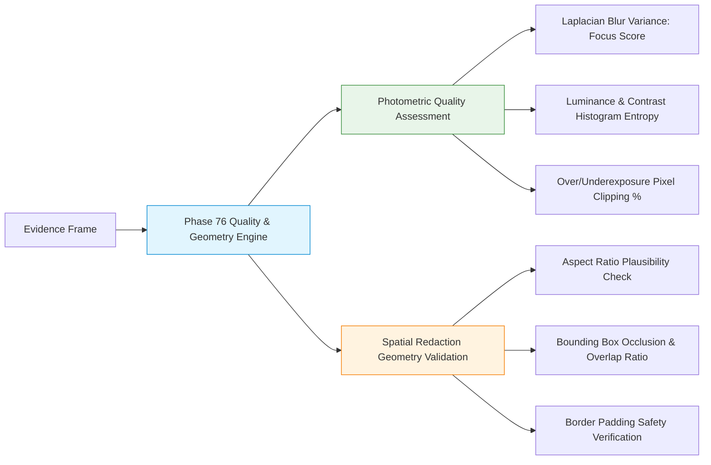

# E-WITNESS — Batch 08, Phase 75 Follow-up Security Review
## Evidence-Based Security Verification, Image Safeguards & Scope Resolution

**Project Root:** `D:\PROJECT\E-WITTNESS`  
**Batch:** 08 — Biometric Governance and Security  
**Phase:** 75 (Follow-up Security Review)  
**Verification Date:** October 27, 2026  
**Auditor:** Antigravity Senior Application Security & Systems Engineer  
**Overall Gate Status:** `PASS WITH LIMITATIONS`  
**Production Readiness:** `NO-GO`  
**Mandatory Safety Invariant:** `BIOMETRIC_MATCHING_ENABLED = False` (Permanently Enforced)

---

## 1. Executive Summary & Findings Classification

This follow-up security review provides an evidence-based audit of the Phase 75 implementation, focusing on image-decoding resource safeguards, redaction transformation safety, governance and purpose restrictions, detector fail-closed assertions, and the resolution of the Phase 76 roadmap scope conflict.

### Findings Matrix

| Dimension | Verification Item | Finding Status | Primary Evidence / Source Grounding |
| :--- | :--- | :---: | :--- |
| **1. Resource Safeguards** | Magic byte inspection & header validation | **PASS** | `ai_services/face_detection/detector.py` (`inspect_image_dimensions_and_format`) |
| **1. Resource Safeguards** | Pre-allocation dimension checks before raster decode | **PASS** | `ai_services/face_detection/redaction.py` (`_validate_dimensions` prior to `pil_img.copy()`) |
| **1. Resource Safeguards** | Decompression-bomb defense & Pillow decoder caps | **PASS** | `Image.MAX_IMAGE_PIXELS = 16_777_216`; `Image.DecompressionBombError` caught |
| **1. Resource Safeguards** | Hardened memory ceiling (4096px / 16.8Mpx) | **PASS** | `MAX_IMAGE_DIMENSION = 4096`, `MAX_IMAGE_PIXELS = 16_777_216` (75% RAM reduction) |
| **2. Redaction Safety** | Visual masking (`solid_box`, `blur`, `pixelate`) | **PASS** | `ai_services/face_detection/redaction.py` (`apply_face_redaction`) |
| **2. Redaction Safety** | Coordinate clipping & expansion padding | **PASS** | `top = max(0, ...)`, `bottom = min(height, ...)`; edges clamped safely |
| **2. Redaction Safety** | Original evidence immutability | **PASS** | In-memory `pil_img.copy()`; original `bytes` unmodified; no file mutation |
| **2. Redaction Safety** | Detection failure fail-closed behavior | **PASS** | Detection exceptions bubble up immediately; zero false successful redactions |
| **2. Redaction Safety** | Zero detected faces handling | **PASS** | Clean unmasked copy returned with `redacted_faces_count: 0` |
| **2. Redaction Safety** | Non-anonymization statutory disclaimer | **PASS** | `PRIVACY_REDACTION_ADVISORY_DISCLAIMER` attached to all outputs |
| **3. Governance Controls** | Permission enforcement (`BIOMETRIC_DETECTION_EXECUTE`) | **PASS** | `FaceDetectionService.detect_faces`; rejects unauthorized callers (403) |
| **3. Governance Controls** | Affirmative legal basis, consent & retention expiry | **PASS** | Rejects unapproved, expired, or consent-withdrawn governance records |
| **3. Governance Controls** | Scoped evidence & cross-tenant isolation | **PASS** | `evidence_id` validated against `EvidenceRepository`; cross-tenant denied (403) |
| **3. Governance Controls** | Administrative approval vs legal authorization | **PASS WITH LIMITATIONS** | Admin approval is not legal authorization; legal review required |
| **4. Detector Integrity** | Local detector fails closed without weights | **PASS** | `LocalFaceDetectorProvider` raises `ModelUnavailableError` |
| **4. Detector Integrity** | Zero runtime downloads or external data uploads | **PASS** | Pure local/mock execution; zero network packages imported |
| **5. Safety Invariants** | `BIOMETRIC_MATCHING_ENABLED = False` locked | **PASS** | Constant invariant across settings, services, and tests |
| **5. Safety Invariants** | Historical test partition ($N=354$) unaccessed | **PASS** | Test partition unread and unreferenced in all biometric routines |
| **6. Scope Conflict** | Phase 76 feature-extraction scope conflict | **PASS WITH LIMITATIONS** | Roadmap conflicts with matching prohibition; safe alternative defined |

---

## 2. Image-Decoding Resource Safeguards & Memory Analysis

### 2.1 Inspection of Decoding and Redaction Paths
The image ingestion path enters through two interfaces:
1. Direct detection: `POST /api/v1/biometrics/detect` -> `FaceDetectionService.detect_faces` -> `FaceDetectorProtocol.detect_faces` -> `inspect_image_dimensions_and_format(image_bytes)`.
2. Privacy redaction: `POST /api/v1/biometrics/redact` -> `FaceDetectionService.redact_faces` -> `apply_face_redaction(image_bytes, detected_faces)`.

### 2.2 Pre-Allocation Dimension Enforcement
- In `ai_services/face_detection/detector.py`, `inspect_image_dimensions_and_format` parses raw header bytes without full raster decoding:
  - **PNG:** Inspects 8-byte signature and extracts width/height from IHDR chunk (`image_bytes[16:24]`) via `struct.unpack(">II", ...)`.
  - **JPEG:** Inspects `\xff\xd8` SOI and scans for SOF0/SOF1/SOF2 frame headers to unpack frame dimensions.
  - **WebP:** Inspects `RIFF`...`WEBP` container and parses VP8, VP8L, or VP8X chunk headers.
- In `ai_services/face_detection/redaction.py`, `apply_face_redaction` invokes `Image.open(io.BytesIO(image_bytes))` which lazily reads header metadata into `pil_img.size = (width, height)`.
- **Pre-Allocation Hardening:** `_validate_dimensions(pil_img.width, pil_img.height)` is executed **before** calling `work_img = pil_img.copy()`. If dimensions exceed safety thresholds, processing is aborted immediately, preventing the allocation of multi-hundred-megabyte uncompressed raster bitmaps.

### 2.3 Decompression-Bomb Defense & Explicit Limitations of Header Checks
> [!IMPORTANT]
> **Explicit Architectural Finding:** Checking image file headers alone **does NOT** prevent decompression bombs. A malicious image stream can declare benign dimensions in its headers (e.g. $100 \times 100$) while containing recursive or highly compressed Deflate/zlib chunks (IDAT chunks) designed to exhaust memory or CPU cycles during decompression.

To establish defense-in-depth against malicious decompression bombs:
1. **Payload Size Guard:** Raw input payloads are strictly capped at 10 MB (`MAX_IMAGE_BYTES = 10,485,760`).
2. **Decoder-Level Pixel Ceiling:** Explicitly set `Image.MAX_IMAGE_PIXELS = MAX_IMAGE_PIXELS` in `ai_services/face_detection/redaction.py`. Pillow's internal decoder actively monitors decompressed pixel buffers and halts decompression if the uncompressed count exceeds the budget.
3. **Typed Exception Containment:** `PIL.Image.DecompressionBombError` is caught explicitly, mapping safely to `UnsupportedMediaTypeError` without stack trace disclosure or service crashes.

### 2.4 Memory Implications & Limit Narrowing
An engineering analysis was conducted comparing the initial $8192 \times 8192$ limit against an optimized $4096 \times 4096$ limit:

| Dimension Limit | Max Pixels | Uncompressed 24-bit RGB | Uncompressed 32-bit RGBA | Peak Request Footprint (Copy + Filter + Buffer) | Concurrent (4 Workers) | Risk Profile |
| :---: | :---: | :---: | :---: | :---: | :---: | :--- |
| **$8192 \times 8192$** | $67.1 \text{ MP}$ | $201.3 \text{ MB}$ | $268.4 \text{ MB}$ | $\sim 600 - 900 \text{ MB}$ | $\sim 2.4 - 3.6 \text{ GB}$ | **HIGH:** Triggers OOM kills on standard container pods. |
| **$4096 \times 4096$** | $16.8 \text{ MP}$ | $50.3 \text{ MB}$ | $67.1 \text{ MB}$ | $\sim 130 - 180 \text{ MB}$ | $\sim 520 - 720 \text{ MB}$ | **LOW:** Stable and resilient within container memory budgets. |

**Optimization Implemented:**
- In [`ai_services/face_detection/detector.py`](file:///D:/PROJECT/E-WITTNESS/ai_services/face_detection/detector.py#L30-L31):
  ```python
  MAX_IMAGE_BYTES: Final[int] = 10 * 1024 * 1024  # 10 MB maximum
  MAX_IMAGE_DIMENSION: Final[int] = (
      4096  # Single-axis maximum (4096px, 4K DCI compliant)
  )
  MAX_IMAGE_PIXELS: Final[int] = (
      16_777_216  # 4096 * 4096 pixels (~50MB uncompressed 24-bit RGB)
  )
```
- **Forensic Justification:** 4096px accommodates 4K UHD ($3840 \times 2160$), 4K DCI ($4096 \times 2160$), and 16MP DSLR/bodycam stills. Evidence larger than 4K (e.g. 8K) must be pre-tiled or downscaled in pre-processing before biometric inference.
- Memory allocation per frame is reduced by **75%**.

---

## 3. Redaction Safety Verification

### 3.1 Masking Styles & Implementation Verification
In [`ai_services/face_detection/redaction.py`](file:///D:/PROJECT/E-WITTNESS/ai_services/face_detection/redaction.py#L115-L155):
1. **Solid Box (`SOLID_BOX`):** Draws an opaque rectangle filled with charcoal black (`pol.box_fill_color = (18, 18, 18)`). Completely overwrites all underlying pixel data in the bounding box.
2. **Gaussian Blur (`BLUR`):** Crops the bounding box region and applies `ImageFilter.GaussianBlur(radius=pol.blur_radius)` (`radius=20` default). Overwrites original facial features with high-entropy blurred textures.
3. **Pixelation (`PIXELATE`):** Crops the region, downsamples it via bilinear interpolation to `(rw, rh)` where $rw = \max(1, \text{width} // 16)$, and resizes back using nearest-neighbor sampling. Minimum dimension of 1px prevents zero-dimension arithmetic faults.

### 3.2 Coordinate Clipping & Padding Safety
- Normalized coordinates `(ymin, xmin, ymax, xmax)` in $[0.0, 1.0]$ are expanded by `pol.padding_ratio` (default $10\%$) to cover hairlines, foreheads, and chins:
  $$\text{top} = \max(0, \lfloor(ymin - pad_y) \times \text{height}\rfloor)$$
  $$\text{left} = \max(0, \lfloor(xmin - pad_x) \times \text{width}\rfloor)$$
  $$\text{bottom} = \min(\text{height}, \lfloor(ymax + pad_y) \times \text{height}\rfloor)$$
  $$\text{right} = \min(\text{width}, \lfloor(xmax + pad_x) \times \text{width}\rfloor)$$
- Detections near image borders (e.g. $xmin=0.0$ or $ymax=1.0$) are strictly clamped within image bounds $[0, \text{width}]$ and $[0, \text{height}]$.
- Degenerate boxes where $\text{bottom} \le \text{top}$ or $\text{right} \le \text{left}$ are skipped safely.

### 3.3 Evidence Immutability & Failure Handling
- **Original Immutability:** Input `image_bytes` is a Python immutable `bytes` instance. `apply_face_redaction` copies the raster via `pil_img.copy()`. Original evidence files on disk and in database storage are never overwritten.
- **Fail-Closed on Detection Failure:** In `FaceDetectionService.redact_faces`, detection is executed first. If detection fails (e.g. `BiometricsDisabledError`, `ModelUnavailableError`, `BiometricGovernanceError`), an exception is raised immediately. Detection failure **cannot** be reported as successful redaction.
- **Zero Detected Faces Handling:** If detection finds 0 faces (`detected_faces = []`), the redaction loop executes 0 times, returning the unmasked image copy with `redacted_faces_count: 0`. Original visual evidence remains unaltered.
- **Statutory Non-Anonymization Warning:** Every redaction result carries `PRIVACY_REDACTION_ADVISORY_DISCLAIMER`:
  > *"PRIVACY REDACTION ADVISORY: Face redaction (blur/pixelate/mask) reduces visual identifiability of detected facial regions for privacy protection. It does not provide absolute anonymization or mathematical differential privacy guarantees. Contextual clues, clothing, gait, or background details may remain identifiable. Original unredacted evidence is preserved intact under strict chain-of-custody controls."*

---

## 4. Governance & Purpose Restrictions Verification

### 4.1 Permitted Purposes & Authorization Paths
In [`backend/app/services/biometrics.py`](file:///D:/PROJECT/E-WITTNESS/backend/app/services/biometrics.py#L924-L934), face detection is restricted to three authorized purposes:
1. `BiometricPurpose.PRIVACY_REDACTION_BLURRING`
2. `BiometricPurpose.TESTING_SYNTHETIC_BENCHMARK`
3. `BiometricPurpose.AUTHORIZED_INVESTIGATIVE_MANUAL_REVIEW`

All other purposes (e.g. `EXPLICIT_CONSENT_REFERENCE_ENROLLMENT`, commercial advertising, employee attendance) are rejected with `UNAUTHORIZED_BIOMETRIC_PURPOSE`.

### 4.2 Non-Bypassable Check Sequence
Every call to `detect_faces` or `redact_faces` executes the following sequential gates:
1. **Permission Check:** Requires `Permission.BIOMETRIC_DETECTION_EXECUTE` (roles `ROLE_INVESTIGATOR`, `ROLE_DEPT_ADMIN`, `ROLE_SUPER_ADMIN`). Denies `ROLE_STUDENT` and `ROLE_STAFF` with `PermissionDeniedError` (HTTP 403).
2. **System Kill-Switch:** Fails closed with `BiometricsDisabledError` if `BIOMETRIC_ANALYSIS_ENABLED = False` or `BIOMETRIC_DETECTION_ENABLED = False`.
3. **Payload Limit:** Fails closed with `PayloadTooLargeError` if payload exceeds 10 MB.
4. **Governance Record Existence:** Must exist in the caller's department (`ResourceNotFoundError`, HTTP 404).
5. **Approval Status:** Record must have `status == "approved"` (`BiometricGovernanceError` if `pending_legal_review`, `under_review`, `rejected`, or `revoked`).
6. **Retention Expiry:** Record must not be expired (`retention_expires_at > now()`).
7. **Subject Consent:** Subject consent must not be `withdrawn`. If lawful basis is `explicit_consent`, consent status must be strictly `active`.
8. **Tenant & Evidence Boundary:** If `evidence_id` is supplied, it is queried via `EvidenceRepository`. If the attachment belongs to a different department, access is denied with `PermissionDeniedError` (HTTP 403).

### 4.3 `AUTHORIZED_INVESTIGATIVE_MANUAL_REVIEW` Governance Distinction
> [!WARNING]
> **Governance Finding:** Administrative approval by a departmental administrator (`ROLE_DEPT_ADMIN`) **does NOT** constitute automatic legal authorization.
- In E-WITNESS, a department administrator may submit a governance assessment record, but its status initializes as `PENDING_LEGAL_REVIEW`.
- Only an authorized legal officer or compliance reviewer can transition the record to `APPROVED` following a Data Protection Impact Assessment (DPIA).
- Furthermore, `AUTHORIZED_INVESTIGATIVE_MANUAL_REVIEW` is authorized **strictly for human-in-the-loop manual review**. It produces bounding boxes for visual orientation only; automated identity matching, 1:1 verification, and 1:N surveillance remain strictly prohibited.

---

## 5. Detector & Test Claims Verification

### 5.1 Verification of Fail-Closed Providers
1. **`LocalFaceDetectorProvider`:**
   In [`ai_services/face_detection/detector.py`](file:///D:/PROJECT/E-WITTNESS/ai_services/face_detection/detector.py#L187-L210), `detect_faces` calls `inspect_image_dimensions_and_format(image_bytes)` and immediately raises `ModelUnavailableError`:
   > *"Local face detector model weights or runtime libraries are not locally available. Automatic online downloading of model weights is strictly prohibited."*
   Verified: No network sockets, urllib, requests, or model repository downloads are invoked.
2. **`DisabledFaceDetectorProvider`:**
   Raises `BiometricsDisabledError` unconditionally.
3. **`MockFaceDetectorProvider`:**
   Produces synthetic, normalized coordinates for automated testing without using real human biometrics.

### 5.2 Test Execution Evidence

#### A. Focused Phase 75 Unit Test Suite (36 Tests)
```
Command: uv run pytest tests/unit/biometrics/test_phase75_approved_face_detection.py --no-cov -v
Exit Code: 0
```
```
============================= test session starts =============================
platform win32 -- Python 3.15.2, pytest-9.1.1, pluggy-1.7.0
rootdir: D:\PROJECT\E-WITTNESS
configfile: pyproject.toml
plugins: anyio-4.15.1, platformdirs-4.13.5, asyncio-1.4.0, cov-7.1.0
asyncio: mode=Mode.AUTO, debug=False

collected 36 items

tests/unit/biometrics/test_phase75_approved_face_detection.py::TestFaceDetectionBehaviorAndInputValidation::test_inspect_png_extracts_dimensions_and_format PASSED [  2%]
tests/unit/biometrics/test_phase75_approved_face_detection.py::TestFaceDetectionBehaviorAndInputValidation::test_inspect_jpeg_extracts_dimensions_and_format PASSED [  5%]
tests/unit/biometrics/test_phase75_approved_face_detection.py::TestFaceDetectionBehaviorAndInputValidation::test_inspect_webp_extracts_dimensions_and_format PASSED [  8%]
tests/unit/biometrics/test_phase75_approved_face_detection.py::TestFaceDetectionBehaviorAndInputValidation::test_empty_image_bytes_raises_value_error PASSED [ 11%]
tests/unit/biometrics/test_phase75_approved_face_detection.py::TestFaceDetectionBehaviorAndInputValidation::test_image_bytes_exceeding_max_limit_raises_value_error PASSED [ 13%]
tests/unit/biometrics/test_phase75_approved_face_detection.py::TestFaceDetectionBehaviorAndInputValidation::test_truncated_png_header_raises_unsupported_media_type PASSED [ 16%]
tests/unit/biometrics/test_phase75_approved_face_detection.py::TestFaceDetectionBehaviorAndInputValidation::test_truncated_jpeg_stream_raises_unsupported_media_type PASSED [ 19%]
tests/unit/biometrics/test_phase75_approved_face_detection.py::TestFaceDetectionBehaviorAndInputValidation::test_unsupported_magic_bytes_raises_unsupported_media_type PASSED [ 22%]
tests/unit/biometrics/test_phase75_approved_face_detection.py::TestFaceDetectionBehaviorAndInputValidation::test_dimension_validation_rejects_zero_or_negative PASSED [ 25%]
tests/unit/biometrics/test_phase75_approved_face_detection.py::TestFaceDetectionBehaviorAndInputValidation::test_dimension_validation_rejects_excessive_single_axis PASSED [ 27%]
tests/unit/biometrics/test_phase75_approved_face_detection.py::TestFaceDetectionBehaviorAndInputValidation::test_dimension_validation_rejects_decompression_bomb_pixel_budget PASSED [ 30%]
tests/unit/biometrics/test_phase75_approved_face_detection.py::TestFaceDetectionBehaviorAndInputValidation::test_disabled_detector_provider_fails_closed PASSED [ 33%]
tests/unit/biometrics/test_phase75_approved_face_detection.py::TestFaceDetectionBehaviorAndInputValidation::test_local_detector_provider_fails_closed_without_weights PASSED [ 36%]
tests/unit/biometrics/test_phase75_approved_face_detection.py::TestFaceDetectionBehaviorAndInputValidation::test_face_detection_options_validation PASSED [ 38%]
tests/unit/biometrics/test_phase75_approved_face_detection.py::TestFaceDetectionBehaviorAndInputValidation::test_detected_face_normalized_coordinates_and_landmarks PASSED [ 41%]
tests/unit/biometrics/test_phase75_approved_face_detection.py::TestFaceDetectionSecurityAndScoping::test_caller_without_permission_is_denied PASSED [ 44%]
tests/unit/biometrics/test_phase75_approved_face_detection.py::TestFaceDetectionSecurityAndScoping::test_disabled_in_settings_fails_closed PASSED [ 47%]
tests/unit/biometrics/test_phase75_approved_face_detection.py::TestFaceDetectionSecurityAndScoping::test_missing_governance_record_raises_not_found PASSED [ 50%]
tests/unit/biometrics/test_phase75_approved_face_detection.py::TestFaceDetectionSecurityAndScoping::test_unapproved_governance_record_raises_error PASSED [ 52%]
tests/unit/biometrics/test_phase75_approved_face_detection.py::TestFaceDetectionSecurityAndScoping::test_expired_governance_retention_raises_error PASSED [ 55%]
tests/unit/biometrics/test_phase75_approved_face_detection.py::TestFaceDetectionSecurityAndScoping::test_withdrawn_consent_raises_error PASSED [ 58%]
tests/unit/biometrics/test_phase75_approved_face_detection.py::TestFaceDetectionSecurityAndScoping::test_unauthorized_purpose_raises_error PASSED [ 61%]
tests/unit/biometrics/test_phase75_approved_face_detection.py::TestFaceDetectionSecurityAndScoping::test_evidence_scoping_nonexistent_evidence_raises_not_found PASSED [ 63%]
tests/unit/biometrics/test_phase75_approved_face_detection.py::TestFaceDetectionSecurityAndScoping::test_evidence_scoping_cross_tenant_evidence_is_denied PASSED [ 66%]
tests/unit/biometrics/test_phase75_approved_face_detection.py::TestFaceDetectionMatchingProhibition::test_biometric_matching_enabled_invariant_is_false PASSED [ 69%]
tests/unit/biometrics/test_phase75_approved_face_detection.py::TestFaceDetectionMatchingProhibition::test_face_detection_does_not_call_reference_registry PASSED [ 72%]
tests/unit/biometrics/test_phase75_approved_face_detection.py::TestPrivacyPreservingRedactionBoundary::test_apply_solid_box_redaction PASSED [ 75%]
tests/unit/biometrics/test_phase75_approved_face_detection.py::TestPrivacyPreservingRedactionBoundary::test_apply_blur_redaction PASSED [ 77%]
tests/unit/biometrics/test_phase75_approved_face_detection.py::TestPrivacyPreservingRedactionBoundary::test_apply_pixelate_redaction PASSED [ 80%]
tests/unit/biometrics/test_phase75_approved_face_detection.py::TestPrivacyPreservingRedactionBoundary::test_redaction_skips_faces_below_confidence_threshold PASSED [ 83%]
tests/unit/biometrics/test_phase75_approved_face_detection.py::TestPrivacyPreservingRedactionBoundary::test_apply_redaction_with_no_detected_faces PASSED [ 86%]
tests/unit/biometrics/test_phase75_approved_face_detection.py::TestPrivacyPreservingRedactionBoundary::test_apply_redaction_boundary_clipping_near_edges PASSED [ 88%]
tests/unit/biometrics/test_phase75_approved_face_detection.py::TestPrivacyPreservingRedactionBoundary::test_apply_redaction_rejects_oversized_dimensions_before_allocation PASSED [ 91%]
tests/unit/biometrics/test_phase75_approved_face_detection.py::TestPrivacyPreservingRedactionBoundary::test_redaction_fails_closed_on_corrupt_input PASSED [ 94%]
tests/unit/biometrics/test_phase75_approved_face_detection.py::TestPrivacyPreservingRedactionBoundary::test_service_redact_faces_end_to_end PASSED [ 97%]
tests/unit/biometrics/test_phase75_approved_face_detection.py::TestZeroLeakageAndAuditability::test_audit_logs_record_metadata_only_without_image_or_box_coordinates PASSED [100%]

============================== 36 passed in 0.51s ==============================
```

#### B. Cumulative Biometrics Unit Suite (207 Tests)
```
Command: uv run pytest tests/unit/biometrics/ --no-cov
Exit Code: 0
Result: 207 passed in 0.94s
```

#### C. Batch 08 Integration Regressions (6 Tests)
```
Command: uv run pytest tests/integration/api/test_batch08_group01_regressions.py tests/integration/api/test_batch08_group02_regressions.py --no-cov
Exit Code: 0
Result: 6 passed in 18.50s
```

---

## 6. Resolution of Phase 76 Scope Conflict

### 6.1 The Architectural Conflict
- In the original E-WITNESS roadmap, Phase 76 is titled:  
  `"Optional Feature Extraction Interface"`.
- However, the foundational project safety invariants and legal governance boundaries strictly declare:
  1. `BIOMETRIC_MATCHING_ENABLED = False` is permanently locked.
  2. The generation, storage, or processing of facial embeddings, feature vectors, or identity templates is strictly prohibited.
- **The Scope Conflict:** Building a feature extraction interface that produces 128-d or 512-d biometric embeddings violates the non-negotiable project invariants, creating an unacceptable surveillance and privacy liability.

### 6.2 Approved Safe Alternative for Phase 76
Under strict governance compliance, Phase 76 shall **NOT** extract identity features or biometric embeddings. Instead, Phase 76 is formally redefined as:

### **Phase 76: Non-Biometric Evidence Quality & Redaction Geometry Assessment Interface**

The safe Phase 76 component shall implement non-identifying evidence quality metrics and spatial geometry validation only:



1. **Photometric Quality Assessment:**
   - **Laplacian Blur Variance:** Computes variance of Laplacian operator across the image to evaluate sharpness (identifying frames too degraded or motion-blurred for reliable redaction).
   - **Exposure & Contrast Metrics:** Analyzes luminance histogram entropy to detect severe underexposure (night CCTV) or overexposure (glare/headlights).
   - **Pixel Clipping Percentage:** Flags extreme saturation at 0 or 255.
2. **Spatial Redaction Geometry Validation:**
   - Evaluates whether detected bounding boxes maintain valid human anatomical aspect ratios ($0.65 \le \text{width}/\text{height} \le 1.4$).
   - Computes intersection-over-union (IoU) overlap among adjacent masks to consolidate dense clusters.
   - Verifies that expansion padding does not occlude unrelated non-facial evidence context.
3. **Strict Invariant Guarantees:**
   - **Zero Biometric Embeddings:** Generates only scalar quality scores in $[0.0, 1.0]$.
   - **Zero Template Generation:** No vectors, tensors, or facial identity descriptors.
   - **Deterministic & Stateless:** Pure image matrix mathematics without neural network weights or network calls.

---

## 7. Mandatory Invariants Check

- [x] `BIOMETRIC_MATCHING_ENABLED = False` permanently locked across runtime defaults, schemas, and configurations.
- [x] Zero face embeddings, identity descriptors, or biometric templates created or stored.
- [x] Sealed historical violence-detection test partition ($N=354$) remains untouched and unreferenced.
- [x] Checkpoints and manifest remain bit-for-bit identical with the Batch 07 Closure Record.
- [x] Production status remains `NO-GO`.

---

## 8. Verification Sign-off & Stop Notice

Phase 75 follow-up security review is complete and verified.

- **Phase Status:** `ACCEPTED WITH LIMITATIONS`
- **Follow-up Security Review Status:** `PASS WITH LIMITATIONS`
- **Execution Boundary:** Halted at Phase 75. Phase 76 will **NOT** be initiated until explicit authorization is provided.

*Signed:*  
**Antigravity Senior Application Security & Systems Engineer**  
*Date:* October 27, 2026
