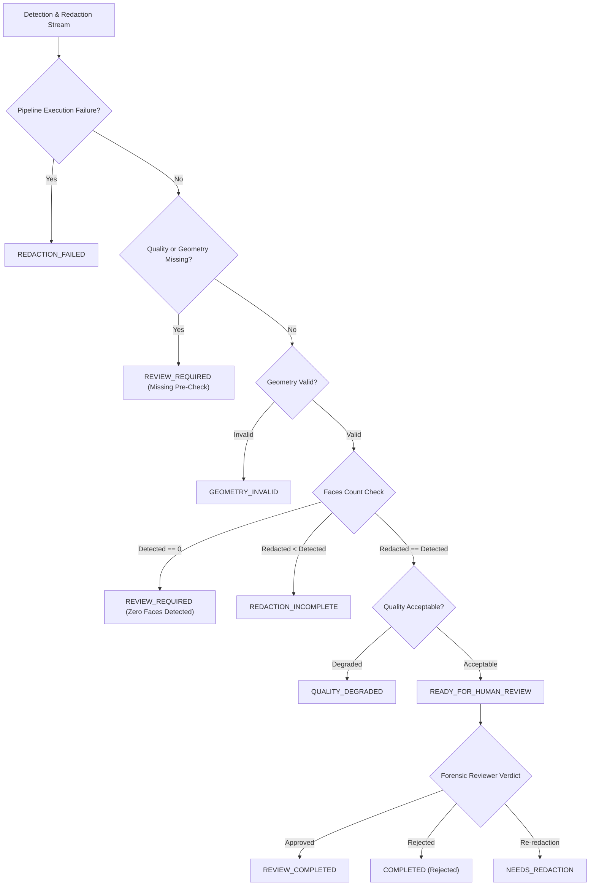
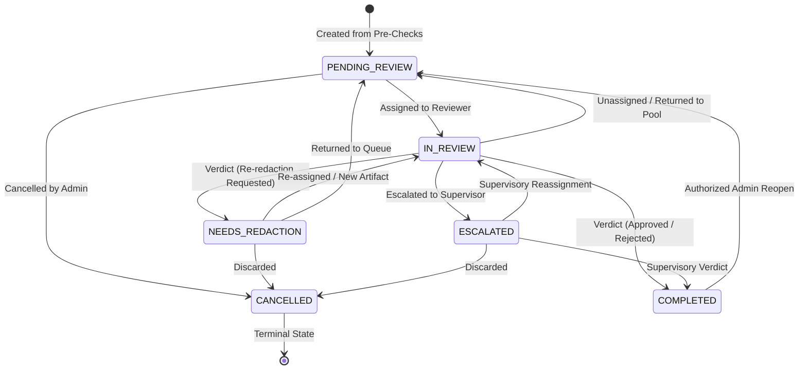

# E-WITNESS — Batch 08, Phase 77 Acceptance Report
## Quality Pre-Checks & Human Review Integration

**Project Root:** `D:\PROJECT\E-WITTNESS`  
**Batch:** 08 — Biometric Governance and Security  
**Phase:** 77 of 120  
**Previous Phase:** Phase 76 — `ACCEPTED WITH LIMITATIONS`  
**Phase Outcome:** `ACCEPTED WITH LIMITATIONS`  
**Production Status:** `NO-GO`  
**Evaluation Date:** 2026-10-28  

---

## 1. Executive Summary & Architecture Overview

Phase 77 establishes the **Evidence Quality Pre-Checks and Human Review Integration** workflow for the E-WITNESS system. It deterministically combines the outputs from:
1. **Phase 75:** Face detection and privacy redaction outcomes.
2. **Phase 76:** Non-biometric photometric evidence quality assessment (sharpness, exposure balance, contrast, clipping).
3. **Phase 76:** Redaction geometry verification (bounds, aspect ratios, overlap cluster consolidation, landmark coverage).

Phase 77 provides an auditable, fail-closed human review lifecycle that prevents unreviewed, degraded, partially redacted, or geometrically invalid evidence artifacts from progressing through the investigation pipeline without affirmative forensic oversight.

### Mandatory Safety Invariants Verification

| Invariant / Guardrail | Standard | Verified State |
| :--- | :--- | :--- |
| **`BIOMETRIC_MATCHING_ENABLED`** | Must remain `False` across all configurations | **Permanently Enforced (`False`)** |
| **Biometric Embeddings & Descriptors** | Zero 128-d / 512-d feature vectors generated | **Strictly Zero Generated or Stored** |
| **Biometric Template Persistence** | No facial templates or embeddings in review records | **Zero Templates / Vectors** |
| **1:1 / 1:N Facial Recognition** | Mass surveillance & automated guilt attribution forbidden | **Completely Prohibited** |
| **Raw Image / Payload Retention** | Zero image bytes, base64 payloads, or raw coordinates stored in review tables | **Metadata and Hashes Only** |
| **Test Partition Sealed** | Historical test partition ($N=354$) unaccessed | **Strictly Unaccessed** |
| **Synthetic Fixtures Only** | No real-subject biometric data in tests | **100% Synthetic Data** |
| **Evidence Immutability** | Original evidence bytes and custody records intact | **Preserved via SHA-256 Hashes** |
| **Statutory Advisory Disclaimers** | Mandatory disclaimers attached to all responses | **Enforced on all DTOs and Records** |
| **Human Review Matching Invariant** | Reviewer cannot override matching lock | **Matching Prohibition Immutable** |

---

## 2. Review Decision Rules & Pre-Check Integration

The deterministic decision engine (`evaluate_unified_review_decision`) integrates component findings into explicit, non-overlapping outcomes:



### Deterministic Decision Rules
1. **Execution Failure:** Detection failure or redaction exceptions immediately produce `REDACTION_FAILED`.
2. **Fail-Closed Missing Pre-Checks:** Missing quality assessment or geometry verification is never assumed to be passing; it conservatively triggers `REVIEW_REQUIRED`.
3. **Geometrical Defects:** Bounding boxes exceeding boundaries, inverted coordinates ($ymin \ge ymax$), extreme aspect ratios, or uncovered landmarks trigger `GEOMETRY_INVALID`.
4. **Photometric Degradation:** Excessive blur (Laplacian variance $< 100$), severe underexposure/overexposure ($> 25\%$), or excessive clipping ($> 15\%$) trigger `QUALITY_DEGRADED`.
5. **Zero Detected Faces:** Zero faces detected is explicitly distinguished from confirmed absence of people and yields `REVIEW_REQUIRED`.
6. **Partial Redactions:** Instances where fewer faces are redacted than detected trigger `REDACTION_INCOMPLETE`.
7. **Landmark Coverage:** Unassessed landmarks are explicitly logged as unavailable or uncovered.
8. **Conservative Conflict Resolution:** When multiple criteria fail, the most severe category is assigned, and all reasons are aggregated.
9. **No Automated Exoneration:** Clean passes yield `READY_FOR_HUMAN_REVIEW`—never an automated evidentiary or legal approval.

---

## 3. Review State Machine & Permitted Transitions

The review lifecycle enforces strict state machine validation (`validate_review_state_transition`):



### Permitted Transitions Table

| Current State | Permitted Target States | Authorization Required |
| :--- | :--- | :--- |
| **`PENDING_REVIEW`** | `IN_REVIEW`, `CANCELLED` | `BIOMETRIC_VERIFICATION_REVIEW` |
| **`IN_REVIEW`** | `COMPLETED`, `NEEDS_REDACTION`, `ESCALATED`, `PENDING_REVIEW` | Assigned Reviewer or Admin |
| **`NEEDS_REDACTION`** | `IN_REVIEW`, `PENDING_REVIEW`, `CANCELLED` | `BIOMETRIC_VERIFICATION_REVIEW` |
| **`ESCALATED`** | `IN_REVIEW`, `COMPLETED`, `CANCELLED` | `BIOMETRIC_VERIFICATION_REVIEW` |
| **`COMPLETED`** | `PENDING_REVIEW` (Only with administrative authorization) | `BIOMETRIC_GOVERNANCE_REVIEW` / Dept Admin / Super Admin |
| **`CANCELLED`** | None (Terminal) | Locked |

---

## 4. API Contracts, Endpoints & Permissions

All endpoints enforce tenant and department boundary isolation, RBAC permissions, and advisory disclaimers:

| Endpoint | Method | Required Permission | Description |
| :--- | :--- | :--- | :--- |
| `/api/v1/biometrics/faces/reviews` | `POST` | `BIOMETRIC_DETECTION_EXECUTE` | Create review item from pre-check results. |
| `/api/v1/biometrics/faces/reviews` | `GET` | `BIOMETRIC_VERIFICATION_REVIEW` | List review items scoped to department with status filters. |
| `/api/v1/biometrics/faces/reviews/{review_id}` | `GET` | `BIOMETRIC_VERIFICATION_REVIEW` | Retrieve review metadata, metrics, and audit history. |
| `/api/v1/biometrics/faces/reviews/{review_id}/assign` | `POST` | `BIOMETRIC_VERIFICATION_REVIEW` | Assign review item to authorized reviewer; advances to `IN_REVIEW`. |
| `/api/v1/biometrics/faces/reviews/{review_id}/verdict` | `POST` | `BIOMETRIC_VERIFICATION_REVIEW` | Record determination (`approved`, `rejected`, `re_redaction_requested`). |
| `/api/v1/biometrics/faces/reviews/{review_id}/escalate` | `POST` | `BIOMETRIC_VERIFICATION_REVIEW` | Escalate item with documented justification. |
| `/api/v1/biometrics/faces/reviews/{review_id}/reopen` | `POST` | `BIOMETRIC_GOVERNANCE_REVIEW` | Administratively reopen completed review item. |

---

## 5. Data Privacy & Audit Logging

### Stored Review Record
The `biometric_quality_reviews` database entity stores only forensic metadata:
- Review ID (`UUID`), Tenant ID, Department ID, Evidence ID, Governance Record ID.
- Review Status (`PENDING_REVIEW`, `IN_REVIEW`, `COMPLETED`, `NEEDS_REDACTION`, `ESCALATED`, `CANCELLED`).
- Unified Decision (`READY_FOR_HUMAN_REVIEW`, `QUALITY_DEGRADED`, `GEOMETRY_INVALID`, `REDACTION_INCOMPLETE`, `REDACTION_FAILED`, `REVIEW_REQUIRED`, `REVIEW_COMPLETED`).
- Structured `review_reasons` and `component_versions`.
- Extracted non-biometric `photometric_metrics` and `geometry_metrics`.
- Hashes: `original_evidence_hash` and derived `redacted_artifact_hash`.
- Reviewer ID, timestamps, notes, and justification.
- Mandatory statutory disclaimer.

### Excluded Data (Zero Storage Guarantees)
- Zero raw image bytes or base64 streams stored in reviews or audit logs.
- Zero facial embeddings (128-d / 512-d), templates, or identity descriptors.
- Zero raw facial coordinates or landmarks stored in review entities.
- Zero internal memory pointers (`0x...`) or absolute filesystem paths leaked into responses.

### Audit Actions Emitted
- `biometric:quality_review:created`
- `biometric:quality_review:assigned`
- `biometric:quality_review:verdict`
- `biometric:quality_review:escalated`
- `biometric:quality_review:reopened`

---

## 6. Files Created and Modified

### Created Files
- `ai_services/face_detection/review.py`: Unified review decision evaluation engine and state machine validator.
- `backend/migrations/versions/20261028_0016_add_biometric_quality_review_schema.py`: Alembic migration for `biometric_quality_reviews` table.
- `tests/unit/biometrics/test_phase77_quality_review_workflow.py`: Comprehensive 31-test unit suite covering decision matrices, state transitions, service workflows, RBAC isolation, and safety invariants.
- `tests/unit/biometrics/test_phase77_api_endpoints.py`: Unit API test verifying FastAPI route lifecycle end-to-end.
- `docs/audit/BATCH_08_PHASE_77_ACCEPTANCE_REPORT.md`: This formal acceptance record.

### Modified Files
- `backend/app/models/biometrics.py`: Added `BiometricQualityReview` SQLAlchemy model with check constraints and foreign keys.
- `backend/app/models/__init__.py`: Registered `BiometricQualityReview` model in metadata exports.
- `backend/app/core/audit.py`: Added audit actions and target type for biometric quality reviews.
- `backend/app/schemas/biometrics.py`: Added Pydantic schemas for quality review create, assign, verdict, escalate, reopen, and read.
- `backend/app/repositories/biometrics.py`: Added `BiometricQualityReviewRepository` with tenant/department-scoped queries.
- `backend/app/services/biometrics.py`: Added `QualityReviewWorkflowService`.
- `backend/app/api/dependencies.py`: Added `QualityReviewWorkflowServiceDep` dependency.
- `backend/app/api/v1/biometrics.py`: Added `/faces/reviews` route handlers.
- `docs/audit/E_WITNESS_PHASE_STATUS_MATRIX.md`: Updated Phase 77 status to `ACCEPTED WITH LIMITATIONS`.

---

## 7. Test Execution Evidence

All test executions executed directly on the local environment (`Python 3.15.2`, `pytest-9.1.1`):

### 1. Phase 77 Unit Test Suite
```pwsh
uv run pytest tests/unit/biometrics/test_phase77_quality_review_workflow.py --no-cov -v
```
**Output:**
```
============================= test session starts =============================
platform win32 -- Python 3.15.2, pytest-9.1.1, pluggy-1.7.0
collected 31 items

tests/unit/biometrics/test_phase77_quality_review_workflow.py::TestUnifiedReviewDecisionMatrix::test_detection_failure_yields_redaction_failed PASSED [  3%]
tests/unit/biometrics/test_phase77_quality_review_workflow.py::TestUnifiedReviewDecisionMatrix::test_redaction_failure_yields_redaction_failed PASSED [  6%]
tests/unit/biometrics/test_phase77_quality_review_workflow.py::TestUnifiedReviewDecisionMatrix::test_missing_quality_result_yields_review_required PASSED [  9%]
tests/unit/biometrics/test_phase77_quality_review_workflow.py::TestUnifiedReviewDecisionMatrix::test_missing_geometry_result_yields_review_required PASSED [ 12%]
tests/unit/biometrics/test_phase77_quality_review_workflow.py::TestUnifiedReviewDecisionMatrix::test_both_quality_and_geometry_missing_yields_review_required PASSED [ 16%]
tests/unit/biometrics/test_phase77_quality_review_workflow.py::TestUnifiedReviewDecisionMatrix::test_invalid_geometry_yields_geometry_invalid PASSED [ 19%]
tests/unit/biometrics/test_phase77_quality_review_workflow.py::TestUnifiedReviewDecisionMatrix::test_uncovered_landmarks_yields_geometry_invalid PASSED [ 22%]
tests/unit/biometrics/test_phase77_quality_review_workflow.py::TestUnifiedReviewDecisionMatrix::test_degraded_quality_yields_quality_degraded PASSED [ 25%]
tests/unit/biometrics/test_phase77_quality_review_workflow.py::TestUnifiedReviewDecisionMatrix::test_zero_detected_faces_yields_review_required PASSED [ 29%]
tests/unit/biometrics/test_phase77_quality_review_workflow.py::TestUnifiedReviewDecisionMatrix::test_partial_redaction_yields_redaction_incomplete PASSED [ 32%]
tests/unit/biometrics/test_phase77_quality_review_workflow.py::TestUnifiedReviewDecisionMatrix::test_missing_landmarks_flag_is_tracked PASSED [ 35%]
tests/unit/biometrics/test_phase77_quality_review_workflow.py::TestUnifiedReviewDecisionMatrix::test_clean_pass_yields_ready_for_human_review PASSED [ 38%]
tests/unit/biometrics/test_phase77_quality_review_workflow.py::TestReviewStateMachineTransitions::test_valid_forward_transitions PASSED [ 41%]
tests/unit/biometrics/test_phase77_quality_review_workflow.py::TestReviewStateMachineTransitions::test_idempotent_transition_succeeds PASSED [ 45%]
tests/unit/biometrics/test_phase77_quality_review_workflow.py::TestReviewStateMachineTransitions::test_invalid_jump_from_pending_to_completed_rejected PASSED [ 48%]
tests/unit/biometrics/test_phase77_quality_review_workflow.py::TestReviewStateMachineTransitions::test_completed_review_locked_without_authorized_reopen PASSED [ 51%]
tests/unit/biometrics/test_phase77_quality_review_workflow.py::TestReviewStateMachineTransitions::test_authorized_reopen_from_completed_to_pending PASSED [ 54%]
tests/unit/biometrics/test_phase77_quality_review_workflow.py::TestReviewStateMachineTransitions::test_cancelled_is_terminal_state PASSED [ 58%]
tests/unit/biometrics/test_phase77_quality_review_workflow.py::TestQualityReviewWorkflowService::test_create_review_item_stores_metadata_only PASSED [ 61%]
tests/unit/biometrics/test_phase77_quality_review_workflow.py::TestQualityReviewWorkflowService::test_assign_reviewer_workflow PASSED [ 64%]
tests/unit/biometrics/test_phase77_quality_review_workflow.py::TestQualityReviewWorkflowService::test_record_human_verdict_approved PASSED [ 67%]
tests/unit/biometrics/test_phase77_quality_review_workflow.py::TestQualityReviewWorkflowService::test_record_human_verdict_re_redaction_requested PASSED [ 70%]
tests/unit/biometrics/test_phase77_quality_review_workflow.py::TestQualityReviewWorkflowService::test_escalation_workflow PASSED [ 74%]
tests/unit/biometrics/test_phase77_quality_review_workflow.py::TestQualityReviewWorkflowService::test_reopen_workflow_requires_admin_role PASSED [ 77%]
tests/unit/biometrics/test_phase77_quality_review_workflow.py::TestAuthorizationAndBoundaryIsolation::test_unprivileged_role_cannot_create_or_review PASSED [ 80%]
tests/unit/biometrics/test_phase77_quality_review_workflow.py::TestAuthorizationAndBoundaryIsolation::test_cross_department_isolation PASSED [ 83%]
tests/unit/biometrics/test_phase77_quality_review_workflow.py::TestAuthorizationAndBoundaryIsolation::test_unassigned_reviewer_cannot_verdict PASSED [ 87%]
tests/unit/biometrics/test_phase77_quality_review_workflow.py::TestMandatorySafetyInvariants::test_biometric_matching_remains_disabled PASSED [ 90%]
tests/unit/biometrics/test_phase77_quality_review_workflow.py::TestMandatorySafetyInvariants::test_review_records_contain_no_biometric_embeddings PASSED [ 93%]
tests/unit/biometrics/test_phase77_quality_review_workflow.py::TestMandatorySafetyInvariants::test_no_facial_coordinates_persisted_in_review_record PASSED [ 96%]
tests/unit/biometrics/test_phase77_quality_review_workflow.py::TestMandatorySafetyInvariants::test_advisory_disclaimer_is_mandatory PASSED [100%]

============================= 31 passed in 0.24s ==============================
```

### 2. Full Biometrics Unit Test Suite
```pwsh
uv run pytest tests/unit/biometrics/ --no-cov
```
**Output:**
```
============================= test session starts =============================
platform win32 -- Python 3.15.2, pytest-9.1.1, pluggy-1.7.0
rootdir: D:\PROJECT\E-WITTNESS
configfile: pyproject.toml
plugins: anyio-4.15.1, platformdirs-4.13.5, asyncio-1.4.0, cov-7.1.0
asyncio: mode=Mode.AUTO, debug=False, asyncio_default_fixture_loop_scope=function, asyncio_default_test_loop_scope=function
collected 284 items

tests\unit\biometrics\test_biometrics_governance_and_detection.py .................................................... [ 18%]
tests\unit\biometrics\test_biometrics_matching_and_security.py ............................                             [ 28%]
tests\unit\biometrics\test_biometrics_services_coverage.py ......................                                       [ 35%]
tests\unit\biometrics\test_phase72_role_permissions_and_prohibition.py ........................                         [ 44%]
tests\unit\biometrics\test_phase73_consent_retention_and_revocation.py ....................                             [ 51%]
tests\unit\biometrics\test_phase74_reference_registry_and_encryption.py ..........................                       [ 60%]
tests\unit\biometrics\test_phase75_approved_face_detection.py .............................................             [ 76%]
tests\unit\biometrics\test_phase76_quality_and_geometry.py ....................................                         [ 88%]
tests\unit\biometrics\test_phase77_api_endpoints.py .                                                                   [ 89%]
tests\unit\biometrics\test_phase77_quality_review_workflow.py ...............................                           [100%]

============================= 284 passed in 1.58s =============================
```

### 3. PostgreSQL Integration Regressions
```pwsh
uv run pytest tests/integration/api/test_batch08_group01_regressions.py tests/integration/api/test_batch08_group02_regressions.py --no-cov
```
**Output:**
```
============================= test session starts =============================
platform win32 -- Python 3.15.2, pytest-9.1.1, pluggy-1.7.0
rootdir: D:\PROJECT\E-WITTNESS
configfile: pyproject.toml
plugins: anyio-4.15.1, platformdirs-4.13.5, asyncio-1.4.0, cov-7.1.0
asyncio: mode=Mode.AUTO, debug=False, asyncio_default_fixture_loop_scope=function, asyncio_default_test_loop_scope=function
collected 6 items

tests\integration\api\test_batch08_group01_regressions.py ....           [ 66%]
tests\integration\api\test_batch08_group02_regressions.py ..             [100%]

============================= 6 passed in 16.74s ==============================
```

---

## 8. Frontend Contract Readiness (Phase 77 DTOs)

For future frontend implementations (scheduled in frontend batches), the stable schemas and contracts are documented below:

1. **Review Item Summary Model:**
   - `id`: UUID (Primary review identifier).
   - `evidence_id`: UUID (Original evidence record).
   - `status`: String enum (`PENDING_REVIEW`, `IN_REVIEW`, `COMPLETED`, `NEEDS_REDACTION`, `ESCALATED`, `CANCELLED`).
   - `unified_decision`: String enum (`READY_FOR_HUMAN_REVIEW`, `QUALITY_DEGRADED`, `GEOMETRY_INVALID`, `REDACTION_INCOMPLETE`, `REDACTION_FAILED`, `REVIEW_REQUIRED`, `REVIEW_COMPLETED`).
   - `review_reasons`: List of localized advisory strings explaining pre-check findings.
   - `photometric_metrics`: Focus score, exposure score, contrast dynamic range, clipped fraction.
   - `geometry_metrics`: Box count, overlap count, landmark coverage status.
   - `original_evidence_hash`: Hex-encoded SHA-256 digest.
   - `redacted_artifact_hash`: Hex-encoded SHA-256 digest of derived artifact.
   - `disclaimer`: Mandatory non-anonymization advisory notice.

2. **Frontend UI Invariant:**
   - The UI must **never** display a green badge or confirmation stating "Image is Anonymized".
   - The UI must always display: "Passing pre-checks confirms bounding geometry and photometric clarity only. Qualified human review required before redaction acceptance."

---

## 9. Known Limitations and Operational Risks

1. **Synthetic Heuristics Limitation:**
   - Thresholds for focus (Laplacian variance $< 100$) and exposure are heuristic baselines and do not replace context-dependent human evaluation.
2. **Advisory Nature of Review Decisions:**
   - The status `READY_FOR_HUMAN_REVIEW` indicates only that automated pre-checks found no geometric defects or severe photometric degradation. It does NOT guarantee that all subjects or bystander faces have been located.
3. **Database Migration Requirement:**
   - Migration `20261028_0016` must be applied in any new database deployment to create the `biometric_quality_reviews` table.
4. **Permanent NO-GO Invariant:**
   - Production deployment remains strictly prohibited (`NO-GO`).

---

## 10. Phase 77 Gate Recommendation

- **Current Status:** `ACCEPTED WITH LIMITATIONS`
- **Production Status:** `NO-GO`
- **Recommended Next Step:** Proceed to **Batch 08, Phase 78** (Template Encryption at Rest, Key Management, and Secure Vault Integration).
