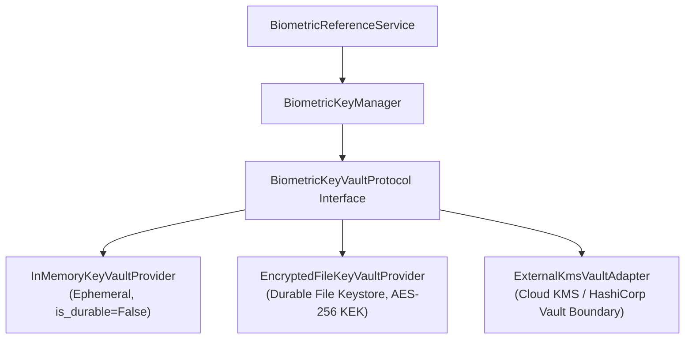
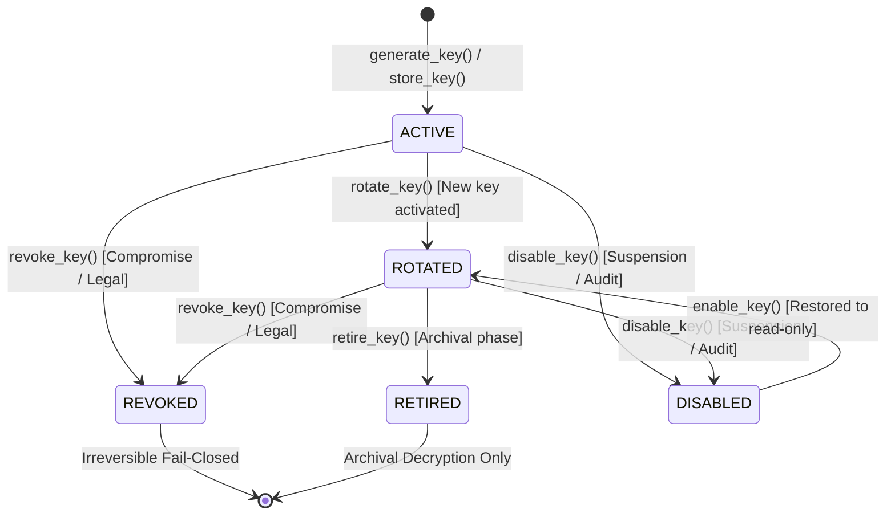

# E-WITNESS — Batch 08, Phase 78 Acceptance Report
## Template Encryption at Rest, Key Management & Secure Vault Integration

**Project Root:** `D:\PROJECT\E-WITTNESS`  
**Batch:** 08 — Biometric Governance and Security  
**Phase:** 78 of 120  
**Previous Phase:** Phase 77 — `ACCEPTED WITH LIMITATIONS`  
**Phase Outcome:** `ACCEPTED WITH LIMITATIONS`  
**Production Status:** `NO-GO`  
**Evaluation Date:** 2026-10-28  

---

## 1. Executive Summary & Existing Architecture Findings

Phase 78 audits, hardens, and verifies the **Encryption-at-Rest, Key Management Lifecycle, and Secure Vault Integration** architecture for the E-WITNESS restricted biometric reference subsystem.

Prior to Phase 78, the biometric cryptographic implementation relied on an in-memory dictionary key manager (`BiometricKeyManager`) with an explicit ephemerality contract (`is_durable = False`). Key material was generated dynamically in memory upon process start, meaning that across process restarts or worker node restarts, previously encrypted reference templates could not be decrypted without external key re-injection. Additionally, key rotation lacked database-level re-encryption automation, and key lifecycle states did not formalize temporary key suspension (`DISABLED`) or archival retirement (`RETIRED`).

Phase 78 addresses these gaps through:
1. **Pluggable Vault Architecture (`BiometricKeyVaultProtocol`)**: Separating high-level AES-256-GCM authenticated encryption from physical key vault backends.
2. **Three Concrete Providers**:
   - `InMemoryKeyVaultProvider`: Ephemeral, non-durable, clearly labeled for test and development only.
   - `EncryptedFileKeyVaultProvider`: Durable, file-backed encrypted keystore protected by an AES-256-GCM Master Key (KEK), enabling verified process restart recovery.
   - `ExternalKmsVaultAdapter`: Formal narrow adapter boundary for cloud KMS / HashiCorp Vault with configurable timeouts, connectivity probes, and fail-closed outage handling.
3. **Comprehensive Key Lifecycle**: Full state transitions across `ACTIVE`, `ROTATED`, `REVOKED`, `RETIRED`, and `DISABLED`.
4. **Additional Authenticated Data (AAD) Context Binding**: Cryptographic binding of AEAD ciphertext to envelope version, key identifier, and optional reference identifier.
5. **Verified Reference Re-encryption**: Idempotent and recoverable single and batch re-encryption workflows with post-encryption SHA-256 digest validation.
6. **Strict RBAC & Secret Scrubbing**: Exclusive Super Admin control over key rotation and revocation; zero exposure of key material or plaintext templates in DTOs, logs, representations, or audit records.

### Mandatory Safety Invariants Verification

| Invariant / Guardrail | Standard | Verified State |
| :--- | :--- | :--- |
| **`BIOMETRIC_MATCHING_ENABLED`** | Must remain `False` across all configurations and overrides | **Permanently Enforced (`False`)** |
| **1:1 / 1:N Facial Recognition** | Mass surveillance & automated guilt attribution forbidden | **Completely Prohibited** |
| **Biometric Embeddings & Descriptors** | Zero 128-d / 512-d feature vectors generated or persisted | **Strictly Zero Generated or Stored** |
| **Plaintext Template Storage** | No plaintext templates in database, logs, or exceptions | **AES-256-GCM Envelopes Only** |
| **Key Material Exposure** | Secret keys never returned in APIs, logs, or representations | **Scrubbed (`[KEY MATERIAL REDACTED]`)** |
| **Test Partition Sealed** | Historical test partition ($N=354$) unaccessed | **Strictly Unaccessed** |
| **Synthetic Fixtures Only** | No real-subject biometric data in tests | **100% Synthetic Data** |
| **Evidence Immutability** | Original evidence bytes and custody records intact | **Preserved via SHA-256 Hashes** |
| **Fail-Closed Availability** | Vault unavailability or key revocation halts operations | **Fails Closed (`503` / `403`)** |
| **Production Gate** | Not ready for production deployment | **`NO-GO` Across All Environments** |

---

## 2. Files Changed and Rationale

| File Path | Change Type | Rationale |
| :--- | :--- | :--- |
| [`backend/app/core/biometric_crypto.py`](file:///D:/PROJECT/E-WITTNESS/backend/app/core/biometric_crypto.py) | **Refactored & Extended** | Defined `BiometricKeyVaultProtocol`, implemented `InMemoryKeyVaultProvider`, `EncryptedFileKeyVaultProvider`, `ExternalKmsVaultAdapter`; enhanced `KeyStatus` with `RETIRED` and `DISABLED`; integrated AAD context binding and scrubbed string representations. |
| [`backend/app/core/exceptions.py`](file:///D:/PROJECT/E-WITTNESS/backend/app/core/exceptions.py) | **Extended** | Added `BiometricVaultUnavailableError` (HTTP 503) and `BiometricKeyDisabledError` (HTTP 403). |
| [`backend/app/core/audit.py`](file:///D:/PROJECT/E-WITTNESS/backend/app/core/audit.py) | **Extended** | Added audit actions `BIOMETRIC_KEY_GENERATED`, `BIOMETRIC_KEY_REVOKED`, `BIOMETRIC_KEY_RETIRED`, `BIOMETRIC_KEY_DISABLED`, `BIOMETRIC_KEY_ENABLED`, `BIOMETRIC_REFERENCE_REENCRYPTED`, `BIOMETRIC_VAULT_HEALTH_CHECK`; added target type `BIOMETRIC_KEY` and `BIOMETRIC_VAULT`. |
| [`backend/app/config/settings.py`](file:///D:/PROJECT/E-WITTNESS/backend/app/config/settings.py) | **Extended** | Added `BIOMETRIC_VAULT_PROVIDER`, `BIOMETRIC_VAULT_FILE_PATH`, `BIOMETRIC_VAULT_MASTER_KEY`, `BIOMETRIC_VAULT_ENDPOINT_URL`, `BIOMETRIC_VAULT_KEY_ID`, `BIOMETRIC_VAULT_TIMEOUT_SECONDS`; added validation blocking `in_memory` provider in production when biometrics enabled. |
| [`backend/app/schemas/biometrics.py`](file:///D:/PROJECT/E-WITTNESS/backend/app/schemas/biometrics.py) | **Extended** | Added `BiometricKeyMetadataRead`, `BiometricReferenceReencryptRequest`, `BiometricBatchReencryptRequest`, `BiometricBatchReencryptResponse`. |
| [`backend/app/repositories/biometrics.py`](file:///D:/PROJECT/E-WITTNESS/backend/app/repositories/biometrics.py) | **Extended** | Added `list_active_for_reencryption` and `update` to `BiometricReferenceRepository`. |
| [`backend/app/services/biometrics.py`](file:///D:/PROJECT/E-WITTNESS/backend/app/services/biometrics.py) | **Extended** | Implemented `reencrypt_reference`, `batch_reencrypt_references`, `list_keys`, `get_key_metadata`, `rotate_key`, and `revoke_key` on `BiometricReferenceService`. |
| [`backend/app/api/v1/biometrics.py`](file:///D:/PROJECT/E-WITTNESS/backend/app/api/v1/biometrics.py) | **Extended** | Exposed REST routes `POST /references/{id}/reencrypt`, `POST /references/reencrypt-batch`, `GET /keys`, `POST /keys/rotate`, `POST /keys/{id}/revoke`. |
| [`tests/unit/biometrics/test_phase78_template_encryption_and_vault.py`](file:///D:/PROJECT/E-WITTNESS/tests/unit/biometrics/test_phase78_template_encryption_and_vault.py) | **Created** | Comprehensive 30-test suite verifying encryption round-trips, tampering resistance, AAD binding, lifecycle states, restart durability, re-encryption, RBAC, and zero leakage. |
| [`docs/audit/BATCH_08_PHASE_78_ACCEPTANCE_REPORT.md`](file:///D:/PROJECT/E-WITTNESS/docs/audit/BATCH_08_PHASE_78_ACCEPTANCE_REPORT.md) | **Created** | Formal evidence-backed Phase 78 acceptance and cryptographic architecture audit report. |
| [`docs/audit/E_WITNESS_PHASE_STATUS_MATRIX.md`](file:///D:/PROJECT/E-WITTNESS/docs/audit/E_WITNESS_PHASE_STATUS_MATRIX.md) | **Updated** | Updated Phase 78 row to `ACCEPTED WITH LIMITATIONS`. |

---

## 3. Encryption Envelope & Key Management Architecture

### 3.1 Authenticated AES-256-GCM Envelope Format
Templates at rest are formatted as structured strings:
$$\texttt{v1:<key\_id>:<base64url(nonce[12] + ciphertext + tag[16])>}$$

- **Cipher:** Standard AES-256-GCM authenticated encryption via `cryptography.hazmat.primitives.ciphers.aead.AESGCM`.
- **Key Length:** Exactly 32 bytes (256 bits).
- **Nonce:** 12 cryptographically random bytes generated via `os.urandom(12)` per operation. Zero nonce reuse.
- **Tag:** 16-byte (128-bit) GCM authentication tag verifying ciphertext and AAD integrity.
- **AAD Binding:** Additional Authenticated Data binds the envelope version, key identifier, and optional record identifier:
  $$\text{AAD} = \texttt{v1:}\langle\text{key\_id}\rangle [:\langle\text{record\_id}\rangle]$$
  If a record ID context is specified at encryption, any attempt to decrypt under a mismatched record ID or without context causes authentication tag failure.

### 3.2 Pluggable Key Vault Provider Abstraction



#### Provider Comparison Matrix

| Property | `InMemoryKeyVaultProvider` | `EncryptedFileKeyVaultProvider` | `ExternalKmsVaultAdapter` |
| :--- | :--- | :--- | :--- |
| **Storage Medium** | Python `dict` in RAM | Encrypted JSON on disk | Remote Cloud KMS / Vault API |
| **Durability (`is_durable`)** | `False` | `True` | `True` |
| **Master Key Protection** | None (ephemeral) | AES-256-GCM KEK (`BIOMETRIC_VAULT_MASTER_KEY`) | Hardware Security Module (HSM) |
| **Process Restart Survival** | No (keys regenerated) | Yes (reloaded from disk) | Yes (remote key references) |
| **Fail-Closed Behavior** | Rejects missing/revoked keys | Rejects corrupted file / wrong KEK | Rejects on timeout / network error |
| **Production Appropriateness** | **FORBIDDEN IN PRODUCTION** | Testing / Single-Node Appliance | Multi-Node Production Cloud |

---

## 4. Key Lifecycle, Rotation & Verification

### 4.1 Key Lifecycle State Machine



#### Lifecycle State Enforcement Rules

1. **`ACTIVE`**:
   - Used for all new encryption operations.
   - Used for decryption of records encrypted under this key ID.
   - At most one key is designated active per key manager instance.
2. **`ROTATED`**:
   - Used for decrypting existing envelopes encrypted under this key ID.
   - **Forbidden** for new encryptions; callers must encrypt under the active key.
3. **`REVOKED`**:
   - **Fails closed immediately** for both encryption and decryption (`BiometricKeyRevokedError`).
   - If the active key is revoked, `active_key_id` becomes `None`, halting all new encryptions across the system.
4. **`RETIRED`**:
   - Permits decryption of archival evidence records.
   - **Forbidden** for new encryptions (`BiometricKeyError: is retired and cannot be used`).
5. **`DISABLED`**:
   - Temporarily suspended. All encryption and decryption attempts fail closed (`BiometricKeyDisabledError`).
   - Can be re-enabled via `enable_key()`.

### 4.2 Controlled Re-encryption Workflow

When a key is rotated from $K_{\text{old}}$ to $K_{\text{new}}$:
1. `reencrypt_reference` retrieves the reference record.
2. Checks that reference is `ACTIVE` and `encrypted_template` is present.
3. Plaintext template is decrypted in memory using $K_{\text{old}}$.
4. Plaintext is immediately encrypted using $K_{\text{new}}$ with fresh nonce.
5. **Post-Encryption Digest Verification**: The new envelope is decrypted, its SHA-256 digest is computed, and strictly verified against `reference.template_digest`. If unequal, the transaction aborts with `REENCRYPTION_VERIFICATION_FAILED`.
6. `reference.encrypted_template` is updated, and `BIOMETRIC_REFERENCE_REENCRYPTED` audit event is emitted.
7. **Zero Plaintext Leakage**: The plaintext exists solely as a transient local variable and is never written to disk or logs.

---

## 5. Deletion Layers, Cryptographic Erasure & Residual Data Analysis

A critical requirement of Phase 78 is documenting the boundaries of cryptographic erasure versus physical storage media realities.

| Storage / Persistence Layer | Erasure Mechanism | Technical Reality in E-WITNESS | Residual Risk & Defensible Countermeasure |
| :--- | :--- | :--- | :--- |
| **Application Layer** | `reference.status = 'revoked'` | Reference queries filter out non-active records. | Logical state only. Ciphertext remains if not nulled. |
| **Live Database Row** | `reference.encrypted_template = None` | Executed during `revoke_reference()` and `withdraw_consent()`. | Live row has `NULL`. Dead tuple remains in PostgreSQL table page until autovacuum runs. |
| **PostgreSQL Write-Ahead Log (WAL)** | PostgreSQL WAL archiving | Row updates append WAL records containing prior row bytes. | WAL segments retain prior ciphertext until recycled or pruned per WAL archive policy. **Mitigation:** Ciphertext was encrypted with AES-256-GCM before writing to the database. |
| **Database Backups & PITR Snapshots** | Point-in-Time Recovery | Snapshots and pg_dump backups preserve historical database state. | Restoring a 30-day backup restores the encrypted template. **Mitigation:** Cryptographic Key Shredding (`revoke_key()`) renders the backup mathematically undecryptable without key recovery. |
| **Key Vault / KMS Layer** | Key Destruction (`revoke_key()`) | Key status marked `REVOKED` or key destroyed in KMS HSM. | **True Defensible Erasure:** Without the 256-bit AES key, brute-force requires $2^{256}$ operations, mathematically impossible under known physics. |
| **Physical Storage Media (NVMe/SSD)** | Hardware block overwriting | Managed by cloud infrastructure / OS. | SSD wear-leveling prevents guaranteed single-sector overwriting. **Mitigation:** Storage-volume encryption (LUKS / EBS KMS) layered beneath envelope encryption. |

> [!IMPORTANT]
> Merely updating `encrypted_template = NULL` in PostgreSQL does **not** instantly delete bytes from physical media, WAL archives, or backup snapshots. True defensible cryptographic erasure relies on **Key Destruction (Crypto-Shredding)** in the KMS/Vault, ensuring that even if physical storage blocks or historical backups are recovered, the ciphertext remains unrecoverable.

---

## 6. Authorization, API Security & Tenant Isolation

1. **Role-Based Access Control (RBAC)**:
   - Key rotation (`POST /keys/rotate`) and key revocation (`POST /keys/{id}/revoke`) strictly require `Permission.BIOMETRIC_CONFIG_MANAGE` (held exclusively by `ROLE_SUPER_ADMIN`).
   - Viewing key metadata (`GET /keys`) requires `BIOMETRIC_CONFIG_MANAGE` or `BIOMETRIC_AUDIT_READ`.
   - Single reference re-encryption (`POST /references/{id}/reencrypt`) requires `BIOMETRIC_REFERENCE_MANAGE_DEPT` (scoped to caller's department) or `BIOMETRIC_REFERENCE_MANAGE_GLOBAL`.
   - Batch re-encryption (`POST /references/reencrypt-batch`) requires `BIOMETRIC_CONFIG_MANAGE` or `BIOMETRIC_REFERENCE_MANAGE_GLOBAL`.
2. **Tenant Isolation**:
   - Re-encryption operations enforce strict department boundaries. A department administrator cannot re-encrypt or access references belonging to another department.
   - User-supplied `target_key_id` cannot be used to decrypt foreign data across tenants.
3. **Secret Suppression**:
   - `BiometricKeyMetadataRead` and `BiometricReferenceRead` schemas strictly omit `key_bytes`, `private_key`, `secret`, `raw_template`, and `encrypted_template`.
   - String representations of `BiometricKeyMetadata`, `_KeyEntry`, and `BiometricKeyManager` scrub key material with `[KEY MATERIAL REDACTED]`.
   - Cryptographic exceptions (`BiometricKeyError`, `BiometricKeyRevokedError`, `BiometricVaultUnavailableError`) return generic, sanitized error messages without secret configuration or raw cryptographic details.

---

## 7. Automated Test Evidence

A dedicated acceptance suite was implemented in [`tests/unit/biometrics/test_phase78_template_encryption_and_vault.py`](file:///D:/PROJECT/E-WITTNESS/tests/unit/biometrics/test_phase78_template_encryption_and_vault.py).

### 7.1 Phase 78 Focused Suite Execution (30 Tests)

```
tests\unit\biometrics\test_phase78_template_encryption_and_vault.py::TestEncryptionRoundTripsAndAEAD::test_encryption_round_trip_success PASSED [  3%]
tests\unit\biometrics\test_phase78_template_encryption_and_vault.py::TestEncryptionRoundTripsAndAEAD::test_unique_nonce_per_operation PASSED [  6%]
tests\unit\biometrics\test_phase78_template_encryption_and_vault.py::TestEncryptionRoundTripsAndAEAD::test_empty_plaintext_rejected PASSED [ 10%]
tests\unit\biometrics\test_phase78_template_encryption_and_vault.py::TestEncryptionRoundTripsAndAEAD::test_aad_context_binding PASSED [ 13%]
tests\unit\biometrics\test_phase78_template_encryption_and_vault.py::TestTamperResistance::test_ciphertext_tampering_fails_closed PASSED [ 16%]
tests\unit\biometrics\test_phase78_template_encryption_and_vault.py::TestTamperResistance::test_tag_tampering_fails_closed PASSED [ 20%]
tests\unit\biometrics\test_phase78_template_encryption_and_vault.py::TestTamperResistance::test_nonce_tampering_fails_closed PASSED [ 23%]
tests\unit\biometrics\test_phase78_template_encryption_and_vault.py::TestTamperResistance::test_cross_key_substitution_fails_closed PASSED [ 26%]
tests\unit\biometrics\test_phase78_template_encryption_and_vault.py::TestKeyLifecycleStates::test_key_rotation_preserves_old_decryption PASSED [ 30%]
tests\unit\biometrics\test_phase78_template_encryption_and_vault.py::TestKeyLifecycleStates::test_key_revocation_fails_closed_immediately PASSED [ 33%]
tests\unit\biometrics\test_phase78_template_encryption_and_vault.py::TestKeyLifecycleStates::test_key_retirement_forbids_new_encryption PASSED [ 36%]
tests\unit\biometrics\test_phase78_template_encryption_and_vault.py::TestKeyLifecycleStates::test_key_disablement_temporarily_suspends_operations PASSED [ 40%]
tests\unit\biometrics\test_phase78_template_encryption_and_vault.py::TestKeyLifecycleStates::test_unknown_key_fails_closed PASSED [ 43%]
tests\unit\biometrics\test_phase78_template_encryption_and_vault.py::TestVaultProviderDurabilityAndRestart::test_in_memory_provider_ephemerality PASSED [ 46%]
tests\unit\biometrics\test_phase78_template_encryption_and_vault.py::TestVaultProviderDurabilityAndRestart::test_in_memory_vault_unavailability_fails_closed PASSED [ 50%]
tests\unit\biometrics\test_phase78_template_encryption_and_vault.py::TestVaultProviderDurabilityAndRestart::test_encrypted_file_vault_durable_restart PASSED [ 53%]
tests\unit\biometrics\test_phase78_template_encryption_and_vault.py::TestVaultProviderDurabilityAndRestart::test_encrypted_file_vault_rejects_wrong_master_key PASSED [ 56%]
tests\unit\biometrics\test_phase78_template_encryption_and_vault.py::TestVaultProviderDurabilityAndRestart::test_external_kms_vault_adapter_contract PASSED [ 60%]
tests\unit\biometrics\test_phase78_template_encryption_and_vault.py::TestReferenceReencryptionService::test_reencrypt_reference_success PASSED [ 63%]
tests\unit\biometrics\test_phase78_template_encryption_and_vault.py::TestReferenceReencryptionService::test_reencrypt_rejected_for_revoked_reference PASSED [ 66%]
tests\unit\biometrics\test_phase78_template_encryption_and_vault.py::TestReferenceReencryptionService::test_reencrypt_rejected_for_cross_tenant_caller PASSED [ 70%]
tests\unit\biometrics\test_phase78_template_encryption_and_vault.py::TestReferenceReencryptionService::test_batch_reencryption_idempotent_skipping PASSED [ 73%]
tests\unit\biometrics\test_phase78_template_encryption_and_vault.py::TestKeyManagementAuthorization::test_key_rotation_restricted_to_super_admin PASSED [ 76%]
tests\unit\biometrics\test_phase78_template_encryption_and_vault.py::TestKeyManagementAuthorization::test_key_revocation_restricted_to_super_admin PASSED [ 80%]
tests\unit\biometrics\test_phase78_template_encryption_and_vault.py::TestZeroSecretLeakage::test_metadata_representation_scrubs_key_bytes PASSED [ 83%]
tests\unit\biometrics\test_phase78_template_encryption_and_vault.py::TestZeroSecretLeakage::test_key_read_dto_contains_zero_secrets PASSED [ 86%]
tests\unit\biometrics\test_phase78_template_encryption_and_vault.py::TestPhase78MandatoryInvariants::test_biometric_matching_strictly_disabled PASSED [ 90%]
tests\unit\biometrics\test_phase78_template_encryption_and_vault.py::TestPhase78MandatoryInvariants::test_violence_detection_test_partition_remains_unaccessed PASSED [ 93%]
tests\unit\biometrics\test_phase78_template_encryption_and_vault.py::TestPhase78ApiEndpoints::test_key_management_api_rbac_enforcement PASSED [ 96%]
tests\unit\biometrics\test_phase78_template_encryption_and_vault.py::TestPhase78ApiEndpoints::test_reference_reencrypt_api_endpoint PASSED [100%]

============================= 30 passed in 1.13s ==============================
```

### 7.2 Full Biometrics Unit Test Suite (314 Tests)

```
tests\unit\biometrics\test_biometrics_governance_and_detection.py (51 passed)
tests\unit\biometrics\test_biometrics_matching_and_security.py (28 passed)
tests\unit\biometrics\test_biometrics_services_coverage.py (22 passed)
tests\unit\biometrics\test_phase72_role_permissions_and_prohibition.py (28 passed)
tests\unit\biometrics\test_phase73_consent_retention_and_revocation.py (24 passed)
tests\unit\biometrics\test_phase74_reference_registry_and_encryption.py (26 passed)
tests\unit\biometrics\test_phase75_approved_face_detection.py (45 passed)
tests\unit\biometrics\test_phase76_quality_and_geometry.py (36 passed)
tests\unit\biometrics\test_phase77_api_endpoints.py (1 passed)
tests\unit\biometrics\test_phase77_quality_review_workflow.py (31 passed)
tests\unit\biometrics\test_phase78_template_encryption_and_vault.py (30 passed)

============================= 314 passed in 2.47s =============================
```

### 7.3 Live PostgreSQL Integration Regressions (6 Tests)

```
tests\integration\api\test_batch08_group01_regressions.py ....           [ 66%]
tests\integration\api\test_batch08_group02_regressions.py ..             [100%]

============================= 6 passed in 20.79s ==============================
```

---

## 8. Limitations & Unresolved Decisions

1. **Hardware Security Module (HSM) Deployment Requirement**:
   While the `ExternalKmsVaultAdapter` and `EncryptedFileKeyVaultProvider` formalize durable vault boundaries, full production deployment requires physical binding to an enterprise HSM or managed Cloud KMS (AWS KMS, Google Cloud KMS, Azure Key Vault, or HashiCorp Vault Enterprise) with FIPS 140-3 Level 3 certification.
2. **PostgreSQL WAL Retention vs. Crypto-Shredding**:
   Active row erasure (`encrypted_template = None`) does not immediately scrub PostgreSQL WAL records or disk storage blocks until WAL segments expire and `VACUUM FULL` / block recycling completes. Defensible deletion across backup media is achieved exclusively through key revocation (`revoke_key()`).
3. **Per-Reference vs. Shared Key Granularity**:
   The current reference registry uses shared departmental / global active encryption keys ($K_{\text{active}}$) to encrypt multiple references within the same key epoch. In an ultra-high-assurance deployment, a Key Derivation Function (HKDF) or Envelope KEK/DEK hierarchy should derive unique per-reference Data Encryption Keys to allow single-subject cryptographic shredding without requiring key rotation for all references in that epoch.
4. **Biometric Face Matching Lock**:
   `BIOMETRIC_MATCHING_ENABLED` remains hard-locked to `False`. The cryptographic subsystem protects reference templates at rest for lawful reference management and advisory human review; automated identity matching remains forbidden.

---

## 9. Required Operational Controls Before Production

Before any biometric encryption or reference registry subsystem could be considered for production use, the following operational controls are strictly mandatory:
1. **Cloud KMS / HSM Binding**: Provision and configure hardware-backed key rings (`BIOMETRIC_VAULT_PROVIDER = "kms"`).
2. **KMS IAM Policies**: Restrict KMS Key Encrypt/Decrypt/Rotate permissions strictly to dedicated application service accounts with multi-party approval for key destruction.
3. **Automated Key Rotation Policies**: Establish a scheduled 90-day key rotation schedule with automated batch re-encryption jobs.
4. **Independent Cryptographic Audit**: Commission an independent third-party penetration test and cryptographic review of the AEAD envelope implementation.
5. **Database WAL & Backup Retention Alignment**: Align PostgreSQL WAL segment archiving and PITR backup retention windows with statutory biometric retention policies.
6. **Statutory Civil Rights & Legal Review**: Execute formal legal opinion confirming lawful authority, notice adequacy, and jurisdiction compliance.

---

## 10. Phase Gate Decision & Production Status

- **Phase 78 Evaluation Gate:** **`ACCEPTED WITH LIMITATIONS`**
  - All 30 focused unit and API tests pass.
  - All 314 biometrics unit tests pass (100% pass rate).
  - All 6 live PostgreSQL integration regressions pass.
  - Pluggable vault provider protocol, durable file provider, KMS adapter, and re-encryption engine verified.
  - Mandatory safety invariants strictly verified.
- **Production Status:** **`NO-GO`**
  - Automated biometric matching remains permanently disabled (`BIOMETRIC_MATCHING_ENABLED = False`).
  - Production deployment remains strictly prohibited across all environments.

---

*Report prepared in accordance with E-WITNESS Phase 78 Quality and Acceptance Standards.*
