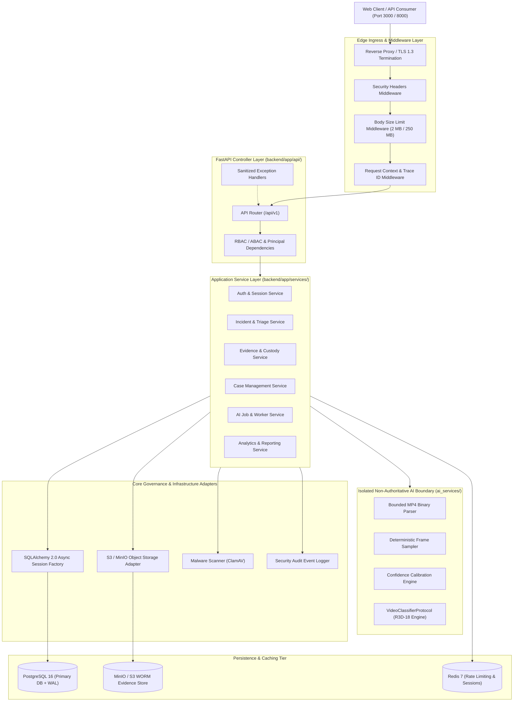
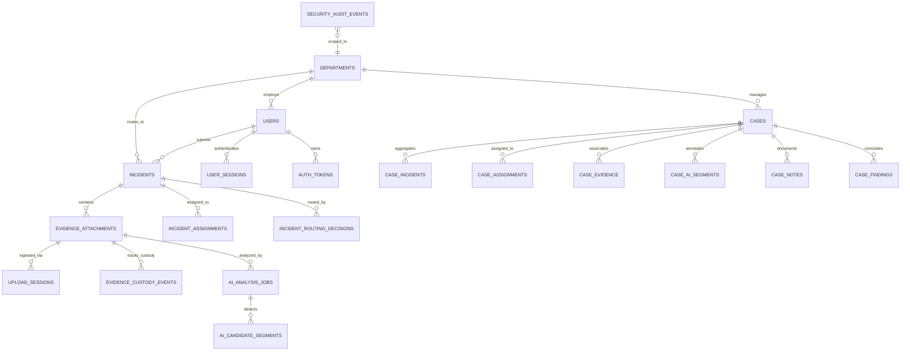
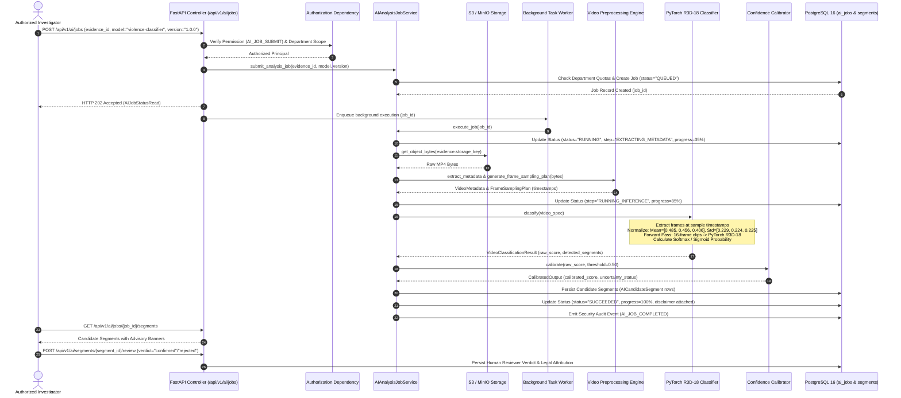

# E-WITNESS — ARCHITECTURE & AI INTEGRATION SPECIFICATION

**Document Reference**: `docs/audit/E_WITNESS_ARCHITECTURE_AND_INTEGRATION.md`  
**Audit Baseline**: Batch 01–11 Backend Architecture, Batch 12 Frontend Boundary, ML Inference Integration  
**Audit Date**: October 26, 2026  
**Auditor**: Senior Software Architect & Machine Learning Engineer  

---

## 1. Actual System Architecture & Layer Boundaries

The E-WITNESS backend is structured as a strict, layered, asynchronous FastAPI system enforcing unidirectional dependencies.

### 1.1 High-Level Component Relationship



### 1.2 Architectural Boundary Invariants (AST Enforced)

Layer purity is guarded by `backend/app/core/architecture.py` and validated by `tests/unit/architecture/test_layer_boundaries.py` (19 passing AST checks):

1. **Controllers (`api/`)**:
   - Must only call application services and schemas.
   - **Strictly forbidden** from importing `models`, `repositories`, or `sqlalchemy`.
2. **Services (`services/`)**:
   - Contain all business logic, authorization invariants, and transaction boundaries.
   - **Strictly forbidden** from importing FastAPI `APIRouter`, `Request`, or `HTTPException`.
3. **Repositories (`repositories/`)**:
   - Execute tenant-scoped SQL queries and handle persistence abstractions.
   - **Strictly forbidden** from importing API controllers, schemas, or application services.
4. **AI Services (`ai_services/`)**:
   - Operate as an isolated, standalone computational library.
   - **Strictly forbidden** from importing `fastapi`, `starlette`, `sqlalchemy`, or any backend models/services.
   - Communicates with the core backend strictly through primitive dataclasses (`VideoInputSpec`, `VideoClassificationResult`).

---

## 2. Existing Database and Evidence Custody Model



### Evidence Custody Rules:
- **Immediate Ingestion Hashing**: Ingested files have their `SHA-256` calculated on the initial byte stream before persistence.
- **Append-Only Custody Ledger**: Every state transition (`UPLOADED`, `SCAN_PASSED`, `DOWNLOADED`, `LINKED_TO_CASE`, `VERIFIED`) creates an immutable row in `evidence_custody_events`.
- **Tamper Detection**: Live verification recalculates object hashes from storage and flags single-bit discrepancies with `TAMPER_DETECTED`.
- **Legal Hold Lock**: Cases marked `legal_hold = True` or `status = UNDER_INVESTIGATION` are permanently protected from retention sweep deletion.

---

## 3. Existing vs. Proposed AI Architecture

### 3.1 Existing AI Subsystem Architecture (Implemented)

The repository already contains the complete architectural framework for AI governance and analysis:

1. **Governance & Registry**:
   - `APPROVED_AI_MODELS` allowlist and version regex validation in `backend/app/core/ai.py`.
   - Dataset registration, review, and licensing verification (`AIDatasetService`).
2. **Video Preprocessing & Sampling**:
   - `BoundedMP4Parser` (`ai_services/video/metadata.py`): Pure-Python bounded ISO-BMFF box parser extracting duration, dimensions, FPS, and codecs.
   - `generate_frame_sampling_plan` (`ai_services/video/preprocessing.py`): Deterministic uniform temporal sampling (1 FPS or evenly spaced timestamps up to `max_frames_to_sample = 600`).
3. **Inference Abstraction**:
   - `VideoClassifierProtocol` in `ai_services/violence_detection/classifier.py`.
   - `PretrainedVideoClassifierProvider`: Implements path traversal checks and SHA-256 weight integrity checks.
   - `MockVideoClassifier`: Deterministic test fixture.
4. **Calibration & Uncertainty**:
   - Platt scaling, Isotonic regression, and Temperature scaling in `ai_services/violence_detection/calibration.py`.
   - Rejection of data leakage (calibration fitted on validation split only).
5. **Asynchronous Execution & Storage**:
   - `AIAnalysisJobService` (`backend/app/services/ai_job.py`): Orchestrates jobs (`QUEUED` $\rightarrow$ `RUNNING` $\rightarrow$ `SUCCEEDED` / `FAILED`), department concurrency quotas (max 5 active jobs), timeout protection (30s), and candidate segment persistence (`AICandidateSegment`).
6. **Human Review & Disclaimers**:
   - Mandatory advisory legal disclaimer attached to all AI outputs.
   - Dedicated review workflow (`POST /api/v1/ai/segments/{id}/review`).

### 3.2 What Is Missing (The ML Gap)

1. **Model Weights Checkpoint**: No trained `.pt` or `.pth` weights file exists in the repository.
2. **Classifier Forward Pass Execution**: In `PretrainedVideoClassifierProvider.classify()`:
   ```python
   # Line 166 of ai_services/violence_detection/classifier.py:
   raise NotImplementedError("Model execution engine loaded without weight checkpoints.")
   ```
3. **Training & Fine-Tuning Pipeline**: No script exists to train a video classifier on video clips.
4. **Dataset Ingestion Utilities**: No dataset inspection, manifest generation, or PyTorch `Dataset` / `DataLoader` implementation exists for video training.
5. **Runtime Dependencies**: `torch`, `torchvision`, and OpenCV are not installed in the active environment.

---

## 4. Proposed AI-Service Integration Boundary

To integrate the local R3D-18 model without violating the existing architecture, the system will use the established `VideoClassifierProtocol` boundary.

### 4.1 Recommended Asynchronous Job Processing Workflow



---

## 5. Model Inference & Execution Contract

### 5.1 PyTorch R3D-18 Adapter Contract (Proposed Implementation for `classifier.py`)

The proposed model runner will be implemented as a concrete `VideoClassifierProtocol` provider:

```python
# Proposed: PyTorchVideoClassifierProvider in ai_services/violence_detection/classifier.py
from pathlib import Path
import torch
import torchvision.models.video as video_models

class PyTorchVideoClassifierProvider:
    """Production R3D-18 video classifier executing local PyTorch inference."""

    def __init__(
        self,
        *,
        model_name: str = "violence-classifier",
        model_version: str = "1.0.0",
        weights_path: Path | str,
        expected_sha256: str,
        device: str = "cuda" if torch.cuda.is_available() else "cpu",
        detection_threshold: float = 0.50,
    ) -> None:
        self.model_name = model_name
        self.model_version = model_version
        self.weights_path = Path(weights_path)
        self.expected_sha256 = expected_sha256.lower()
        self.device = torch.device(device)
        self.detection_threshold = detection_threshold
        self._model: torch.nn.Module | None = None
        
        self._load_and_verify_weights()

    def _load_and_verify_weights(self) -> None:
        # 1. Cryptographic SHA-256 verification
        # 2. Instantiate r3d_18(weights=None)
        # 3. Replace fc layer: in_features=512, out_features=2 (Non-Violence, Violence)
        # 4. Load state_dict from weights_path
        # 5. Move to self.device (RTX 4050 GPU) and set eval() mode
        pass

    def classify(self, video_spec: VideoInputSpec) -> VideoClassificationResult:
        # Decodes frames according to video_spec sampling plan
        # Runs torch.no_grad() forward pass under torch.cuda.amp.autocast()
        # Returns structured VideoClassificationResult
        pass
```

### 5.2 API Data Contract Alignment

The existing Pydantic request and response schemas in `backend/app/schemas/ai.py` are already completely aligned with this workflow:
- `AIJobSubmitRequest`: Validates `evidence_id`, `model_name`, `model_version`, and `options`.
- `AIJobStatusRead`: Returns monotonic status, progress percentage, start/end timestamps, error codes, and advisory disclaimers.
- `AICandidateSegmentRead`: Returns `start_seconds`, `end_seconds`, `duration_seconds`, `raw_score`, `calibrated_score`, `calibration_status`, `uncertainty_status`, and `review_status`.
- `SegmentReviewRequest`: Captures human investigator verdict (`confirmed`, `rejected`, `inconclusive`, `escalated`), rejection reason, and investigation notes.

---

## 6. Security and Authorization Invariants

1. **Non-Authoritative AI Invariant**:
   - AI outputs are probabilistic hypotheses.
   - The platform strictly rejects any automated status update to cases or incidents triggered directly by AI results without human review.
2. **Model Provenance Invariant**:
   - Only models registered in `backend/app/core/ai.py::APPROVED_AI_MODELS` with verified `SHA-256` weight digests may be loaded.
   - Path traversal sequences (`..`, `/`, `\`) in model names or version strings are intercepted and rejected with HTTP 422.
3. **Biometric Matching Prohibition**:
   - `BIOMETRIC_MATCHING_ENABLED = False` is enforced at the configuration, API router, and service layers.
   - Requests to `/api/v1/biometrics/match` return HTTP 403 Forbidden (`BIOMETRIC_FEATURE_DISABLED`).
4. **Data Isolation Invariant**:
   - Video evidence and AI analysis jobs inherit the `tenant_id` and `department_id` of the originating incident report.
   - Cross-department access attempts return HTTP 404 or HTTP 403.
