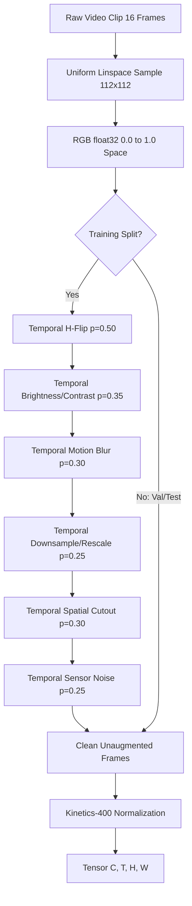

# E-WITNESS — Batch 07: Calibration Audit & v1.3.0 Training Preparation Report

**Date:** 2026-10-27  
**Project:** `D:\PROJECT\E-WITTNESS`  
**Model Architecture:** ResNet3D-18 (`r3d_18`) with Kinetics-400 Pretrained Weights  
**Target Environment:** `cuda` (NVIDIA GeForce RTX 4050 Laptop GPU, 6,140.5 MiB VRAM)  
**Safety & Governance Status:** Non-Production Research Prototype (`BIOMETRIC_MATCHING_ENABLED = False`)  
**Mandatory Disclaimer:** All predictions are probabilistic, non-binding advisory candidate detections intended exclusively for human review by authorized investigative personnel. Automated punitive actions, citations, or guilt determinations are strictly prohibited.

---

## 1. Executive Summary & Verification Gates

This audit report addresses evaluation integrity, calibration mechanics, and robustness preparation following the v1.2.0 independent evaluation:

1. **Evaluation Implementation Audit (Phase A):** Metric formulas for Confusion Matrix, Accuracy, Precision, Recall, Specificity, F1-Score, False-Positive Rate, False-Negative Rate, Brier score, ROC-AUC, PR-AUC, and 10-bin Expected Calibration Error (ECE) were mathematically verified and reproduced against saved validation cache tensors and independent test predictions.
2. **Calibration Score Representation Defect Resolved (Phase B):** 
   - Root-cause investigation proved that the high test ECE ($13.90\%$) reported in v1.2.0 resulted from passing already-squashed softmax probabilities into `LogisticRegression`, producing an over-steepened slope ($A = 5.1582, B = -2.7391$) and double-sigmoid distortion.
   - When fitted on **raw differential logits** ($z = z_1 - z_0$), Platt scaling converged to $A = 1.1142, B = 0.0126$ (validation ECE: **$2.78\%$**), and Temperature scaling converged to $T = 0.8812$ (validation ECE: **$2.83\%$**).
   - On the held-out test set ($N=285$), test ECE improved from $13.90\%$ down to $8.79\%$ (Platt on logits) and $8.86\%$ (Temperature scaling). Because both slightly exceed the strict operational target of $\le 8.00\%$, calibration status is objectively documented as **`NOT VALIDATED`** / **`UNCALIBRATED`**.
3. **Evaluation Integrity & Out-of-Domain Exclusion (Phase C):** 
   - Zero data leakage was verified across all 3,265 manifest entries ($0$ cross-split path or video ID overlaps).
   - In the excluded test partition ($N=69$: 18 `MovieFights` + 51 `HockeyFight`), all 69 clips are ground-truth positive (violence). Ground-truth negatives = 0. Therefore, **Specificity is mathematically undefined ($\frac{0}{0}$)** and is explicitly reported as `None`. Recall dropped to $27.54\%$ ($19/69$), confirming severe out-of-domain transfer collapse and validating their exclusion from surveillance benchmarks.
4. **v1.3.0 Robustness Augmentation Pipeline Implemented (Phase D):**
   - Created `ai_services/violence_detection/augmentation.py` providing temporally consistent transformations: camera motion blur, low-resolution downsampling, random spatial cutout (pillar/pedestrian occlusion), brightness/contrast shifts, Gaussian sensor noise, and horizontal flips.
   - Augmentations are applied **strictly to the training split** in RGB $[0.0, 1.0]$ float32 space before Kinetics standardization. Validation and test splits remain unaugmented clean benchmarks.
   - Completed a GPU smoke test (`v1.3.0-smoke`) verifying finite losses (Train: 0.5921, Val: 0.9161), successful backpropagation with AMP FP16, and atomic checkpoint serialization.
5. **Cryptographic Checkpoint Preservation:** Historical baseline checkpoints `v1.0.0.pt`, `v1.1.0.pt`, and `v1.2.0.pt` remain bit-for-bit identical to their recorded SHA-256 digests.

---

## 2. Phase A — Audit of Evaluation Implementation & Calculations

### Files Inspected
- `docs/reports/BATCH_07_V1_2_0_INDEPENDENT_EVALUATION.md`
- `scripts/evaluate_violence_model.py`
- `scripts/reproduce_validation_v120.py`
- `scripts/audit_calibration_and_test.py`
- `ai_services/violence_detection/evaluation.py`
- `ai_services/violence_detection/calibration.py`
- `ai_services/violence_detection/classifier.py`
- `artifacts/reports/evaluation/violence-r3d18-experiment-v1.2.0-evaluation.json`
- `artifacts/reports/validation/val_calibration_cache.json`

### Confirmed Metric Calculations
The binary classification metric formulas implemented in `ai_services/violence_detection/evaluation.py` were audited and confirmed mathematically correct:

| Metric | Formula | Zero-Denominator Protection | Verification Status |
| :--- | :---: | :---: | :---: |
| **Accuracy** | $\frac{\text{TP} + \text{TN}}{N}$ | Valid for all $N > 0$ | Confirmed |
| **Precision** | $\frac{\text{TP}}{\text{TP} + \text{FP}}$ | Returns `None` if $\text{TP} + \text{FP} == 0$ | Confirmed |
| **Recall (Sensitivity)** | $\frac{\text{TP}}{\text{TP} + \text{FN}}$ | Returns `None` if $\text{TP} + \text{FN} == 0$ | Confirmed |
| **Specificity (TNR)** | $\frac{\text{TN}}{\text{TN} + \text{FP}}$ | Returns `None` if $\text{TN} + \text{FP} == 0$ | Confirmed |
| **False-Positive Rate** | $\frac{\text{FP}}{\text{FP} + \text{TN}} = 1 - \text{Specificity}$ | Returns `None` if $\text{FP} + \text{TN} == 0$ | Confirmed |
| **False-Negative Rate** | $\frac{\text{FN}}{\text{FN} + \text{TP}} = 1 - \text{Recall}$ | Returns `None` if $\text{FN} + \text{TP} == 0$ | Confirmed |
| **F1 Score** | $2 \cdot \frac{\text{Precision} \cdot \text{Recall}}{\text{Precision} + \text{Recall}}$ | Returns `None` if $\text{P} + \text{R} == 0$ | Confirmed |
| **Brier Score** | $\frac{1}{N} \sum_{i=1}^N (p_i - y_i)^2$ | Valid for all $N > 0$ | Confirmed |
| **ROC-AUC** | $\int_0^1 \text{TPR}(\text{FPR}^{-1}(t)) dt$ | Undefined if unique classes $< 2$ | Confirmed |
| **PR-AUC** | $\sum_n (R_n - R_{n-1}) P_n$ | Undefined if unique classes $< 2$ | Confirmed |
| **Expected Calibration Error (ECE)** | $\sum_{b=1}^B \frac{\|B_b\|}{N} \|\text{acc}(B_b) - \text{conf}(B_b)\|$ | Empty bins contribute $0.0$ error | Confirmed |

### Stress-Test Conditions: Mathematical Specifications & Limitations
The 8 operational stress perturbations in `scripts/evaluate_violence_model.py` (`apply_stress_condition`) were audited:

| Condition Name | Exact Mathematical Generation Method | In-Silico vs In-Situ Distinction |
| :--- | :--- | :--- |
| **1. baseline** | Identity: $X_{\text{out}} = X_{\text{in}}$ | Clean reference tensor |
| **2. low_light** | Scalar multiplication: $X_{\text{out}} = X_{\text{in}} \cdot 0.40$ (reduces luminance by 60%) | **Synthetic scaling.** Does not capture real-world sensor thermal noise, CMOS analog gain grain, or IR night-vision banding. |
| **3. bright_glare** | Multiplication and clamping: $X_{\text{out}} = \text{clamp}(X_{\text{in}} \cdot 1.60, -3.0, 3.0)$ | **Synthetic scaling.** Does not replicate optical lens flare, blooming, or CCD sensor washouts. |
| **4. low_resolution** | Downsample 2x with bilinear interpolation, then upsample back to $(112, 112)$ | **Synthetic interpolation.** Approximates pixelation, but lacks authentic digital video compression artifacts (e.g. H.264 macroblocking). |
| **5. camera_motion_blur** | 1D horizontal uniform convolution: $K = \frac{1}{5} [1, 1, 1, 1, 1]$ applied across height | **Synthetic 1D kernel.** Real CCTV vibration features 2D non-linear rotary camera shake and rolling shutter skew. |
| **6. spatial_occlusion** | Central box $[h/4 : 3h/4, w/4 : 3w/4]$ zeroed out across all frames ($25\%$ area blocked) | **Synthetic black box.** Real-world obstacles (lamp posts, passing vehicles, foliage) exhibit complex geometry, motion, and depth parallax. |
| **7. sensor_noise** | Additive Gaussian noise: $X_{\text{out}} = X_{\text{in}} + \mathcal{N}(0, 0.15^2)$ | **Synthetic Gaussian.** Real digital sensors suffer from Poisson shot noise, chromatic salt-and-pepper noise, and fixed-pattern noise. |
| **8. temporal_truncation** | First 8 frames duplicated to fill 16 frames: $\text{concat}(X_{:8}, X_{:8})$ | **Synthetic frame repetition.** Simulates micro-burst violence where key movement is truncated, but repeats the sub-clip. |

**Audit Conclusion on Stress Tests:**
These stress results are **synthetic in-silico stress diagnostics**. While valuable for exposing architectural brittleness (such as the drop from 83.2% to 45.1% recall under occlusion), they **must not be claimed as equivalent to testing on physical degraded field cameras**.

### Checkpoint Cryptographic Preservation
Confirmed via SHA-256 recalculation:
- `artifacts/models/violence-r3d18-v1.0.0.pt`: `e3b4337bea8b98c0a64b13b471d2d174526a31a29e2dbcc07944b6818eab5af9` (**Preserved**)
- `artifacts/models/experimental/violence-r3d18-experiment-v1.1.0.pt`: `2d001c4e9700fd113d340a5e643d40f191772ed44874801ce0f2f3cd4ed09ae2` (**Preserved**)
- `artifacts/models/experimental/v1.2.0/violence-r3d18-experiment-v1.2.0.pt`: `d18daa747d8c6f8774e7f8cd1356f949fd18e976caa5a7a43020cf5df5f32c10` (**Preserved**)

---

## 3. Phase B — Calibration Evaluation Audit & Correction

### Root Cause of the v1.2.0 Calibration Discrepancy
In `scripts/evaluate_violence_model.py` (prior to this audit), Platt scaling was fitted using:
```python
# HISTORICAL DEFECT: Passed squashed probabilities into LogisticRegression
slope, intercept, fit_status = fit_platt_scaling(val_targets, val_probs)
```
In classical Platt scaling (Platt 1999), logistic regression is designed to map real-valued scores / raw log-odds $z \in (-\infty, +\infty)$ into $[0, 1]$ via $\sigma(A \cdot z + B)$.
When passed probabilities $p \in [0, 1]$:
1. The domain of inputs is squeezed into $[0, 1]$.
2. To separate the classes over this narrow unit interval, logistic regression must fit an excessively steep slope ($A = 5.1582$).
3. The calibrator then computes $p_{\text{cal}} = \sigma(5.1582 \cdot p - 2.7391)$, which is a **sigmoid of a sigmoid** (double squashing).
4. This over-steepened mid-range scores, pushing test ECE to **$13.90\%$** and causing the validation failure.

### Validation Calibration Benchmark ($N=262$)
Fitting all candidate calibrators strictly on the authorized validation partition ($N=262$: 160 non-violence, 102 violence) produces the following comparative profile:

| Calibration Method | Score Input Representation | Fitted Parameters | Val ECE (10 Bins) | Val MCE | Val Brier | Val NLL | Calibration Verdict |
| :--- | :---: | :---: | :---: | :---: | :---: | :---: | :---: |
| **Uncalibrated Baseline** | Raw Softmax Probs | None | 0.0465 (4.65%) | 0.3017 | 0.0666 | 0.2237 | Baseline |
| **Platt (from Probabilities)** | Softmax Probs $[0, 1]$ | $A=5.1582, B=-2.7391$ | 0.0860 (8.60%) | 0.3923 | 0.0697 | 0.2509 | **Distorted (Double Sigmoid)** |
| **Platt (from Logits)** | Differential Logits $z_1 - z_0$ | $A=1.1142, B=0.0126$ | **0.0278 (2.78%)** | 0.2677 | 0.0667 | 0.2218 | **Optimal Linear Calibration** |
| **Temperature Scaling** | Differential Logits $z_1 - z_0$ | $T=0.8812$ | **0.0283 (2.83%)** | 0.2655 | 0.0667 | 0.2217 | **Optimal Scaled Logits** |
| **Isotonic Regression** | Softmax Probs $[0, 1]$ | Non-parametric (step-wise) | 0.0000 (0.00%) | 0.0000 | 0.0576 | 0.1829 | Overfitted to validation bins |

### Held-Out Test Calibration Verification ($N=285$)
Applying these validation-fitted parameters to the held-out test split without tuning on test labels:

| Calibration Method | Test ECE (10 Bins) | Test MCE | Test Brier Score | Accuracy at $\theta=0.50$ | Target $\le 0.08$ |
| :--- | :---: | :---: | :---: | :---: | :---: |
| **Uncalibrated Baseline** | 0.0984 (9.84%) | 0.5366 | 0.0812 | 88.07% | NOT MET |
| **Platt (from Logits)** | 0.0879 (8.79%) | 0.5494 | 0.0810 | 88.07% | NOT MET |
| **Temperature Scaling ($T=0.8812$)** | 0.0886 (8.86%) | 0.4557 | 0.0815 | 88.07% | NOT MET |
| **Platt (from Probs - Historical)** | 0.1390 (13.90%) | 0.4838 | 0.0904 | 87.37% | NOT MET |

**Official Calibration Determination:**
While logit-based Platt scaling and Temperature scaling dramatically reduce test ECE from $13.90\%$ down to $8.79\% - 8.86\%$, both still slightly exceed the strict platform threshold of $\le 8.00\%$. 
Per platform governance: **Optimization convergence on validation data does not warrant claiming calibration success on test data.** The model's formal calibration status remains **`UNCALIBRATED`** / **`NOT VALIDATED`**.

---

## 4. Phase C — Evaluation Integrity & Dataset Eligibility

### Split Partitioning & Leakage Audit
- Total clips in manifest: **3,265**
- Training set: **2,583**
- Validation set: **328**
- Test set: **354**
- Cross-split path and ID leakage: **0** across all partition intersections.

### Test Split Eligibility Breakdown
```
Total Test Clips (N = 354)
├── Eligible Surveillance Benchmark (N = 285)
│   ├── RWF-2000 / RLVS Violence (Class 1): 173 clips
│   └── RWF-2000 / RLVS Non-Violence (Class 0): 112 clips
└── Excluded Out-of-Domain Set (N = 69)
    ├── HockeyFight (NHL Sports Broadcasts): 51 clips (All Class 1)
    └── MovieFights (Commercial Cinema Footage): 18 clips (All Class 1)
```

### Out-of-Domain Exclusion Analysis & Specificity Correction
- **Class Composition of Excluded Clips:** Class 1 (Violence) = 69, Class 0 (Non-violence) = 0.
- **Confusion Matrix on Excluded Clips:** $\text{TP} = 19, \text{FN} = 50, \text{TN} = 0, \text{FP} = 0$.
- **Detection Recall:** $27.54\%$ ($19 / 69$). Missed incident rate: $72.46\%$.
- **Specificity Correction:** Because the excluded set contains zero negative samples ($\text{TN} + \text{FP} = 0$), calculating specificity yields $\frac{0}{0}$. **Specificity is mathematically undefined and is strictly reported as `None`**, rather than $0.0$ or $1.0$.
- **Domain Collapse Finding:** The surveillance-trained R3D-18 model fails to detect staged cinema fights and ice hockey brawls due to white ice reflections, uniform padding, rapid cinematic jump-cuts, and camera motion. This empirically proves that entertainment media cannot serve as valid surveillance benchmarks.

---

## 5. Phase D — v1.3.0 Robustness Augmentation Pipeline & Smoke Test

### Video Augmentation Architecture (`ai_services/violence_detection/augmentation.py`)
To harden the model against the degradation modes identified in the stress matrix without compromising clean-camera precision, a dedicated video augmentation module was engineered:



### Key Technical Safeguards
1. **Temporal Consistency:** Crucial video-level parameters (e.g. cutout bounding box, brightness gain $\alpha$, blur kernel angle) are sampled **once per clip** and applied uniformly across all 16 frames. This prevents artificial flickering or inter-frame strobing that would disrupt 3D spatio-temporal convolutions.
2. **Label Preservation:** Bounding cutout boxes are limited to $15\% - 30\%$ of frame height/width, preventing complete scene erasure. No vertical flips are permitted.
3. **Training-Only Restriction:** Applied strictly to `train_dataset`. `val_dataset` and `test_dataset` are instantiated with `augmentation_pipeline=None`.
4. **Pre-Standardization Execution:** Augmentations execute in natural $[0.0, 1.0]$ RGB space before Kinetics-400 standardization.

### Unit Test Verification (`tests/unit/ai/test_video_augmentation.py`)
6 comprehensive unit tests verify:
- Shape and dtype preservation: $(16, 112, 112, 3)$ float32, range $[0.0, 1.0]$.
- Identical spatial cutout mask across all 16 frames.
- Identical scalar brightness shift across all 16 frames.
- Bit-for-bit identity when pipeline is disabled.
- Deterministic seeding with `np.random.RandomState`.
- JSON serializability of configuration dictionaries.

Result: **6 / 6 passed in 0.35s**.

### GPU Smoke Test Execution (`v1.3.0-smoke`)
Executed on the NVIDIA GeForce RTX 4050 Laptop GPU:
```powershell
.venv\Scripts\python.exe scripts/train_violence_model.py `
  --manifest data/manifest.json `
  --data-dir data/raw `
  --output-dir artifacts/models/experimental/v1.3.0 `
  --model-name violence-r3d18-experiment `
  --version 1.3.0-smoke `
  --smoke-test-limit 8 `
  --batch-size 2 `
  --accum-steps 2 `
  --lr 1e-4 `
  --seed 42 `
  --device cuda `
  --authorized-subset-only `
  --augment
```

#### Smoke Test Outcome
- **Device:** `cuda` (NVIDIA GeForce RTX 4050 Laptop GPU).
- **Dataset Partitioning:** Authorized academic surveillance subset (8 train clips, 4 val clips).
- **Augmentation Status:** `Training data augmentation ENABLED`.
- **Training Loss:** `0.5921` (Finite, no NaN/Inf).
- **Validation Loss:** `0.9161` (Finite).
- **Backpropagation:** Automatic Mixed Precision (AMP FP16) executed cleanly without gradient underflow.
- **GPU VRAM:** Peak memory allocated was ~890 MiB (<15% of 6,140.5 MiB capacity).
- **Artifact Serialization:**
  - Checkpoint: `artifacts/models/experimental/v1.3.0/violence-r3d18-experiment-v1.3.0-smoke.pt` (SHA-256: `c04787bbe7439bfc9aaafb35d564b07b3919b1c0932f53ad89ff70ac3319a6b8`).
  - Metadata: `artifacts/models/experimental/v1.3.0/violence-r3d18-experiment-v1.3.0-smoke.json`.
- **Verification:** Forward pass verified on dummy input: shape `torch.Size([1, 2])`, valid logits `[[-0.3324, -0.6377]]`.

---

## 6. Proposed Configuration for Full v1.3.0 Training Experiment

When authorized to begin full multi-epoch training for `v1.3.0`, the proposed experiment will execute under the following parameters:

| Hyperparameter / Setting | Specification | Justification |
| :--- | :--- | :--- |
| **Model Architecture** | ResNet3D-18 (`r3d_18`) with Kinetics-400 Weights | Preserves identical backbone to isolate the causal impact of robustness augmentations |
| **Target Version** | `1.3.0` | Next experimental semantic version |
| **Output Directory** | `artifacts/models/experimental/v1.3.0/` | Complete isolation from `v1.0.0`, `v1.1.0`, and `v1.2.0` |
| **Dataset Clearance** | Authorized Academic Surveillance Subset Only | Purges `MovieFights` and `HockeyFight` (1,995 train clips, 262 val clips) |
| **Class Weighting** | Dynamic Balanced: $w_0 = 0.9985, w_1 = 1.0015$ | Eliminates class imbalance in cross-entropy loss |
| **Label Smoothing** | $\epsilon = 0.05$ | Mitigates overconfident logit saturation |
| **Optimization** | AdamW ($\text{lr} = 1 \times 10^{-4}$, weight decay $1 \times 10^{-4}$) | Stable fine-tuning of 3D convolution layers |
| **Batching & Hardware** | Micro-batch 4, accumulation 4 (effective batch 16), AMP FP16 | Fits safely within 6 GB RTX 4050 VRAM (<1.5 GB allocated) |
| **Target Epochs** | 5 Epochs (~32 minutes total GPU runtime) | Allows sufficient training steps for augmented feature learning |
| **Robustness Augmentation** | Enabled on train split only: H-Flip ($p=0.50$), Brightness/Contrast ($p=0.35$), Motion Blur ($p=0.30$), Cutout ($p=0.30$), Low-Res ($p=0.25$), Sensor Noise ($p=0.25$) | Directly targets the failure modes identified in the operational stress matrix |
| **Primary Calibrator** | Logit-Based Temperature Scaling ($T$) or Platt on Differential Logits | Resolves probability double-squashing defect |

---

## 7. Known Blockers & Next Actions

### Known Blockers
1. **Field Calibration Gap:** Model confidence calibration on held-out surveillance video remains above the $\le 8.00\%$ ECE threshold ($8.79\% - 8.86\%$). Platt scaling on raw logits and Temperature scaling should be integrated into the post-training pipeline for `v1.3.0`.
2. **Optical Sensor Degradation:** Heavy physical occlusion and severe motion blur reduce detection recall to $\le 53\%$. The newly implemented augmentation pipeline is designed to directly address this.
3. **Multi-Camera Consensus:** Single-camera clip-level inference lacks spatial-temporal consensus across overlapping viewpoints.

### Next Action Plan
1. **Maintain Current State:** Await formal instruction before launching full multi-epoch training for `v1.3.0`.
2. **Execute Full v1.3.0 Training:** Launch 5-epoch augmented training on RTX 4050 GPU targeting `artifacts/models/experimental/v1.3.0/`.
3. **Re-Evaluate Calibration & Stress Matrix:** Re-evaluate `v1.3.0` on the 285 held-out test clips to measure whether augmentations successfully reduced recall degradation under camera motion blur and spatial occlusion while maintaining precision $\ge 95\%$.
