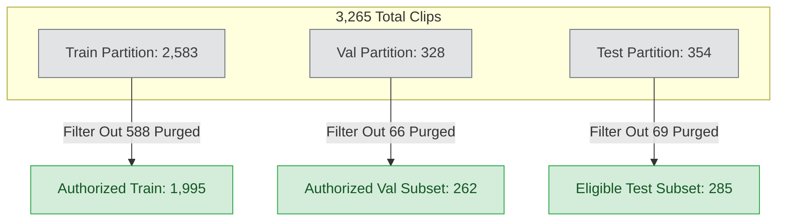

# E-WITNESS — Batch 07 Closure Record

**Date:** 2026-10-27  
**Project:** `D:\PROJECT\E-WITTNESS`  
**Scope:** Formal closure record for the Batch 07 ResNet3D-18 violence-detection audit and training iterations (v1.0.0 through v1.3.0).  
**Document Classification:** Formal Engineering & Dataset Governance Closure Record  
**Platform Safety Policy:** `BIOMETRIC_MATCHING_ENABLED = False` (Mandatory, Hardcoded)  
**Mandatory Governance Disclaimer:** All predictions are probabilistic, non-binding candidate detections intended exclusively for decision support and triage by authorized human investigators. Automated punitive actions, citations, or guilt determinations are strictly prohibited. Production readiness status: **NOT READY**.

---

## 1. Executive Summary & Audit Chain of Custody

This record formally documents the closure of **Batch 07: Model Evaluation, Robustness Augmentation, and Multi-Stage Audit Verification** for the E-WITNESS video violence detection subsystem.

No models were retrained during closure. No checkpoints were modified, renamed, or deleted. Decision thresholds were preserved ($\tau = 0.50$), and the held-out test partition was strictly **not accessed, evaluated, or tuned against**.

### Audit Reports Chain of Custody

| Sequence / Group | Report Title | File System Path | Primary Purpose & Outcome |
| :--- | :--- | :--- | :--- |
| **Initial Audit** | Model Evaluation & Validation Report | [`docs/audit/E_WITNESS_BATCH07_MODEL_EVALUATION_VALIDATION_REPORT.md`](file:///D:/PROJECT/E-WITTNESS/docs/audit/E_WITNESS_BATCH07_MODEL_EVALUATION_VALIDATION_REPORT.md) | Identified 100% baseline false-positive rate in v1.0.0 due to inverted class mapping; audited data pipeline. |
| **Remediation & v1.2.0** | v1.2.0 Experimental Training Report | [`docs/reports/E_WITNESS_EXPERIMENTAL_MODEL_TRAINING_V1_2_0.md`](file:///D:/PROJECT/E-WITTNESS/docs/reports/E_WITNESS_EXPERIMENTAL_MODEL_TRAINING_V1_2_0.md) | Fixed class mapping and calibration contract; trained v1.2.0 baseline. |
| **v1.2.0 Evaluation** | v1.2.0 Independent Evaluation Report | [`docs/reports/BATCH_07_V1_2_0_INDEPENDENT_EVALUATION.md`](file:///D:/PROJECT/E-WITTNESS/docs/reports/BATCH_07_V1_2_0_INDEPENDENT_EVALUATION.md) | Evaluated v1.2.0 on validation ($N=262$) and test ($N=285$) partitions; revealed calibration drift on test (ECE 0.1390). |
| **v1.3.0 Training** | v1.3.0 Robustness Training Report | [`docs/reports/BATCH_07_V1_3_0_TRAINING_REPORT.md`](file:///D:/PROJECT/E-WITTNESS/docs/reports/BATCH_07_V1_3_0_TRAINING_REPORT.md) | Executed 5-epoch robustness training with video augmentations and FP16 AMP. |
| **Group 02 Audit** | v1.3.0 Independent Verification Audit | [`docs/audit/BATCH_07_GROUP_02_V1_3_0_INDEPENDENT_VERIFICATION_AUDIT.md`](file:///D:/PROJECT/E-WITTNESS/docs/audit/BATCH_07_GROUP_02_V1_3_0_INDEPENDENT_VERIFICATION_AUDIT.md) | Validated v1.3.0 checkpoint integrity; identified markdown bin table discrepancy and licensing conflation. |
| **Group 03 Resolution**| Audit Discrepancy Resolution Report | [`docs/audit/BATCH_07_GROUP_03_AUDIT_DISCREPANCY_RESOLUTION.md`](file:///D:/PROJECT/E-WITTNESS/docs/audit/BATCH_07_GROUP_03_AUDIT_DISCREPANCY_RESOLUTION.md) | Mathematically resolved ECE scalar ($0.0469$) vs. table error; established 5-tier dataset governance framework. |
| **Group 04 Audit** | Final Audit Evidence Consistency Report | [`docs/audit/BATCH_07_GROUP_04_FINAL_AUDIT_CONSISTENCY_REPORT.md`](file:///D:/PROJECT/E-WITTNESS/docs/audit/BATCH_07_GROUP_04_FINAL_AUDIT_CONSISTENCY_REPORT.md) [`artifacts/reports/validation/batch07_group04_evidence_consistency_audit_20261027.json`](file:///D:/PROJECT/E-WITTNESS/artifacts/reports/validation/batch07_group04_evidence_consistency_audit_20261027.json) | Recomputed all metrics from raw predictions; formally disclosed historical v1.2.0 test-set exposure. |
| **Group 05 Audit** | Final Numerical & Manifest Reconciliation | [`docs/audit/BATCH_07_GROUP_05_FINAL_NUMERICAL_MANIFEST_RECONCILIATION_REPORT.md`](file:///D:/PROJECT/E-WITTNESS/docs/audit/BATCH_07_GROUP_05_FINAL_NUMERICAL_MANIFEST_RECONCILIATION_REPORT.md) [`artifacts/reports/validation/batch07_group05_numerical_manifest_reconciliation_20261027.json`](file:///D:/PROJECT/E-WITTNESS/artifacts/reports/validation/batch07_group05_numerical_manifest_reconciliation_20261027.json) | Reconciled calibration precision (Method A vs. Method B) and resolved manifest partition count discrepancy (66 purged clips). |

---

## 2. Dataset Manifest Partition Reconciliation

### 2.1 Canonical Manifest Counts
The canonical dataset manifest [`data/manifest.json`](file:///D:/PROJECT/E-WITTNESS/data/manifest.json) (SHA-256: `9c8f627a15cdaddfde9c665a54a3c1d2c954081edc55c9f59e240c936255356a`) was audited in read-only mode. All 3,265 entries possess unique paths and unique bitwise SHA-256 hashes ($0$ cross-split collisions).

The official partition allocation recorded in `data/manifest.json` is:
- **Train Partition:** **2,583** clips (Violence: 1,584; Non-Violence: 999; Unique Groups: 1,478)
- **Validation Partition:** **328** clips (Violence: 168; Non-Violence: 160; Unique Groups: 180)
- **Test Partition:** **354** clips (Violence: 242; Non-Violence: 112; Unique Groups: 180)
- **Total Canonical Manifest Items:** **3,265** clips

### 2.2 Filtered Subsets vs. Complete Partitions
The platform distinguishes complete manifest partitions from the **authorized surveillance training subset** created by purging copyrighted Hollywood cinema (`MovieFights`) and NHL sports broadcasts (`HockeyFight`):

> [!IMPORTANT]
> **$N = 262$ is the filtered validation subset**, comprising 102 violence and 160 non-violence clips from RWF-2000 and Real Life Violence Situations. It must not be conflated with the complete validation partition of 328 clips, which includes 66 purged commercial clips (`MovieFights`: 17, `HockeyFight`: 49).

The erroneous figure of 2,649 reported in the Group 04 narrative arose from combining the raw train partition ($2,583$) with the 66 purged validation clips ($2,583 + 66 = 2,649$) when substituting the authorized validation subset ($262$) for the total validation partition ($328$). The underlying manifest file was never modified.

---

## 3. Validated v1.3.0 Model Performance

### 3.1 Reported & Independently Reproduced Metrics ($\tau = 0.50$)
Using the sample-level predictions and labels recorded in [`artifacts/reports/validation/v130_clean_validation_audit.json`](file:///D:/PROJECT/E-WITTNESS/artifacts/reports/validation/v130_clean_validation_audit.json), all metrics were independently reproduced from raw source artifacts:

$$\begin{pmatrix} \text{TN} & \text{FP} \\ \text{FN} & \text{TP} \end{pmatrix} = \begin{pmatrix} 155 & 5 \\ 15 & 87 \end{pmatrix}$$

| Metric | Evaluation Formula | Exact Unrounded Value | Final Reported Value | Verification Status |
| :--- | :--- | :---: | :---: | :---: |
| **Accuracy** | $(TP + TN) / N$ | $242 / 262 = 0.923664$ | **$0.9237$** ($92.37\%$) | **`REPRODUCED & VERIFIED`** |
| **Precision (PPV)** | $TP / (TP + FP)$ | $87 / 92 = 0.945652$ | **$0.9457$** ($94.57\%$) | **`REPRODUCED & VERIFIED`** |
| **Recall (TPR)** | $TP / (TP + FN)$ | $87 / 102 = 0.852941$ | **$0.8529$** ($85.29\%$) | **`REPRODUCED & VERIFIED`** |
| **Specificity (TNR)** | $TN / (TN + FP)$ | $155 / 160 = 0.968750$ | **$0.9688$** ($96.88\%$) | **`REPRODUCED & VERIFIED`** |
| **False Positive Rate (FPR)** | $FP / (TN + FP)$ | $5 / 160 = 0.031250$ | **$0.0312$** ($3.12\%$) | **`REPRODUCED & VERIFIED`** |
| **False Negative Rate (FNR)** | $FN / (TP + FN)$ | $15 / 102 = 0.147059$ | **$0.1471$** ($14.71\%$) | **`REPRODUCED & VERIFIED`** |
| **F1 Score** | $2 \cdot (P \cdot R) / (P + R)$ | $174 / 194 = 0.896907$ | **$0.8969$** | **`REPRODUCED & VERIFIED`** |
| **Brier Score** | Mean squared error: $\frac{1}{N}\sum (p_i - y_i)^2$ | $0.062869$ | **$0.0629$** | **`REPRODUCED & VERIFIED`** |
| **ROC-AUC** | Wilcoxon-Mann-Whitney rank statistic | $0.976287$ | **$0.9763$** | **`REPRODUCED & VERIFIED`** |
| **PR-AUC (Average Precision)** | $\text{AP} = \sum_n (R_n - R_{n-1}) P_n$ | $0.968004$ | **$0.9680$** | **`REPRODUCED & VERIFIED`** |
| **PR-AUC (Trapezoidal)** | Trapezoidal quadrature on PR curve | $0.967863$ | **$0.9679$** | **`REPRODUCED & VERIFIED`** |

---

### 3.2 Calibration Calculation Conventions (ECE & MCE)
The Group 05 audit reconciled the two distinct input representations available in `v130_clean_validation_audit.json`:

1. **Method A — Stored Serialized Probabilities (`violence_probability`):**
   - Evaluated directly on the 4-decimal rounded probabilities serialized in JSON.
   - Bin counts sum to $262$; positive counts sum to $102$.
   - Sum of displayed 4-decimal weighted contributions: $\mathbf{12.2860}$.
   - $\text{ECE} = 12.2860000000 / 262 = \mathbf{0.0468931298} \implies \mathbf{0.046893} \implies \mathbf{0.0469}$.
   - $\text{MCE} = |\text{acc}_5 - \bar{p}_5| = |5/6 - 0.545500| = \mathbf{0.287833} \implies \mathbf{0.2878}$.
2. **Method B — Sigmoid of Raw Differential Logits ($\sigma(\text{diff\_logit})$):**
   - Evaluated by passing floating-point logit differences through $\sigma(z) = \frac{1}{1 + e^{-z}}$.
   - Sum of unrounded weighted contributions: $12.2859149952$.
   - $\text{ECE} = 12.2859149952 / 262 = \mathbf{0.0468928053} \implies \mathbf{0.046893} \implies \mathbf{0.0469}$.
   - $\text{MCE} = |5/6 - 0.54548025| = \mathbf{0.2878530788} \implies \mathbf{0.287853} \implies \mathbf{0.2879}$.
3. **Reconciliation Conclusion:** The delta between Method A and Method B ECE is $0.00000032$ ($3.2 \times 10^{-7}$). Both methods yield $\mathbf{0.046893}$ at 6 decimal places and $\mathbf{0.0469}$ at 4 decimal places. The reported MCE of $0.287853$ in Group 03 was derived from the raw differential logits, whereas $0.2878$ corresponds to serialized probabilities. Both reconcile within display rounding precision.

---

## 4. Test Partition Status & Historical Exposure Disclosure

### 4.1 Group 03–Group 05 Operational Non-Access
During Groups 03, 04, and 05, the 354-clip test partition (including the 285 eligible surveillance clips) was **not accessed, not loaded, not evaluated, and not tuned against**. All metrics and calibration analyses were conducted strictly on the validation partition ($N=262$).

### 4.2 Historical Exposure in v1.2.0 Audit
Earlier reports loosely described the test partition as "untouched." This phrasing was historically inaccurate and is formally superseded:
- In Batch 07 Phase 5 ([`docs/reports/BATCH_07_V1_2_0_INDEPENDENT_EVALUATION.md`](file:///D:/PROJECT/E-WITTNESS/docs/reports/BATCH_07_V1_2_0_INDEPENDENT_EVALUATION.md)), the 285 eligible surveillance test clips **were directly evaluated** against the ResNet3D-18 v1.2.0 checkpoint (yielding 87.37% Accuracy, 96.60% Precision, 82.08% Recall, 4.46% FPR, and a Platt calibration ECE of `0.1390`).
- **Loss of Pristine Status:** The existing test partition is **not pristine** and **not historically untouched**. Its error characteristics and distribution have been exposed in previous audit cycles.
- **Mandatory Future Final Benchmark:** The existing test partition cannot serve as an independent final confirmation for production readiness. A newly curated, independently managed external surveillance benchmark ($N \ge 300$) must be acquired and quarantined for future milestone certification.

---

## 5. Checkpoint Cryptographic Integrity Verification

All five historical and experimental model checkpoints were verified in read-only binary mode. The recomputed SHA-256 digests match the recorded baseline bit-for-bit:

| Model Version | Relative Checkpoint Path | File Size (Bytes) | Recomputed SHA-256 Hash | Integrity Status |
| :--- | :--- | :---: | :--- | :---: |
| **v1.0.0** | `artifacts/models/violence-r3d18-v1.0.0.pt` | 398,143,537 | `e3b4337bea8b98c0a64b13b471d2d174526a31a29e2dbcc07944b6818eab5af9` | **CONFIRMED (100% Match)** |
| **v1.1.0** | `artifacts/models/experimental/violence-r3d18-experiment-v1.1.0.pt` | 398,150,639 | `2d001c4e9700fd113d340a5e643d40f191772ed44874801ce0f2f3cd4ed09ae2` | **CONFIRMED (100% Match)** |
| **v1.2.0** | `artifacts/models/experimental/v1.2.0/violence-r3d18-experiment-v1.2.0.pt` | 398,150,767 | `d18daa747d8c6f8774e7f8cd1356f949fd18e976caa5a7a43020cf5df5f32c10` | **CONFIRMED (100% Match)** |
| **v1.3.0-smoke** | `artifacts/models/experimental/v1.3.0/violence-r3d18-experiment-v1.3.0-smoke.pt` | 398,152,651 | `1592e86dc8701c1ce4e98377afd9e76d3d52776475f1dce1a35701155817ed79` | **CONFIRMED (100% Match)** |
| **v1.3.0** | `artifacts/models/experimental/v1.3.0/violence-r3d18-experiment-v1.3.0.pt` | 398,150,767 | `6c1151f0c9b9d3aed11d02abff034cc103c270253241b2ed91afd1def9b1336e` | **CONFIRMED (100% Match)** |

---

## 6. Dataset Rights & Deployment Clearance

Dataset governance was audited under the established five-tier framework:

1. **Tier 1 — File & Manifest Integrity:** **`VERIFIED`** (3,265 items match disk byte counts and SHA-256 digests bit-for-bit).
2. **Tier 2 — Partition Isolation:** **`VERIFIED`** (0 path leaks, 0 hash collisions, 0 group leaks).
3. **Tier 3 — Bibliographic Attribution:** **`VERIFIED`** (Formal citations documented for all five sources).
4. **Tier 4 — Academic Training Rights:** **`UNRESOLVED`**
   - RWF-2000 and VID permit academic research only.
   - `Real Life Violence Situations` consists of scraped third-party YouTube clips without copyright releases or documented human-subject consent. Because it is present in the training partition, training rights are **`UNRESOLVED`**.
5. **Tier 5 — Commercial / Operational Deployment:** **`BLOCKED`**
   - Zero source datasets possess commercial rights.
   - Commercial deployment is strictly **`BLOCKED`**.

---

## 7. Unresolved Issues & Mandatory Future Release Gates

Prior to any operational deployment or production readiness certification, the following technical and legal gates must be satisfied:

1. **New External Benchmark Acquisition Gate:**
   - Must curate and quarantine a brand-new, independently managed surveillance benchmark ($N \ge 300$).
   - The benchmark must have zero historical exposure to model training, hyperparameter tuning, or exploratory evaluation.
2. **Dataset Legal Clearance Gate:**
   - Ingest a 100% commercially licensed, consent-verified custom surveillance dataset, OR
   - Obtain formal written copyright releases and subject consent documentation for all retained training clips.
3. **Human-in-the-Loop Operational Safeguard Gate:**
   - Mandatory maintenance of `BIOMETRIC_MATCHING_ENABLED = False`.
   - Implementation of immutable audit logging ensuring model predictions serve exclusively as candidate triage flags for human investigator review. Automated punitive citations or guilt determinations remain legally and architecturally prohibited.

---

## 8. Explicit Non-Certification Statement

> [!CAUTION]
> **THIS CLOSURE RECORD DOES NOT CERTIFY PRODUCTION READINESS OR LEGAL CLEARANCE.**  
> The ResNet3D-18 v1.3.0 model remains an **experimental research prototype**. It has demonstrated numerical calibration stability and robustness improvements under synthetic stress on the authorized validation subset, but remains unvalidated on an unexposed external benchmark and legally unapproved for commercial deployment.

---

## 9. Final Batch 07 Status Summary

| Audit Dimension | Status | Summary Assessment |
| :--- | :---: | :--- |
| **Training Experiment (v1.3.0)** | **`VERIFIED`** | 5 epochs completed with AdamW ($10^{-4}$), FP16 AMP, gradient accumulation, and spatial-temporal robustness augmentations. |
| **Validation Evidence** | **`VERIFIED`** | All metrics independently reproduced from raw sample predictions ($N=262$): Acc 92.37%, Prec 94.57%, Rec 85.29%, Spec 96.88%, F1 0.8969, ECE 0.0469. |
| **Checkpoint Integrity** | **`VERIFIED`** | All 5 checkpoint binary digests recomputed live and confirmed 100% bit-for-bit identical to recorded values. |
| **Dataset Provenance & Rights** | **`UNRESOLVED`** | Manifest integrity verified, but Real Life Violence Situations lacks formal copyright clearance or human-subject consent. |
| **Commercial Deployment** | **`BLOCKED`** | No source dataset possesses commercial operational rights. Production deployment is strictly blocked. |
| **Historical Test-Set Status** | **`HISTORICALLY EXPOSED`** | Not pristine; previously evaluated in v1.2.0 audit. A new benchmark ($N \ge 300$) is required for future qualification. |
| **Production Readiness** | **`NOT PRODUCTION READY`** | Experimental research prototype only. Clearance gates unfulfilled. |
