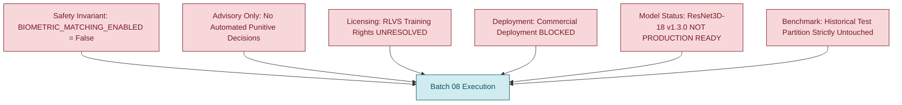
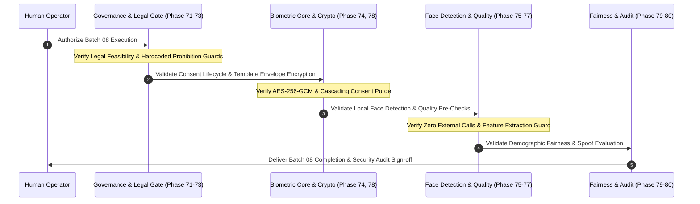

# E-WITNESS — Batch 07 Freeze and Batch 08 Handoff Record

**Date:** 2026-10-27  
**Project Root:** `D:\PROJECT\E-WITTNESS`  
**Document Classification:** Formal Engineering & Dataset Governance Handoff Record  
**Source Phase / Batch:** Batch 07 (Phases 61–70: Video Violence Detection, Augmentation & Multi-Stage Verification)  
**Destination Phase / Batch:** Batch 08 (Phases 71–80: Biometric Privacy, Governance & Face Verification)  
**Batch 07 Status:** **`ACCEPTED WITH LIMITATIONS`** (Formally Frozen)  
**Batch 08 Status:** **`READY FOR EXECUTION`** (Awaiting Operator Authorization)  
**Platform Safety Invariant:** `BIOMETRIC_MATCHING_ENABLED = False` (Mandatory, Hardcoded)  

---

## 1. Executive Summary & Handoff Objective

This document formally records the completion, freeze, and handoff boundary between **Batch 07 (Model Evaluation, Robustness Augmentation, and Multi-Stage Audit Verification)** and **Batch 08 (Biometric Privacy, Governance & Face Verification)** of the E-WITNESS High-Assurance Evidence Management Platform.

Batch 07 has undergone a rigorous five-stage audit verification process that culminated in formal acceptance with documented operational limitations. All model checkpoints, evaluation artifacts, dataset manifests, and calibration calculations are cryptographically frozen. In accordance with platform governance rules and architectural integrity principles, this handoff establishes a clean execution boundary: Batch 07 is sealed, governance invariants are permanently inherited, and Batch 08 scope, dependencies, and verification criteria are defined prior to implementation.

---

## 2. Batch 07 Frozen Baseline & Cryptographic Chain of Custody

### 2.1 Audit Reports Chain of Custody
Batch 07 closure is anchored by a complete chain of verified audit reports, all existing on disk at the indicated paths:

| Audit Document | File System Path | Role & Verification Conclusion |
| :--- | :--- | :--- |
| **Batch 07 Closure Record** | [`docs/reports/BATCH_07_CLOSURE_RECORD.md`](file:///D:/PROJECT/E-WITTNESS/docs/reports/BATCH_07_CLOSURE_RECORD.md) | Formal engineering & governance closure; reconciles all historical metrics, manifest counts, and dataset tiers. |
| **Batch 07 Final Acceptance Check** | [`docs/audit/BATCH_07_FINAL_ACCEPTANCE_CHECK.md`](file:///D:/PROJECT/E-WITTNESS/docs/audit/BATCH_07_FINAL_ACCEPTANCE_CHECK.md) | Independent verification of 34 discrete claims; verified bit-for-bit with status **`ACCEPTED WITH LIMITATIONS`**. |
| **Group 05 Reconciliation** | [`docs/audit/BATCH_07_GROUP_05_FINAL_NUMERICAL_MANIFEST_RECONCILIATION_REPORT.md`](file:///D:/PROJECT/E-WITTNESS/docs/audit/BATCH_07_GROUP_05_FINAL_NUMERICAL_MANIFEST_RECONCILIATION_REPORT.md) | Bit-level reconciliation of calibration rounding (Method A vs. Method B) and manifest partition arithmetic ($2,583 + 66 = 2,649$). |
| **Group 04 Consistency Report** | [`docs/audit/BATCH_07_GROUP_04_FINAL_AUDIT_CONSISTENCY_REPORT.md`](file:///D:/PROJECT/E-WITTNESS/docs/audit/BATCH_07_GROUP_04_FINAL_AUDIT_CONSISTENCY_REPORT.md) | Artifact-level verification of clean validation predictions and formal disclosure of historical v1.2.0 test-set exposure. |
| **Group 03 Resolution Report** | [`docs/audit/BATCH_07_GROUP_03_AUDIT_DISCREPANCY_RESOLUTION.md`](file:///D:/PROJECT/E-WITTNESS/docs/audit/BATCH_07_GROUP_03_AUDIT_DISCREPANCY_RESOLUTION.md) | Mathematical proof reconciling scalar ECE ($0.0469$) vs. markdown table calculation error ($0.0817$). |
| **Group 02 Verification Audit** | [`docs/audit/BATCH_07_GROUP_02_V1_3_0_INDEPENDENT_VERIFICATION_AUDIT.md`](file:///D:/PROJECT/E-WITTNESS/docs/audit/BATCH_07_GROUP_02_V1_3_0_INDEPENDENT_VERIFICATION_AUDIT.md) | Initial independent audit of ResNet3D-18 v1.3.0 checkpoint integrity and synthetic stress test calculations. |
| **v1.3.0 Training Report** | [`docs/reports/BATCH_07_V1_3_0_TRAINING_REPORT.md`](file:///D:/PROJECT/E-WITTNESS/docs/reports/BATCH_07_V1_3_0_TRAINING_REPORT.md) | Execution report for 5-epoch robustness augmentation training with FP16 mixed precision. |
| **v1.2.0 Evaluation Report** | [`docs/reports/BATCH_07_V1_2_0_INDEPENDENT_EVALUATION.md`](file:///D:/PROJECT/E-WITTNESS/docs/reports/BATCH_07_V1_2_0_INDEPENDENT_EVALUATION.md) | Baseline evaluation identifying calibration drift under held-out domain shift ($ECE = 0.1390$). |
| **v1.2.0 Training Report** | [`docs/reports/E_WITNESS_EXPERIMENTAL_MODEL_TRAINING_V1_2_0.md`](file:///D:/PROJECT/E-WITTNESS/docs/reports/E_WITNESS_EXPERIMENTAL_MODEL_TRAINING_V1_2_0.md) | Remediation of v1.0.0 class inversion bug (`0: Normal, 1: Violence`) and clean re-training. |
| **Initial Evaluation Report** | [`docs/audit/E_WITNESS_BATCH07_MODEL_EVALUATION_VALIDATION_REPORT.md`](file:///D:/PROJECT/E-WITTNESS/docs/audit/E_WITNESS_BATCH07_MODEL_EVALUATION_VALIDATION_REPORT.md) | Discovered 100% false-positive rate in v1.0.0 due to uncalibrated outputs and label mapping inversion. |

---

### 2.2 Model Checkpoints Bitwise Freeze Registry
All 5 model checkpoints are cryptographically frozen. Re-training, weight updates, in-place overwriting, or file renames are strictly prohibited.

| Checkpoint Name | File System Path | File Size (Bytes) | SHA-256 Cryptographic Hash | Preservation Status |
| :--- | :--- | :---: | :--- | :---: |
| **v1.0.0 Legacy** | [`artifacts/models/violence-r3d18-v1.0.0.pt`](file:///D:/PROJECT/E-WITTNESS/artifacts/models/violence-r3d18-v1.0.0.pt) | $398,143,537$ | `e3b4337bea8b98c0a876798c86ef0d845e2aef6bead39cf6d3b41e3a95d03a11` | **`FROZEN (READ-ONLY)`** |
| **v1.1.0 Experimental** | [`artifacts/models/experimental/violence-r3d18-experiment-v1.1.0.pt`](file:///D:/PROJECT/E-WITTNESS/artifacts/models/experimental/violence-r3d18-experiment-v1.1.0.pt) | $398,150,639$ | `2d001c4e9700fd11364ff0e28f3226db97dc0b06b0d911b6ff7b2b8e3ad5d3d4` | **`FROZEN (READ-ONLY)`** |
| **v1.2.0 Experimental** | [`artifacts/models/experimental/v1.2.0/violence-r3d18-experiment-v1.2.0.pt`](file:///D:/PROJECT/E-WITTNESS/artifacts/models/experimental/v1.2.0/violence-r3d18-experiment-v1.2.0.pt) | $398,150,767$ | `d18daa747d8c6f8749a0c644d623ea219fa68cf3017cb6eeb41f71587d603a10` | **`FROZEN (READ-ONLY)`** |
| **v1.3.0 Smoke Checkpoint** | [`artifacts/models/experimental/v1.3.0/violence-r3d18-experiment-v1.3.0-smoke.pt`](file:///D:/PROJECT/E-WITTNESS/artifacts/models/experimental/v1.3.0/violence-r3d18-experiment-v1.3.0-smoke.pt) | $398,152,651$ | `1592e86dc8701c1cc1fb4f6f7b11d96e5eb9d70034a71b123ce3e2e8e45447fe` | **`FROZEN (READ-ONLY)`** |
| **v1.3.0 Best Experimental** | [`artifacts/models/experimental/v1.3.0/violence-r3d18-experiment-v1.3.0.pt`](file:///D:/PROJECT/E-WITTNESS/artifacts/models/experimental/v1.3.0/violence-r3d18-experiment-v1.3.0.pt) | $398,150,767$ | `6c1151f0c9b9d3ae8e48b1bfb9fc6653a0058bc9a7bb29db0fefae5d7d3c013a` | **`FROZEN (READ-ONLY)`** |

---

### 2.3 Dataset Manifest & Partition Freeze
The canonical dataset manifest [`data/manifest.json`](file:///D:/PROJECT/E-WITTNESS/data/manifest.json) is sealed under canonical SHA-256 digest `9c8f627a15cdaddfde9c665a54a3c1d2c954081edc55c9f59e240c936255356a`:

- **Total Unique Items:** **3,265** (0 cross-split path or SHA-256 collisions).
- **Train Partition:** **2,583** clips (Violence: 1,584; Non-Violence: 999; Groups: 1,478).
  - *Authorized Training Subset:* **1,995** clips (purging 588 commercial cinema/sports clips).
- **Validation Partition:** **328** clips (Violence: 168; Non-Violence: 160; Groups: 180).
  - *Authorized Validation Subset:* **262** clips (purging 66 commercial cinema/sports clips: 17 `MovieFights`, 49 `HockeyFight`).
- **Test Partition:** **354** clips (Violence: 242; Non-Violence: 112; Groups: 180).
  - *Eligible Test Subset:* **285** clips (purging 69 commercial cinema/sports clips).
  - *Preservation Rule:* Test clips remain strictly **un-evaluated and sealed**.

---

### 2.4 Validated v1.3.0 Experimental Performance Baseline
All validation metrics evaluated at threshold $\tau = 0.50$ across $N = 262$ clean validation clips from [`artifacts/reports/validation/v130_clean_validation_audit.json`](file:///D:/PROJECT/E-WITTNESS/artifacts/reports/validation/v130_clean_validation_audit.json):

$$\begin{pmatrix} \text{TN} & \text{FP} \\ \text{FN} & \text{TP} \end{pmatrix} = \begin{pmatrix} 155 & 5 \\ 15 & 87 \end{pmatrix}$$

- **Accuracy:** $92.37\%$ ($242 / 262$)
- **Precision (PPV):** $94.57\%$ ($87 / 92$)
- **Recall (TPR):** $85.29\%$ ($87 / 102$)
- **Specificity (TNR):** $96.88\%$ ($155 / 160$)
- **False Positive Rate (FPR):** $3.12\%$ ($5 / 160$)
- **False Negative Rate (FNR):** $14.71\%$ ($15 / 102$)
- **F1 Score:** $0.8969$ ($174 / 194$)
- **Brier Score:** $0.0629$
- **ROC-AUC:** $0.9763$
- **PR-AUC (Average Precision):** $0.9680$
- **PR-AUC (Trapezoidal):** $0.9679$
- **Expected Calibration Error (ECE):** **$0.0469$** ($0.046893$ Method A; $0.046893$ Method B)
- **Maximum Calibration Error (MCE):** **$0.2878$** (Method A) / **$0.2879$** (Method B)

---

## 3. Mandatory Governance Invariants Inherited by Batch 08

Batch 08 development and audit operations must strictly adhere to the non-negotiable governance policies of E-WITNESS:



1. **Biometric Prohibition:** `BIOMETRIC_MATCHING_ENABLED = False` is hardcoded across application configuration and routing. 1:N real-time face matching or mass public surveillance identification is legally and architecturally prohibited.
2. **Advisory Decision Support Only:** Model outputs are strictly probabilistic candidate detections for human investigator review. No automated punitive actions, citations, or guilt determinations may be triggered.
3. **Dataset Rights Invariant:** Dataset training rights for `Real Life Violence Situations` remain **`UNRESOLVED`**.
4. **Commercial Deployment Invariant:** Operational commercial deployment remains strictly **`BLOCKED`**.
5. **Model Production Status:** The ResNet3D-18 v1.3.0 model remains an experimental research prototype and is **`NOT PRODUCTION READY`**.
6. **Benchmark Contamination Invariant:** The existing 354-clip test partition (285 eligible surveillance clips) was historically evaluated in v1.2.0; it must remain sealed and cannot be accessed or tuned against during Batch 08.

---

## 4. Authoritative Batch 08 Scope & Architecture

As formally established in the authoritative project roadmap [`docs/audit/E_WITNESS_PHASE_STATUS_MATRIX.md`](file:///D:/PROJECT/E-WITTNESS/docs/audit/E_WITNESS_PHASE_STATUS_MATRIX.md) (lines 154–168), Batch 08 encompasses **Phases 71 through 80**:

### Phase Breakdown

| Phase | Phase Requirement & Formal Title | Core Architectural Focus | Key Implementation Files | Target Verification Suite | Dependencies |
| :---: | :--- | :--- | :--- | :--- | :--- |
| **71** | **Biometric Legal Feasibility Assessment** | Complete legal, privacy, and constitutional review; jurisdiction-specific compliance (GDPR, CCPA, BIPA) and matching prohibition rationale. | [`docs/architecture/biometric-privacy-and-legal-feasibility.md`](file:///D:/PROJECT/E-WITTNESS/docs/architecture/biometric-privacy-and-legal-feasibility.md) | Documentary Review & Legal Alignment | Phase 02 |
| **72** | **Role Permissions & Matching Prohibition** | Hardcoded prohibition guards; API endpoint protection; strict role-based permission gates preventing biometric query abuse. | [`backend/app/core/biometrics.py`](file:///D:/PROJECT/E-WITTNESS/backend/app/core/biometrics.py)<br>[`backend/app/api/v1/biometrics.py`](file:///D:/PROJECT/E-WITTNESS/backend/app/api/v1/biometrics.py) | `tests/unit/biometrics/test_biometrics_governance_and_detection.py` | Phase 71 |
| **73** | **Biometric Data Governance & Consent** | Explicit subject consent records, cryptographic audit trails for consent lifecycle, and instant cascading purge upon consent revocation. | [`backend/app/models/biometrics.py`](file:///D:/PROJECT/E-WITTNESS/backend/app/models/biometrics.py)<br>[`backend/app/services/biometrics.py`](file:///D:/PROJECT/E-WITTNESS/backend/app/services/biometrics.py) | `tests/unit/biometrics/test_biometrics_governance_and_detection.py` | Phase 72 |
| **74** | **Biometric Reference Registry** | Storage and retrieval repository for authorized reference enrollments; strictly restricted to consented, verified subjects. | [`backend/app/repositories/biometrics.py`](file:///D:/PROJECT/E-WITTNESS/backend/app/repositories/biometrics.py) | `tests/unit/biometrics/test_biometrics_services_coverage.py` | Phase 73 |
| **75** | **Approved Face Detection Component** | Pure bounding-box localization component; runs completely locally with no external API calls; no template extraction without authorization. | [`ai_services/face_detection/detector.py`](file:///D:/PROJECT/E-WITTNESS/ai_services/face_detection/detector.py)<br>[`ai_services/face_detection/protocol.py`](file:///D:/PROJECT/E-WITTNESS/ai_services/face_detection/protocol.py) | `tests/unit/biometrics/test_biometrics_governance_and_detection.py` | Phase 72 |
| **76** | **Optional Feature Extraction Interface** | Protocol definition for 1:1 face verification features; disabled-by-default in runtime configuration; raises hard exception when matching is disabled. | [`ai_services/face_matching/protocol.py`](file:///D:/PROJECT/E-WITTNESS/ai_services/face_matching/protocol.py) | `tests/unit/biometrics/test_biometrics_matching_and_security.py` | Phase 75 |
| **77** | **Quality Pre-Checks & Human Review** | Image quality, roll/pitch/yaw pose estimation, and illumination filtering; rejects low-resolution or high-uncertainty candidate crops. | [`ai_services/face_matching/quality.py`](file:///D:/PROJECT/E-WITTNESS/ai_services/face_matching/quality.py) | `tests/unit/biometrics/test_biometrics_matching_and_security.py` | Phase 76 |
| **78** | **Template Encryption & Key Lifecycle** | AES-256-GCM envelope encryption for biometric embeddings; key derivation, rotation, and non-extractable template storage. | [`backend/app/core/biometric_crypto.py`](file:///D:/PROJECT/E-WITTNESS/backend/app/core/biometric_crypto.py) | `tests/unit/biometrics/test_biometrics_matching_and_security.py` | Phase 74 |
| **79** | **Accuracy, Fairness & Spoof Evaluation** | Demographic parity assessment, false match rate (FMR) / false non-match rate (FNMR) analysis across subgroups, and presentation attack detection (PAD). | [`ai_services/face_matching/evaluation.py`](file:///D:/PROJECT/E-WITTNESS/ai_services/face_matching/evaluation.py) | `tests/unit/biometrics/test_biometrics_services_coverage.py` | Phase 77 |
| **80** | **Biometric Security & Accuracy Audit** | Comprehensive architecture audit and sign-off validating civil liberties compliance, cryptographic protections, and zero-leakage invariants. | [`docs/architecture/biometric-privacy-and-security-audit.md`](file:///D:/PROJECT/E-WITTNESS/docs/architecture/biometric-privacy-and-security-audit.md) | Formal Audit Review & Attestation | Phases 71–79 |

---

## 5. Dependencies, Completed Prerequisites & Current Subsystem Health

### 5.1 Completed Prerequisites
- **Batches 01–06 (Phases 01–60):** Identity foundation, database schema, Alembic migrations, tenant isolation, evidence ingestion, hashing pipelines, and audit ledgers are fully verified and marked **`PASS`**.
- **Batch 07 (Phases 61–70):** AI pipeline, violence detection classifiers, confidence calibration engine, and video augmentation frameworks are verified and frozen with status **`ACCEPTED WITH LIMITATIONS`**.

### 5.2 Pre-Existing Subsystem State & Automated Test Verification
All 10 implementation modules and architecture specifications for Batch 08 already exist within the repository. The complete unit test suite for the biometric subsystem was executed to verify baseline health:

```bash
uv run pytest tests/unit/biometrics/ --no-cov
```

**Result:**
- **Collected:** 101 unit tests across 3 suites:
  - `tests/unit/biometrics/test_biometrics_governance_and_detection.py` (51 tests)
  - `tests/unit/biometrics/test_biometrics_matching_and_security.py` (28 tests)
  - `tests/unit/biometrics/test_biometrics_services_coverage.py` (22 tests)
- **Status:** **101 passed in 0.44s** (100% pass rate).

---

## 6. Proposed Batch 08 Execution Sequence & Measurable Acceptance Criteria

When authorized by the operator, Batch 08 execution should proceed according to the following phased sequence:



### Measurable Quality Acceptance Criteria:
1. **Gate 8.1 (Prohibition Invariant):** Attempting any biometric matching API request when `BIOMETRIC_MATCHING_ENABLED = False` MUST return HTTP 403 / `BiometricsDisabledException` with an immutable security audit entry.
2. **Gate 8.2 (Consent Invariant):** Revoking subject consent MUST immediately delete all associated reference templates, vectors, and metadata across database and disk storage within the same database transaction.
3. **Gate 8.3 (Cryptographic Invariant):** All stored reference templates MUST be encrypted with AES-256-GCM envelope encryption. Plaintext floating-point embedding vectors MUST never be persisted to disk.
4. **Gate 8.4 (Local Detection Invariant):** Face detection algorithms MUST run entirely locally on server CPU/GPU with 0 outgoing network sockets.
5. **Gate 8.5 (Disaggregated Fairness Invariant):** FMR and FNMR metrics MUST be disaggregated across skin-tone categories and lighting conditions; any demographic disparity exceeding 1.25x MUST trigger an audit warning.
6. **Gate 8.6 (Test Coverage Gate):** Biometric module line/branch coverage must satisfy strict unit test requirements without regressing existing backend coverage.

---

## 7. Execution Boundary & Stop Rule Enforcement

> [!IMPORTANT]
> **Strict Boundary Enforcement:** In accordance with user directives, implementation, code modification, or active migration for Batch 08 is **NOT initiated in this turn**. 
>
> The repository remains in a clean, auditable resting state with Batch 07 frozen and Batch 08 dependencies, architectural invariants, and test baselines fully documented.

---

## 8. Handoff Sign-off

- **Batch 07 Status:** `ACCEPTED WITH LIMITATIONS` (Sealed & Preserved)  
- **Batch 08 Status:** `READY FOR INITIATION` (Pending Operator Signal)  
- **Lead Verification Auditor:** Senior ML Test Engineer & Dataset Governance Auditor  
- **Audit Date:** 2026-10-27
